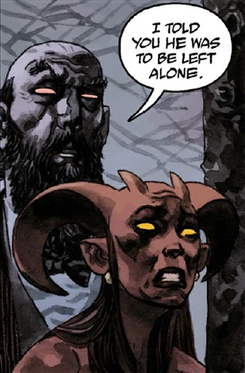

**Gamori** is the vindictive sister of [Hellboy](/entry/Hellboy). She plotted to murder her younger brother in 1948, claiming he would eventually be the ruin of both herself and her uncle, [Astaroth](/entry/Astaroth). However, after a thwarted attempt at young Hellboy's life, Astaroth forbade Gamori from ever touching or plotting against Hellboy, so long as Astaroth still lived.

When Hellboy finally died and was sent to [Hell](/entry/Hell), events led to the deaths of Astaroth and Gamori's brothers [Lusk](/entry/Lusk) and [Gamon](/entry/Gamon). Gamori blamed Hellboy for her relatives' deaths and sent the [Erinyes](/entry/Erinyes) to punish him. However, the Erinyes judged Hellboy to be innocent and they tried Gamori for lying to them. After Gamori was taken away, the Erinyes revealed to Hellboy that once Gamori was finally released from her judgement, she would be sent to follow a river of blood to [Pandemonium](/entry/Pandemonium). There, she would discover the source of the blood river to be from the cut throat of [Satan](/entry/Satan). Upon seeing the lord of Hell dead, Gamori went mad to the point that her screaming caused Pandemonium to crumble into ruins, thus forever destroying the heart of Hell.[1]

In *[Koshchei the Deathless](/entry/Koshchei_the_Deathless_%28story%29)*, she is seen again in a flashback as told by Koshchei to Hellboy. She is shown to be pale and scrawny, crossing the desert of Hell in the search of a river of blood. (This is a confirmation of the Erynies prediction as told to Hellboy in *[The Hounds of Pluto](/entry/The_Hounds_of_Pluto)*.

At the end of [*Koshchei in Hell* \#1](/entry/Koshchei_in_Hell), when Koshchei descends into the sunken Pandemonium, he meets Gamori again, still looking unhealthy, but fueled with the conviction of Hell's rebirth with her as its Queen.

## Gallery

|Gamori caught in the act of trying to kill Hellboy by Astaroth
## Sources

<references />

[1] *[Hellboy in Hell: The Hounds of Pluto](/entry/The_Hounds_of_Pluto)*
