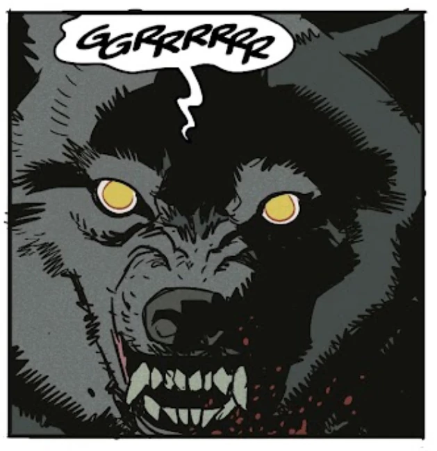

**Garm**, the hound of Gnipahellir, is a monster from Norse mythology.

## History

He reemerged on Earth (or Midgrard) during the resurrection of [Thrym](/entry/Thrym), king of the frost [giants](/entry/Giant), and served him. Garm was notably guarding the corpses of the villagers the giants had killed and the hound was discovered in an abandoned barn by [Hellboy](/entry/Hellboy_(character)), [Abe Sapien](/entry/Abe_Sapien), [Pernilla Aickman](/entry/Pernilla_Aickman) and several [dwarves](/entry/Dwarf). A fight broke out between the creature and the intruders, and Garm managed to kill Eitri, one of the dwarves.

Despite his great strength, the dwarves and Hellboy, armed with [Thor](/entry/Thor)'s hammer [Mjollnir](/entry/Mjollnir), managed to kill it in the end.

## Appearance

- [The Bones of Giants](/entry/The_Bones_of_Giants_(comic_miniseries))
