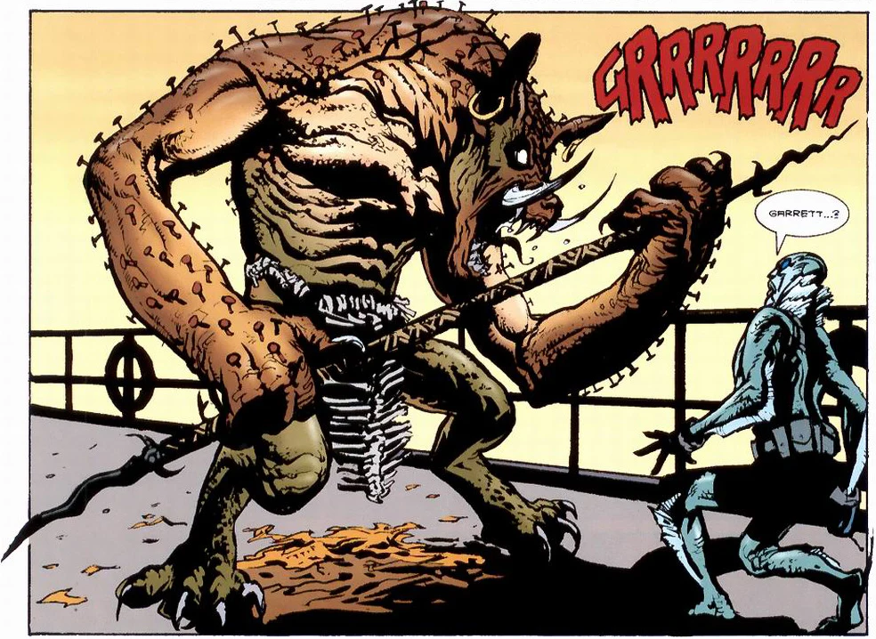

**Garrett Omatta** is a medium under the employ of the [B.P.R.D.](/entry/B.P.R.D.). He first appeared in the the [Abe Sapien](/entry/Abe_Sapien) one-shot *[Drums of the Dead](/entry/Drums_of_the_Dead)*.

## History

Garrett Omatta was a seminary student who fell victim to an unknown accident, one that left him in a coma for over two years. He miraculously awoke one day and claimed that he had been to heaven, and that heaven had sent him back to guide wayward spirits home. He also claimed that he could see the ghosts of the dead wandering the halls. The doctors originally believed that he was suffering from some sort of mental trauma until Garrett calmly relayed to one of the physicians a message from the doctor's deceased father, including in the message things no one but the father could have possibly known. The hospital contacted the [B.P.R.D.](/entry/B.P.R.D.), who added Garrett to their roster of "enhanced talents."

 One of Garrett's earliest missions, possibly his first, was with [Abe Sapien](/entry/Abe_Sapien). The two of them were assigned to investigate a series of ocean-based paranormal incursions that had been plaguing an African shipping company. Traveling with Abe aboard one of the company's ships, the *Polaris*, Garrett began experiencing strange feelings of apprehension and fear almost immediately, eventually vomiting gratuitously on Abe and transforming into a monstrous, spear wielding, boar-like creature with nails growing out of its arms and back. After a brief fight, Abe reminded Garrett of the reason heaven had sent him back to earth, and how he wasn't meant to be a murderer. These words shook Garrett's consciousness free of the forces that were suppressing it, allowing him to transform back into his normal self, albeit physically exhausted from the ordeal.

While recovering in bed, Garrett told Abe of his experiences during his transformation. He explained that the spirit that had possessed him was actually an amalgam of various protector spirits, ones who were closely tied to the numerous ghosts that had been plaguing the *Polaris* and other ships crossing the Atlantic. He also mentioned that he had had visions of a triangle over and over again.

Using these clues, Abe was able to piece together that the ghosts attacking the various ships were the ghosts of captured slaves who had died en-transit and had been dumped overboard, specifically ones who had died in the "middle passage" of the shipping triangle used in the colonial era. The spirit that had taken hold of Garrett had been a composite of the guardian spirits revered by numerous African cultures, reflecting the numerous slaves that had been abducted.

After fully recovering, Garrett saw Abe off as he dove into the underwater "hot spot" of the ghost activities. There, Abe was able to find the skeletons of the dead Africans and pull them to the surface, where they were properly laid to rest, ending the supernatural threat.

## Powers and Abilities

Garrett Omatta is a gifted medium with the ability to see and speak to the dead. His powers were either unlocked during his accident or granted to him by heaven, though in either case it is clear that heaven chose him to be one of their agents.

Garrett's powers seem to be something of a double edged sword, as they can leave him vulnerable to invasion from powerful spirits.
