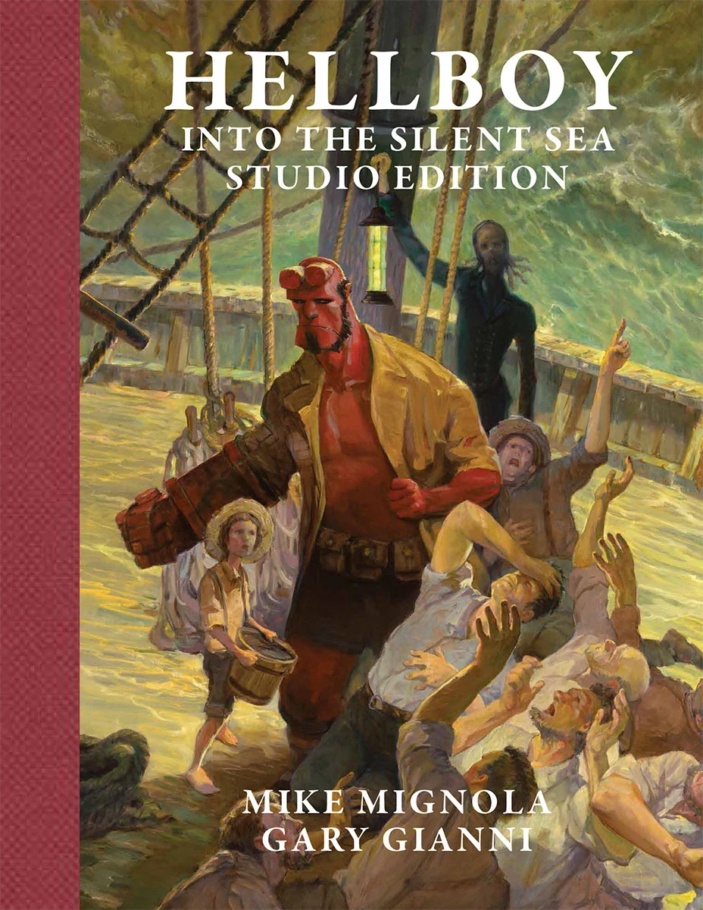

**Gary Gianni** is a writer and comics artist. He made his Hellboy Universe debut in April 2017 with the original graphic novel [*Hellboy: Into the Silent Sea*](/entry/Into_the_Silent_Sea), although he has long had an association with *[Hellboy](/entry/Hellboy_%28series%29)* as his creator-owned series, *The MonsterMen*, often appeared in issues of *Hellboy* as back-up stories. He was nominated for an [Eisner Award](https://www.comic-con.org/awards/eisner-awards-current-info) for Best Penciller/Inker or Penciller/Inker Team in 2018 for his work on [*Into the Silent Sea*](/entry/Into_the_Silent_Sea).

## Interior Art

- [*Hellboy: Into the Silent Sea*](/entry/Into_the_Silent_Sea)

## Cover Art

Studio Edition](/entry/Into_the_Silent_Sea)

## Writer

- [*Hellboy: Into the Silent Sea*](/entry/Into_the_Silent_Sea)

## *The MonsterMen*

While *The MonsterMen* (also called *Corpus Monstrum*) comic series does not take place in the Hellboy Universe, its publication has been closely connected to *Hellboy* stories. Several have appeared as back-up stories in issues of *Hellboy*:

- *Silent as the Grave* (in [*Hellboy: Wake the Devil* \#1–5](/entry/Wake_the_Devil))
- *Autopsy in B-Flat* (in [*Hellboy: Almost Colossus* \#1–2](/entry/Almost_Colossus))
- *A Gift for the Wicked* (in the *[Hellboy Christmas Special](/entry/Hellboy_Christmas_Special)*)
- *The MonsterMen: The Skull and the Snowman* (with [Mike Mignola](/entry/Mike_Mignola)'s *[Goodbye Mister Tod](/entry/Goodbye_Mister_Tod)*)
- *O Sinner Beneath Us!* (in [*Hellboy: The Wild Hunt* \#5–6](/entry/The_Wild_Hunt))

## External Links

- [**Comic Book DB:** Gary Gianni](http://comicbookdb.com/creator.php?ID=681)
