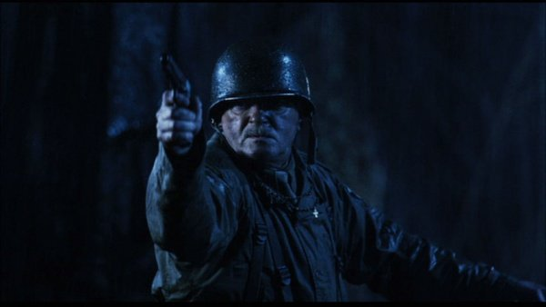

Sergeant **George Whitman** was a U.S. military official during World War II.

## History

George Whitman orchestrated the gathering of three paranormal experts in 1944, consisting of [Trevor Bruttenholm](/entry/Trevor_Bruttenholm), [Malcolm Frost](/entry/Malcolm_Frost), and a psychic, [Lady Cynthia Eden-Jones](/entry/Lady_Cynthia_Eden-Jones). Whitman, along with these specialists were present during the event known as the "[Hellboy incident](/entry/Seed_of_Destruction)." Also present was Nazi fighting super-hero [The Torch of Liberty](/entry/The_Torch_of_Liberty), who Whitman was surprised to see simply enjoying a cup of coffee with the rest of his men, unlike the hero's usual public appearances.

## Other Media

 Agnus Maclnnes as George Whitman

- George Whitman appears in *[Hellboy](/entry/Hellboy_%28film%29)*portrayed by Agnus Maclnnes he was an army sergeant that lead the military raid on the Ruins of Trondham Abbey. His mission was to sabotage Rasputin's ritual and defeated the Nazi unit.
- In the Hellboy animated series, Whitman appears in *[Hellboy: Sword of Storms](/entry/Hellboy%3A_Sword_of_Storms)*.

[pt-br:George Whitman](/entry/pt-br%3AGeorge_Whitman)
