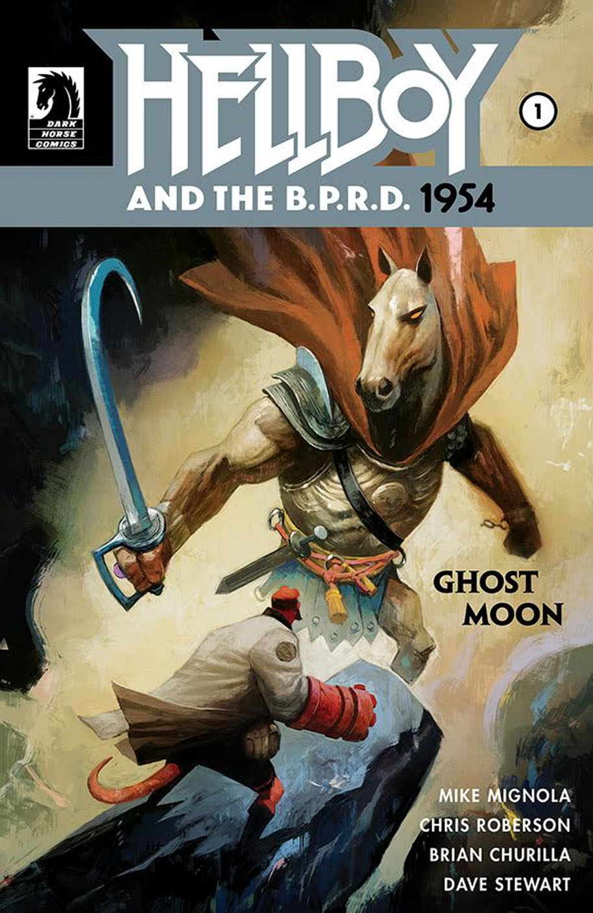
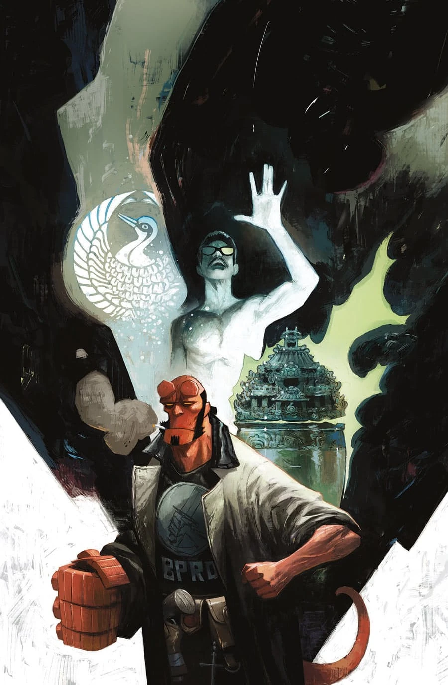

***Ghost Moon*** is an arc of *[Hellboy and the B.P.R.D.](/entry/Hellboy_and_the_B.P.R.D.): 1954* written by Mike Mignola and Chris Roberson, and illustrated by Brian Churilla.

## Synopsis

### Part One

Hellboy hunts ancient Chinese demons in the Walled City of Hong Kong when an old friend of Bruttenholm’s calls in a favor.

### Part Two

Hellboy squares off against a pair of Chinese demons while Sue psychically hunts down the source of the supernatural trouble in Hong Kong.

## *Who the Hell Is Lady Cynthia?*

This two-page back-up feature written and drawn by [Matt Strackbein](/entry/Matt_Strackbein) appeared in *Hellboy and the B.P.R.D.: 1954—Ghost Moon* \#2. It recapped the history of [Lady Cynthia Eden-Jones](/entry/Cynthia_Eden-Jones). It is not included any any collections.

## Gallery

Covers by [Mike Huddleston](/entry/Mike_Huddleston).

|*1954: Ghost Moon* \#1

|*1954: Ghost Moon* \#2
