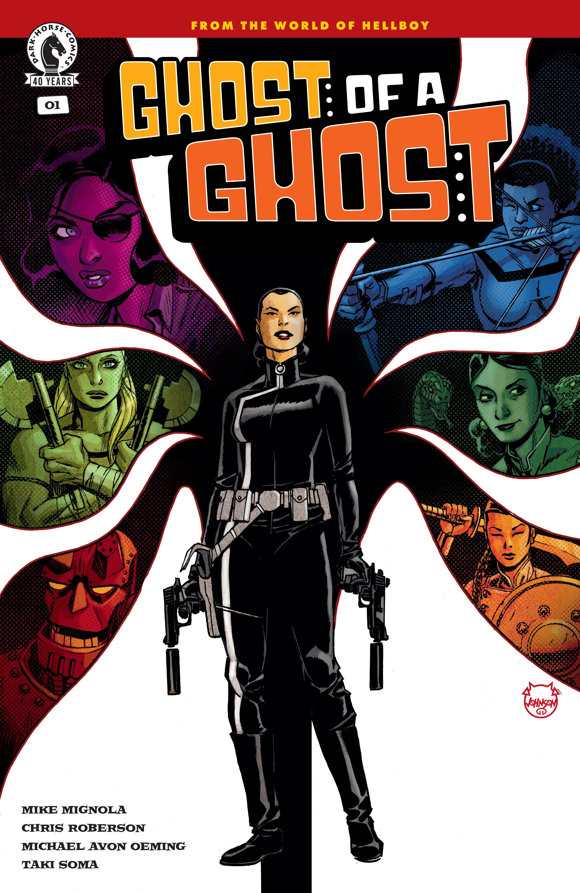

*This article is a stub. You can help Hellboy Wiki by expanding it.*

***Ghost of a Ghost*** is a four-issue miniseries written by Mike Mignola and Chris Roberson and illustrated by Michael Avon Oeming. It continues on from the events of *[Giant Robot Hellboy](/entry/Giant_Robot_Hellboy_(story))* and *[Giant Robot Hellboy Returns](/entry/Giant_Robot_Hellboy_Returns)*, focusing on Agent Jian.

## Publication History

According to Roberson:

> Many of the stories that I've worked on in the Hellboy Universe have started with a conversation, with me having the germ of idea or Mignola having a half-formed notion that he wants to explore. In some cases, the original inspiration is mostly mine and other times it's mostly Mignola's, but this one was a fully formed Mike Mignola idea from the beginning. At a convention a couple of years ago he sat down with me, Mike Oeming, and Taki Soma and explained to us what he had in mind for this character that he'd introduced in *Giant Robot Hellboy*, and then we got to work on realizing it. But from the very beginning we were all totally in sync with the vision that Mignola had for the character of Jian and her story, a jet-setting spy-fi thriller in the swinging Sixties, but approached in a way that we had never really seen used in a Hellboy Universe story before.

## Synopsis

### Part One

After being exposed to enkeladite in Giant Robot Hellboy, superspy Agent Jian uses her newfound powers as part of a mysterious spy ring entrusted to investigate enkeladite stores and keep the powerful material out of the wrong hands—but just whose hands are the wrong ones is harder to determine than she thought.

## Gallery

Main covers by Michael Avon Oeming

Issue \#1

|Issue #1 by Dave Johnson
### Variant Covers

Issue \#1  
by Dave Johnson
