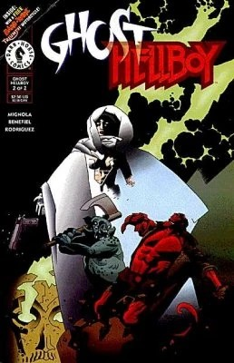
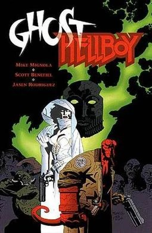

***Ghost/Hellboy*** is a non-canonical, two-issue miniseries written by Mike Mignola with pencils by Scott Benefiel, inks by Jason Rodriguez and published by [Dark Horse Comics](/entry/Dark_Horse_Comics). It features a crossover between Hellboy and Ghost, who are both Dark Horse Comics properties.

## Synopsis

### Part One

[Hellboy](/entry/Hellboy_(character)) travels to Arcadia to hunt down Ghost, but the tables are turned when Ghost receives a vision from someone calling himself Peace who tells her that Hellboy is her enemy and the key to releasing her from her suffering is the [Right Hand of Doom](/entry/Right_Hand_of_Doom).

### Part Two

In the story Ghost delivers Hellboy to the being calling himself Peace on a mystical plane, but when he reveals himself to be Alal the Destroyer, who has been lying to her all along, the vengeful spirit and the world’s greatest paranormal investigator must team up to avert the impending apocalypse.

## Collected Editions

In addition to being collected in the [Masks and Monsters](/entry/Masks_and_Monsters) trade paperback a *Ghost/Hellboy Special* was released that collected both issues along with a small sketchbook section.

## Cover Gallery

Issue \#1
Issue \#2

|Issue #2

|Special
## External Links

- Ghost/Hellboy #1 product page on DarkHorse.com
- Ghost/Hellboy #2 product page on DarkHorse.com
- Ghost/Hellboy Special product page on DarkHorse.com
