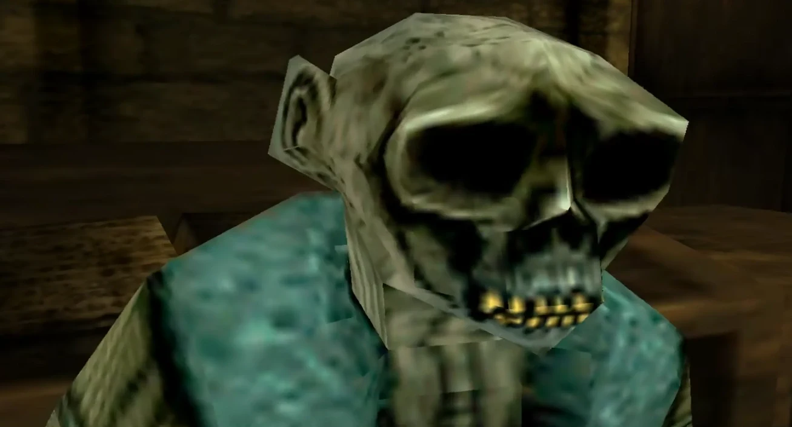

The **Giant Monkey** is a fictional character from the *[Hellboy: Dogs of the Night](/entry/Hellboy__Dogs_of_the_Night)* game. His real name is unknown and he is only called the Great Monkey or **Monkey-Boy** by [Hellboy](/entry/Hellboy_(character)).

## History

### Dogs of the Night

Hellboy, who had traveled to the past, tricked him by showing [Sanchez's](/entry/Sanchez) head through a crack in the door. He thought it was the real Sanchez and opened the door for Hellboy. When he saw Hellboy, he assumed he was Sanchez's murderer and transformed, revealing his true form as a great ape. He attacked Hellboy but was defeated.

## Allies and Enemies

### Allies

- **[Sanchez](/entry/Sanchez)**

### Enemies

- **[Hellboy](/entry/Hellboy_(character))**

## Gallery

|The Giant Monkey's monk form.
