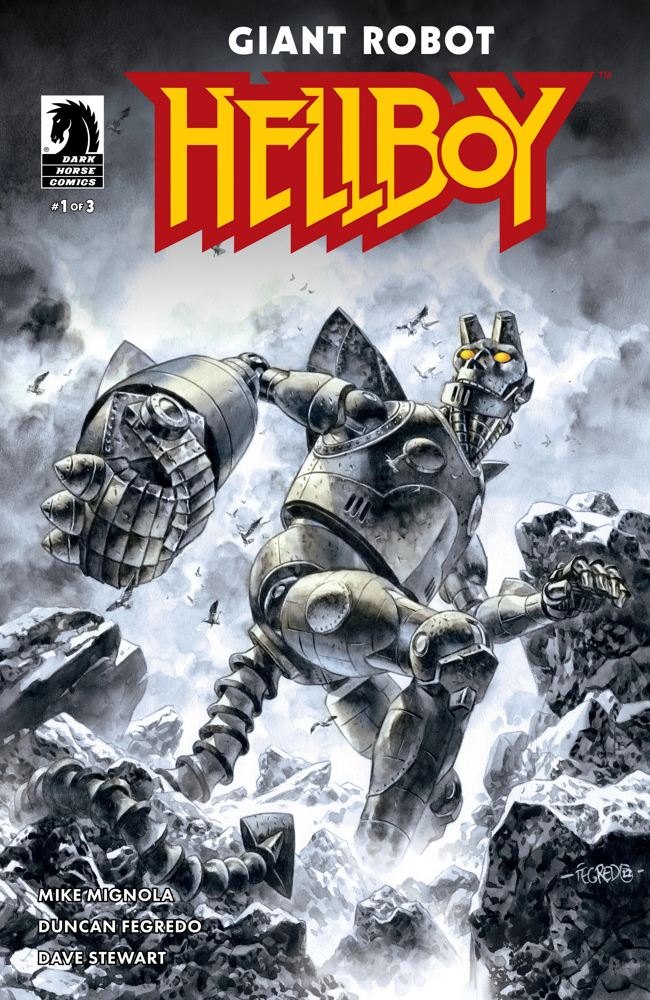
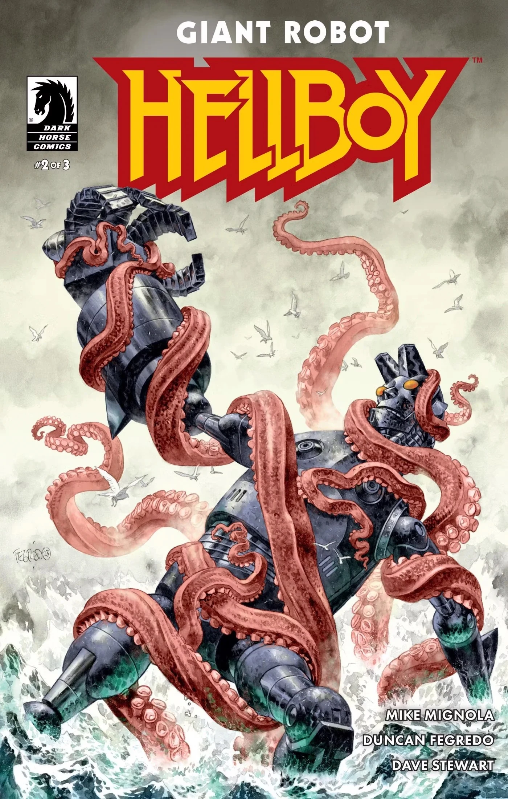
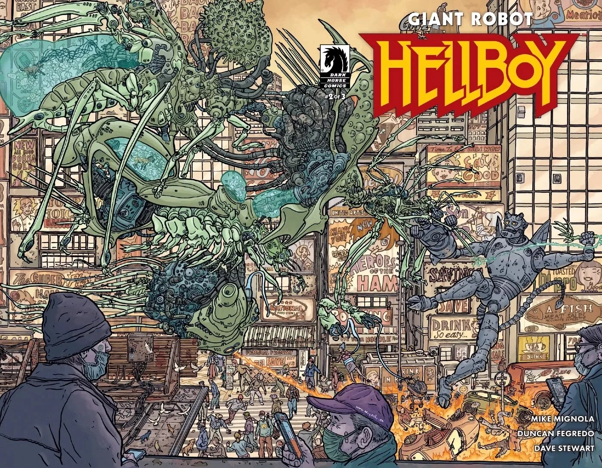
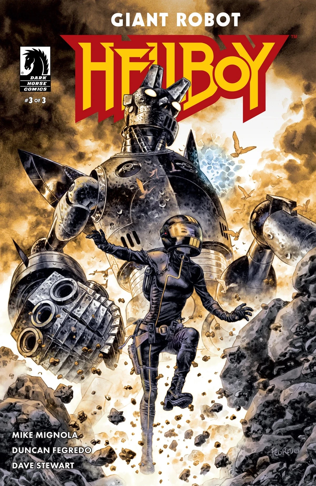
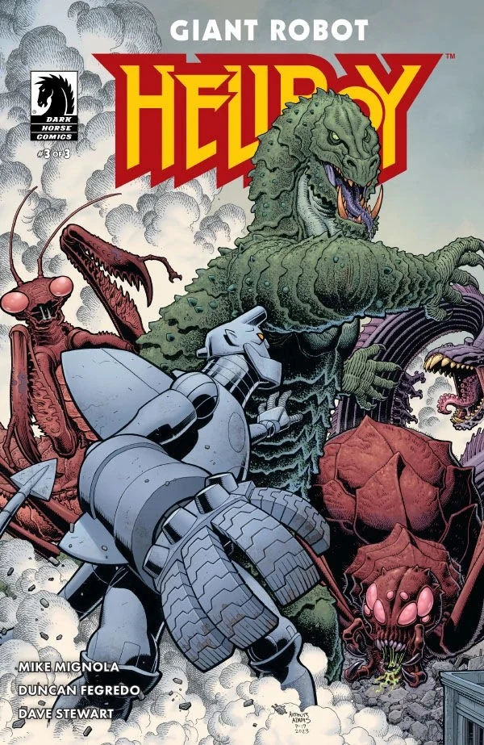

*This article is a stub. You can help Hellboy Wiki by expanding it.*

***Giant Robot Hellboy*** is a three-issue miniseries written by Mike Mignola and illustrated by Duncan Fegredo.

## Publication History

The idea for *Giant Robot Hellboy* was something Mike Mignola had for a long time, but he considered it "too silly to actually do." Then, during the first year of the COVID-19 pandemic, Mignola started drawing sketches for charity which featured Giant Robot Hellboy, and he ended up liking the sketches so much, that the idea started to "seem like something that could actually be done."

The project was inspired by listening to artists Geof Darrow and Art Adams talking about Kaiju movies. Mignola had initially hoped one of them would draw the comic, but they were too busy with other projects, so Mignola turned to Duncan Fegredo. Mignola thought if Fegredo thought the project was too silly, that would be the end of it.

The sequel, *[Giant Robot Hellboy Returns](/entry/Giant_Robot_Hellboy_Returns)*, is been release in 2026.

## Synopsis

### Part One

Hellboy is kidnapped and hooked up to a massive mecha-Hellboy for a mission on a mysterious, faraway island, but the island might just put up a fight of its own.

### Part Two

While Hellboy’s robotic counterpart battles giant monsters on a faraway island, the scientists running the mission scramble when things at the lab get more than a little out of hand.

### Part Three

Giant Robot Hellboy goes rogue, leaving both the island and the laboratory in explosive chaos!

## Gallery

Issue \#1  
cover by Duncan Fegredo

Issue \#1  
variant cover by Mike Mignola  
colors by Dave Stewart

Issue \#2  
cover by Duncan Fegredo

Issue \#2  
variant cover by Geof Darrow  
colors by Dave Stewart

Issue \#3  
cover by Duncan Fegredo

Issue \#3  
variant cover by Art Adams  
colors by Dave Stewart

|Issue #1 cover by Duncan Fegredo

|Issue #2 cover by Duncan Fegredo

|Issue #2 variant cover by Geof Darrow colors by Dave Stewart

|Issue #3 cover by Duncan Fegredo

|Issue #3 variant cover by Art Adams colors by Dave Stewart
