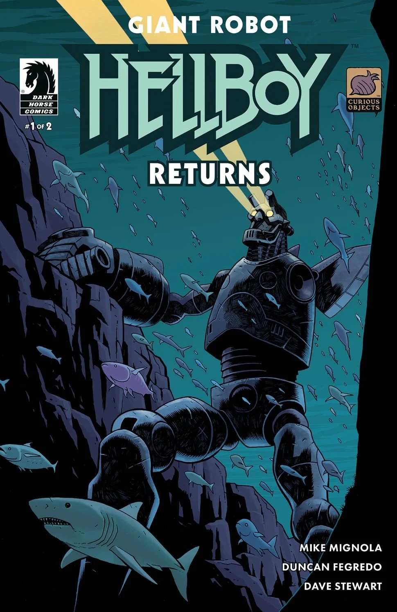
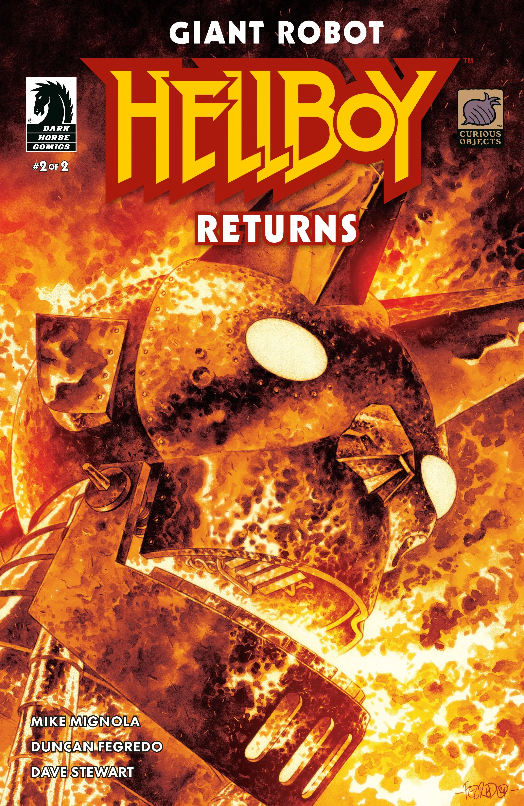
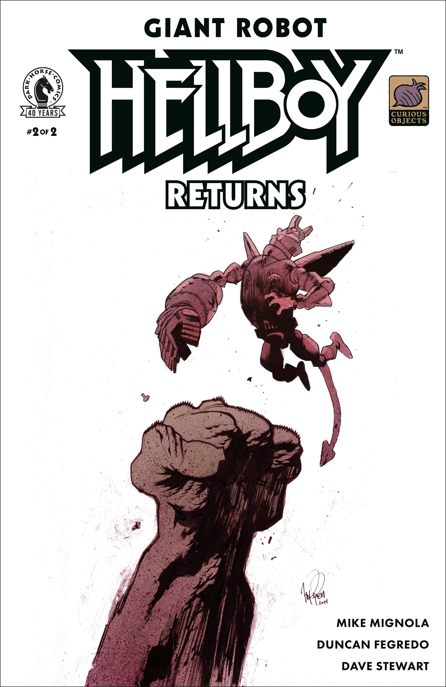

*This article is a stub. You can help Hellboy Wiki by expanding it.*

***Giant Robot Hellboy Returns*** is a two-issue miniseries written by Mike Mignola and illustrated by Duncan Fegredo and a sequel to 2023's *[Giant Robot Hellboy](/entry/Giant_Robot_Hellboy_(story))*.

## Synopsis

### Part One

Hellboy’s robot counterpart is back—but he’s not alone! Scientists comb the deep sea for any sign of Giant Robot Hellboy after his disappearance, but find more than they bargained for when an interdimensional portal threatens to pull them in—or let monsters of unknown origin out.

### Part Two

Still searching for Giant Robot Hellboy, the submarine loses contact with the lab above water when the uncharted waters lead to a truly unknown and terrifying location.

## Gallery

Issue \#1  
cover by Duncan Fegredo

Issue \#1  
variant cover by Ben Stenbeck

Issue \#2  
cover by Duncan Fegredo

Issue \#2  
variant cover by James Harren  
colors by Dave Stewart

|Issue #1 variant cover by Ben Stenbeck

|Issue #2 cover by Duncan Fegredo

|Issue #2 variant cover by James Harren colors by Dave Stewart
