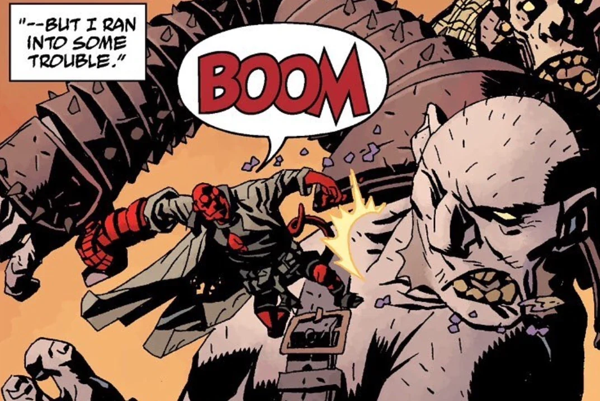

The **Giants** were a race of large humanoids that once walked the Earth.

## Background

According to the [Osiris Club](/entry/Osiris_Club), England once was the domain of the giants, but their homeland is filled with graves of their kind. The last living giant in England was Hale who was slain by Weldon. Curiously giants once dead happened to rise from their graves. Solitary undead giants are little to no concern to occult groups, however when a group rise together the Wild Hunt is organized to deal with them.

An enormous humanoid guarded the prison of [Nimue](/entry/Nimue) and served the witches. Upon Nimue's release he climbed into the pit, frightened of the times that were coming. It is unclear if he was a giant, but the Osiris Club isn't necessarily always right.
