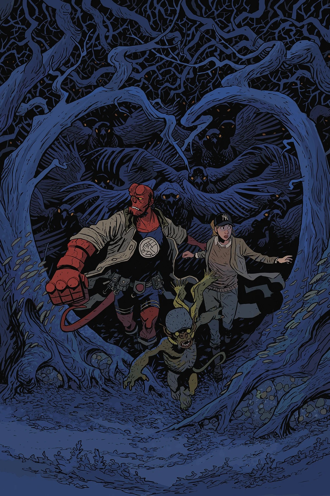

***Goblin Night*** is a two-issue arc of *[Hellboy in Love](/entry/Hellboy_in_Love)* written by [Mike Mignola](/entry/Mike_Mignola) and [Christopher Golden](/entry/Christopher_Golden) and illustrated by [Matt Smith](/entry/Matt_Smith). It is the comic book debut of [Anastasia Bransfield](/entry/Anastasia_Bransfield).

## Synopsis

### Part One

[Hellboy](/entry/Hellboy_(character)) has been assigned to patrol a train route where [goblins](/entry/Goblin) have been stealing from passengers. Their latest victim, [Anastasia](/entry/Anastasia_Bransfield), is a researcher and archaeologist transporting valuable artifacts to a museum, and she's not going to let them go without a fight! Rather than stay behind, she teams up with Hellboy to chase the light-fingered fey through the British countryside and into... a local punk show?

### Part Two

Hellboy and Anastasia chase the goblins from punk show to occult auction in pursuit of Anastasia's stolen artifacts in this fun romp across the English countryside.

## Gallery

All covers by Matt Smith.

*Hellboy in Love* \#1  
*Goblin Night* (Part 1)

*Hellboy in Love* \#2  
*Goblin Night* (Part 2)

|Hellboy in Love #2 Goblin Night (Part 2)
