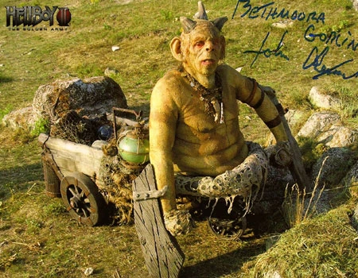

*For the Bethmoran goblin blacksmith, see [Goblin (Bethmoran)](/entry/Goblin_Master_Blacksmith_(Bethmoran)).*

**Goblins** are a mythical race of beings with green skin and horns.

## Overview

An [unnamed goblin](/entry/Goblin_Master_Blacksmith_(Bethmoran)) was the original creator of [the Golden Army](/entry/The_Golden_Army) for King [Balor](/entry/Balor) in in order to protect the magical creatures from [humans](/entry/Human).

In the 21st Century the same goblin agreed to take [Hellboy](/entry/Hellboy_(character)), Liz Sherman, [Abe Sapien](/entry/Abraham_Sapien) and [Johann Kraus](/entry/Johann_Kraus) fist meet the [Angel of Death](/entry/Angel_of_Death), and after that to army itself.

## Notable Goblins

- [Bethmoran goblin](/entry/Goblin_Master_Blacksmith_(Bethmoran))
- [Iron Shoes](/entry/Iron_Shoes_(character))

## Appearance

- [*Hellboy II: The Golden Army*](/entry/Hellboy_II__The_Golden_Army)
- [*The Iron Shoes*](/entry/The_Iron_Shoes)
