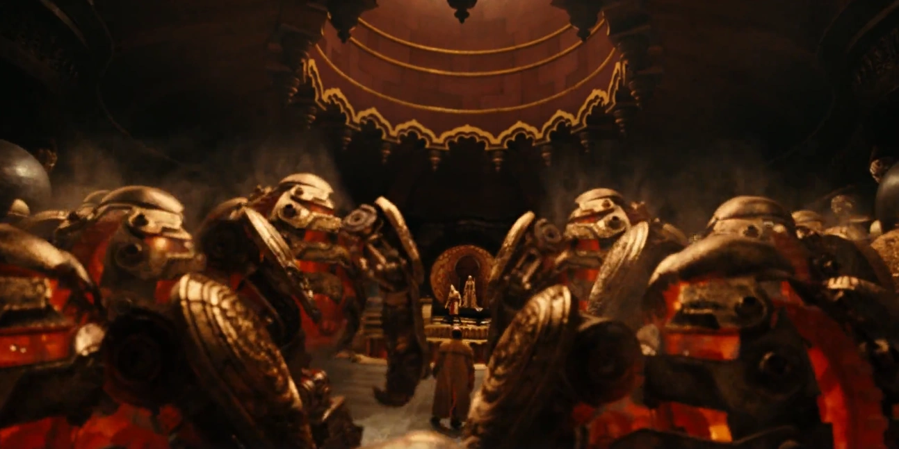
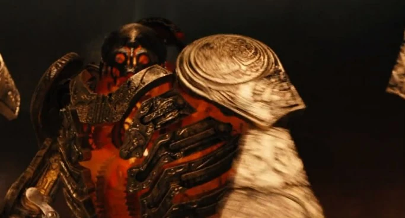

*For the 2008 film, its soundtrack, and the promotional comic, see [Hellboy II: The Golden Army](/entry/Hellboy_II:_The_Golden_Army), [Hellboy II: The Golden Army (soundtrack)](/entry/Hellboy_II:_The_Golden_Army_(soundtrack)), and [The Golden Army (promo)](/entry/The_Golden_Army_(promo)).*

The **Golden Army** is an army of "seventy times seventy" (4,900) robot-like mechanical soldiers created by [goblins](/entry/Goblin), [trolls](/entry/Troll) and [elves](/entry/Elf) in the [war](/entry/War) against [humans](/entry/Human).

  

## Overview

The three species were miserably losing to humans, but with the help with the Golden Army they quickly turned tables and defeated the invading human army. However, the elf king who commissioned their construction felt resentful about their merciless, machine-like attitude in the battlefield and decided to negotiate a truce with the humans and lock the entire Army in a dormant state in the Giant's Causeway in Northern Ireland. Eras later, the power-hungry elf prince [Nuada](/entry/Nuada) awakened the army again to seek revenge against the humans.

## History

The Army was proposed by a goblin blacksmith who sought the respect of [King Balor](/entry/Balor), and when the King was despaired at the human onslaught, he agreed to have the blacksmith build him a gigantic Army.

The next time the humans marched, the earth trembled, and the skies darkened from the looming Golden Army. The onslaught was unstoppable, and the sadistic Golden Army slaughtered injured humans. Nobody survived. One might argue that the humans got their desserts for starting a war, but does violence really solve violence?

After the army savagely slaughtered innocent human, King Balor had hated the evil the Army made, so he ordered it deactivated. The goblin agreed and confessed that sometimes he wished he had never made the Army.

When the goblin took Hellboy to the Prince, Abraham Sapien gave Nuada the third piece of the Crown of Bethmora, which could control the Army, by whoever wore the Crown would be rightful leader and King of the Army. One of royal blood simply had to wear the Crown, announce "I am King (insert name here) ruler of the Golden Army. Is there any who would dispute my right?" If the Golden Army recognized the royal blood, they would salute the ruler. If the ruler was challenged by another being, then they would have to accept the challenge. Years later, when Prince Nuada put the Crown on and declared himself King, to which the unstoppable Army awoke. Hellboy attempted to fight the Golden Army all by himself. Eventually, Johann Krauss, the ghost secret agent, entered the fight by possessing one of the Golden Army. The two were able to hold their own, however one of them managed to stab Krauss causing him to reenter his original body.

The Golden Army eventually repaired itself, and surrounded Hellboy, Liz, Abe, and Johann. Out of ideas, Hellboy, remembering the story Professor Broom had told him, challenged Prince Nuada for the right to command the Golden Army. Prince Nuada proclaimed that Hellboy wasn't royalty so he can't challenge for the right to command the army. However, Princess Nuala told her brother that Hellboy is royalty, as she called him "the son of [Fallen One](/entry/Azzael)". After learning this, Prince Nuada accepted his challenge and the two fought, with Hellboy emerging victorious. However, Nuada, refusing to let anyone else to claim the power of the Golden Army, attempting to kill Hellboy. Fortunately, Nuala saved Hellboy by killing herself, as if she gets injured, her brother will get the same injury. When Prince Nuada died, Hellboy was tempted to claim the powers of the Golden Army, but Liz Sherman steps in and melts the Crown with her arsonic power, which resulted in the Golden Army permanently shutting down.
