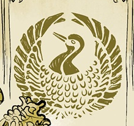

 The **Golden Crane Society** was a secret occult society based in China.

## History

### [Ghost Moon](/entry/Ghost_Moon)

For generations the Golden Crane protected China since the time of the Middle Kingdom from otherworldly threats. However the group faced persecution by the Communist Party in 1954, who were against many secret societies and occult groups. The Chairman of China had been collecting various items of power to a secret facility in Chengdou. The Society tasked one of their own, [Bao Zhi](/entry/Bao_Zhi), to bring the [Hunping](/entry/Hunping) beyond the Communists reach in Kowlon Walled City, however in transit he was attacked by [Thomas Rhymes](/entry/Thomas_Rhymes), a rogue agent of the S.D.I., who stole the artifact. It was revealed that [Susan Xiang](/entry/Susan_Xiang) family were long-time members of the Society. Before dying Bao Zhi passed on some words to her, causing her to reevaluate her past, and motivate her to resolve some family business.

## Members

- *Bao Zhi (deceased)*
