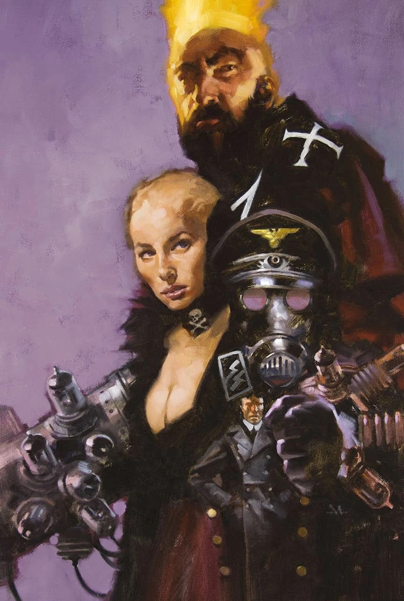

*This article is a stub. You can help Hellboy Wiki by expanding it.*

**Gregory Manchess** is an American illustrator and artist best known for his oil paintings.

## Cover Art

[Lobster Johnson: The Satan Factory](/entry/Lobster_Johnson%3A_The_Satan_Factory)

[Rasputin: The Voice of the Dragon](/entry/Rasputin%3A_The_Voice_of_the_Dragon) \#2 Variant

## External Links

- **Wikipedia:** Gregory Manchess
- www.manchess.com

## Gallery

|Rasputin: The Voice of the Dragon #2 Variant
