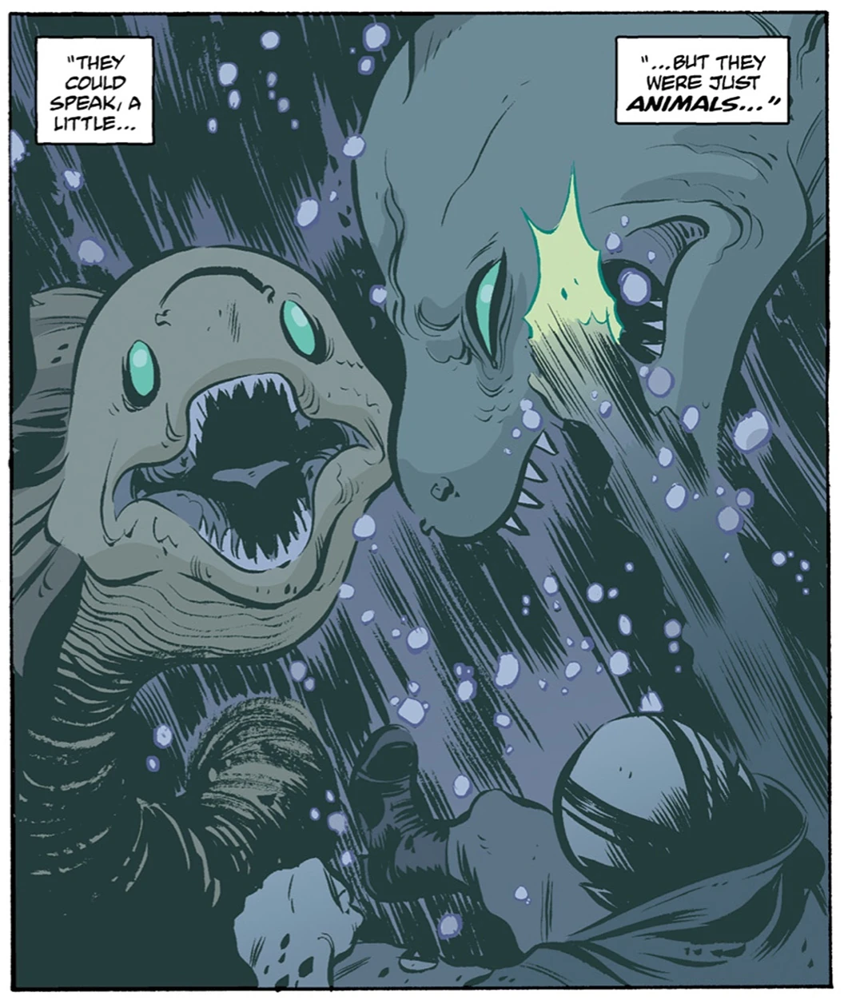

The **Guardians of Mona** were eel-like monsters that guarded the [Mona](/entry/Mona)-egg, which housed the [Ogdru Hem](/entry/Ogdru_Hem)-spirit [Istra-Hem](/entry/Istra-Hem).

## Appearance

- [*The Shadow Over Suwanee*](/entry/The_Shadow_Over_Suwanee)
