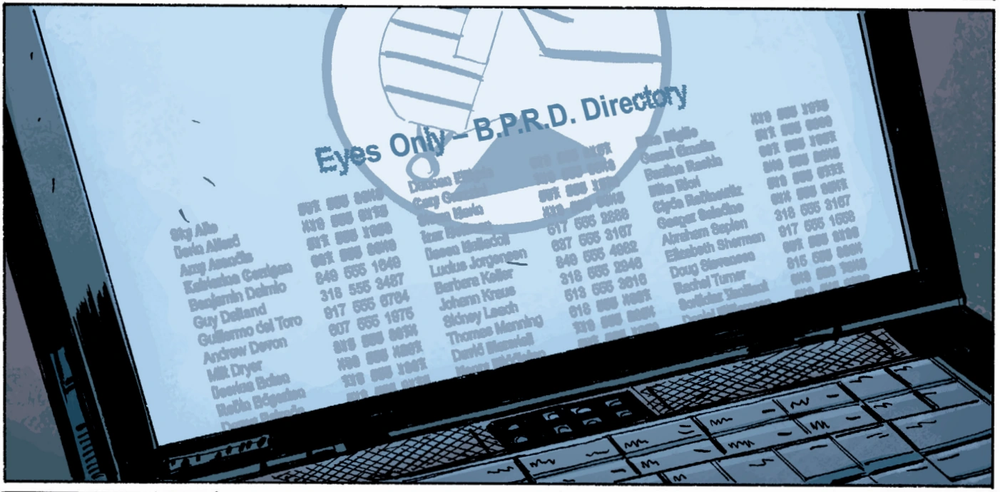

**Guillermo del Toro Gómez** is a Mexican filmmaker, author, actor, and make-up artist.

He is the writer/director of the live-action *[Hellboy](/entry/Hellboy_%282004_film%29)* (2004) film and its sequel *[Hellboy II: The Golden Army](/entry/Hellboy_II%3A_The_Golden_Army)* (2008). He served also as creative producer on the *[Hellboy Animated](/entry/Hellboy_Animated)* films *[Sword of Storms](/entry/Hellboy%3A_Sword_of_Storms)* (2006) and *[Blood and Iron](/entry/Hellboy%3A_Blood_and_Iron)* (2007), as well as writer/voice over director for the video game *[The Science of Evil](/entry/Hellboy%3A_The_Science_of_Evil)* (2008).

He wrote the introduction to the *[Conqueror Worm](/entry/Conqueror_Worm_%28story%29)* trade paperback collection, as well as cowriting with Matthew Robbins the short story "Tasty Teeth" for the *[Odder Jobs](/entry/Hellboy%3A_Odder_Jobs)* prose anthology collection.

He has also been referred to in the series. According to the comics, he was rumoured to have been interested in remaking '['Lobster Johnson](/entry/The_Lobster) and the Ring of Death", a low budget 1957 [*Lucha libre* film](/entry/wikipedia%3A_Luchador_films) starring [Adolfo Flores](/entry/Adolfo_Flores).

## Trivia

Guillermo del Toro makes a cameo in the B.P.R.D. comic, [Killing Ground](/entry/Killing_Ground), in the B.P.R.D. Directory:

Bprd_directory.png

(Leftmost column, 7th name down).

## Links

[Guillermo del Toro](/entry/wikipedia%3AGuillermo_del_Toro) on Wikipedia
