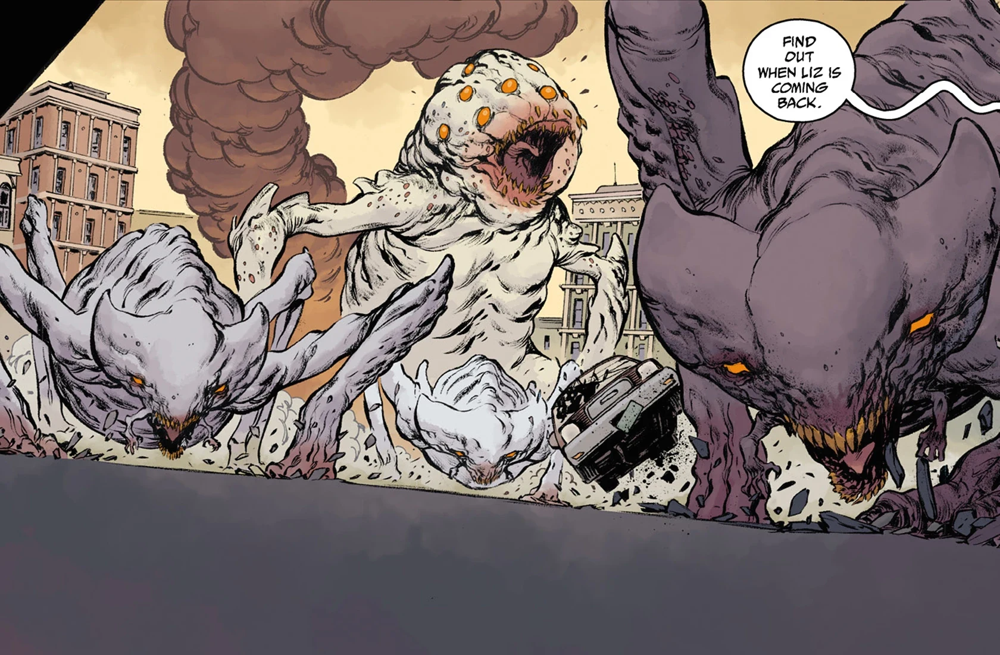

The **Hammerheads** are one of the most prominent species to arise in the wake of the coming apocalypse.  They first appeared after a volcanic eruption near Houston, likely the awakening of an unnamed Ogdru Hem.

## Biology

Hammerheads are very large pseudo-hexapods (with their rear legs branching into two separate appendages past the knee) who have a set of much smaller arm-like appendages extending from their faces. They sport a pair of piercing orange eyes across their broad faces (though some specimens display four or more eyes) along with a pair of nostrils. Their entire bodies are protected by a bone-white exoskeleton that can disregard most small arms fire, but is susceptible to explosives and large caliber armor-piercing rounds. Despite being well-armored, they possess an exploitable weak spot on the inside of their mouths which can be fired upon to almost instantly kill them, though attempting to do so would require a shooter to be dangerously close to the creature. The species also shows a remarkable hardiness that allows them to survive with equal comfort in regions as diverse as the Russian tundra and the deserts of Arizona. 

In addition to their resilience, hammerheads are shown to possess prodigious strength which allows them to send most automobiles tumbling or flying with a swipe. They also show sufficient speed and stamina to chase motorized vehicles for miles on end when properly motivated. These traits are somewhat variable in different specimens, as they possess a very wide range of sizes, with some individuals being roughly the size of a modern rhinoceros, and others having sufficient size to crush automobiles in the palms of their hands. It is unknown if smaller examples are simply younger versions of the larger ones, or are different breeds.   

While not fully sapient, hammerheads are nonetheless quite intelligent creatures, and are capable of highly cooperative pack hunting, in addition to having been seen laying traps for unsuspecting prey using live humans as bait. Despite this, they still ultimately serve their baser instincts, and have been known to cut off their chase if a new meal presents itself (such as a dead hammerhead).  

## Distribution

Thanks to their inordinately fast breeding and ability to tunnel through even concrete, hammerheads have rapidly spread across North America since the onset of the apocalypse, with smaller distributions of them causing havoc in locations as far away as Bangalore, Paris, and Doyonek. There also existed a unique subtype of the species in Japan, which lacked the facial appendages of the Western variety, but sported a number of fin-like extensions across their bodies. 

Besides the infestations plaguing modern Earth, there are indications that hammerheads have spread across other planets as well, and are a common creature produced by the scourge of the [Ogdru Hem](/entry/Ogdru_Hem). Following the events of [Hell on Earth (story cycle)](/entry/Hell_on_Earth_(story_cycle)), a Hammerhead was observed by a drone carrying a single egg from a large nest within the desiccated corpse of an Ogdru Hem, lending some credence to this idea.

## Gallery​​​​​​​

A hammerhead displays its immense strength.

Hammerheads cannibalizing one of their fallen brethren.

Agent Howards engaging one of the four-eyed variety.

Bureau agents engage Japanese hammerheads.

The Visitor recalls the fall of his planet.

A hammerhead on the cover B.P.R.D.: Hell on Earth—The Devil's Engin Issue \#2

A hammerhead on the cover B.P.R.D.: Hell on Earth—The Devil's Engin Issue \#3
