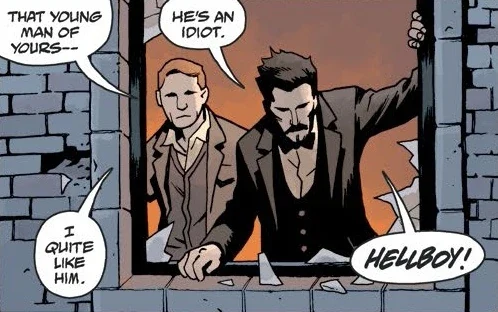
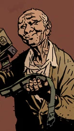

**Harry H. Middleton**[1] was a private occult investigator. A college friend of [Trevor Bruttenholm](/entry/Trevor_Bruttenholm), Middleton befriended Bruttenholm's adopted son [Hellboy](/entry/Hellboy) in the 1950s. This friendship would last beyond Middleton's death, with his ghost continuing to provide company and aid to Hellboy.

## History

Harry Middleton was a friend of Bruttenholm,[2] meeting him at Eton College in the 1930s. Both members of the school's Ghost Club, the the pair encountered their first ghost near a Scottish monastery while still students.[3]

Middleton was introduced to Hellboy in 1953, when Broom brought him along on an investigation at St. Albans; he quickly took a liking to Hellboy, in no small part due to the lad's enthusiastic approach to supernatural entities.[4] Middleton continued to work alongside the duo in the 1950s on a number of cases,[5] including 'The Braunton Burrows Hound'.[6]

### Death

Harry Middleton died in 1984.[7][8] Both Bruttenholm and Hellboy traveled to England to attend his funeral, strongly affected by the death of their friend.[9]

### Visitation

Following Hellboy's time at sea (as seen in *[The Island](/entry/The_Island)*), he stayed with Harry Middleton for one month,[10] before being taken to a gathering of witches (as seen in *[Darkness Calls](/entry/Darkness_Calls)*). Harry, along with the ghosts of Sir Albert Lindsay and Lady Celia Radford, played cards with Hellboy two weeks before the events of *[Darkness Calls](/entry/Darkness_Calls)*.[11] Noticing that Hellboy had lost [his gun](/entry/Hellboy%27s_gun), Harry gave him a 1941 U.S. Army .45 in a left-handed holster as a parting gift.[12]

## Trivia

- [Mike Mignola](/entry/Mike_Mignola) originally wrote *Darkness Calls* with the idea that Middleton was alive. When plotting "[The Mole](/entry/The_Mole)", he instead considered that it would be "cooler" if Hellboy were playing cards with ghosts; therefore, in the epilogue to *Darkness Calls*, it is established that Middleton was long-dead by the time of the story.[13]

## Gallery

 (left) with Broom in 1953[14]

 presents Hellboy with an M1911 pistol.[15]

## Notes

<references/>

[1] His middle initial is given in "[The Mole](/entry/The_Mole)" and "[The Phantom Hand](/entry/The_Phantom_Hand)".

[2] *[Darkness Calls](/entry/Darkness_Calls)* epilogue 1

[3] *[Hellboy and the B.P.R.D.](/entry/Hellboy_and_the_B.P.R.D.): 1953* – "[The Kelpie](/entry/The_Kelpie)"

[4] *[Hellboy and the B.P.R.D.](/entry/Hellboy_and_the_B.P.R.D.): 1953* – "[The Phantom Hand](/entry/The_Phantom_Hand)"

[5]

[6] *[Darkness Calls](/entry/Darkness_Calls)* \#1

[7]

[8] "[The Mole](/entry/The_Mole)"

[9]

[10] This is also mentioned in *[The Wild Hunt](/entry/The_Wild_Hunt)* \#1

[11]

[12]

[13] [*Hellboy – Volume 10: The Crooked Man and Others*](/entry/Trade_Collections)

[14]

[15]
