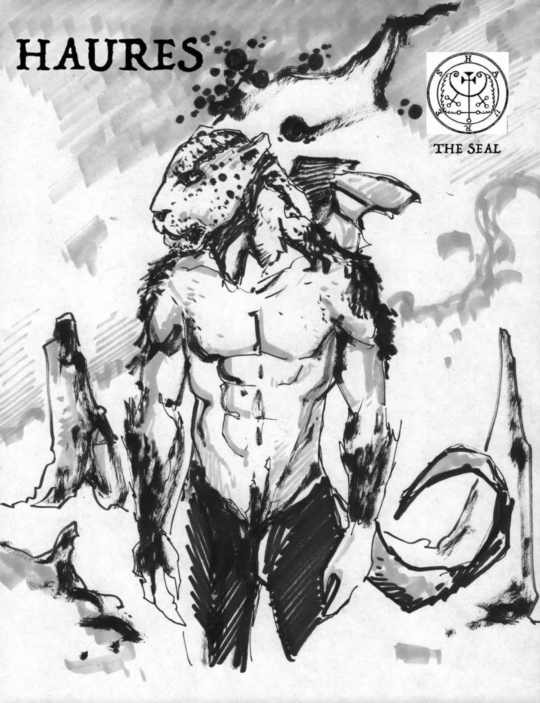
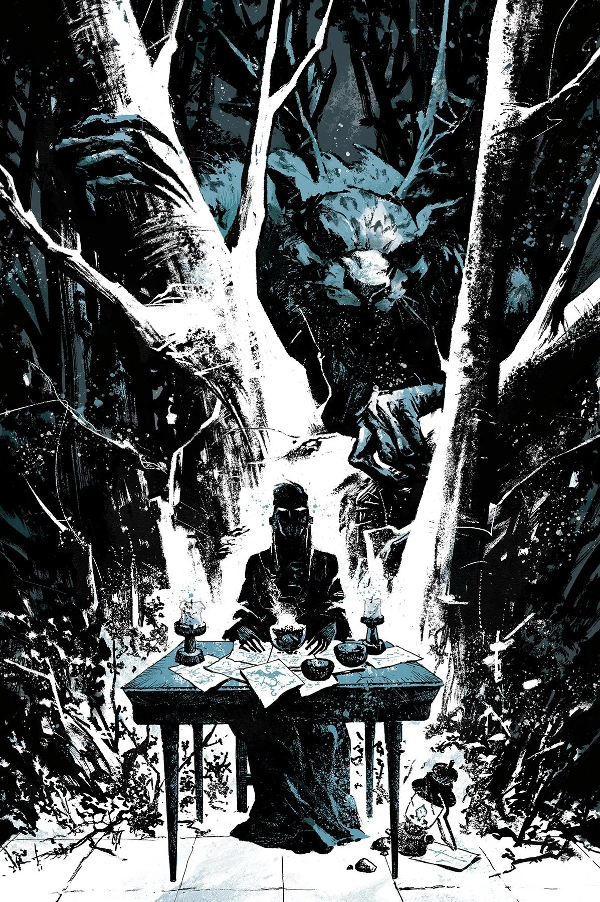

**Haures** was a demon who would have appeared (presumably in a villainous role) in the cancelled story *[The Last Knight of St. Hagan](/entry/The_Last_Knight_of_St._Hagan)*.

## Gallery

|

|
## Trivia

Haures, or Flauros, is a occult demon, who holds the rank of Duke and appears as a leopard. He is associated with true answers of all things, present, past, and to come, tells about the creation of the world and divinity and destroys the enemies of his summoner. He also tries to lie and deceive his summoner if he is not contained in a black triangle.
