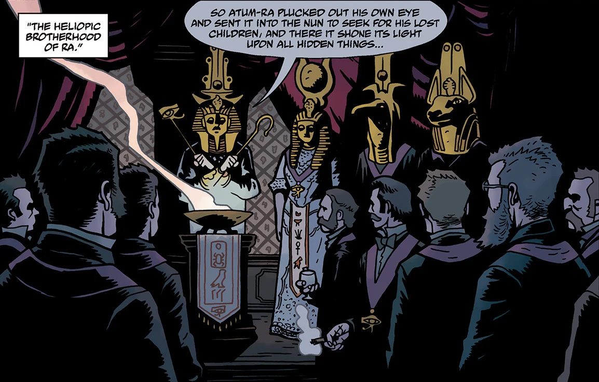
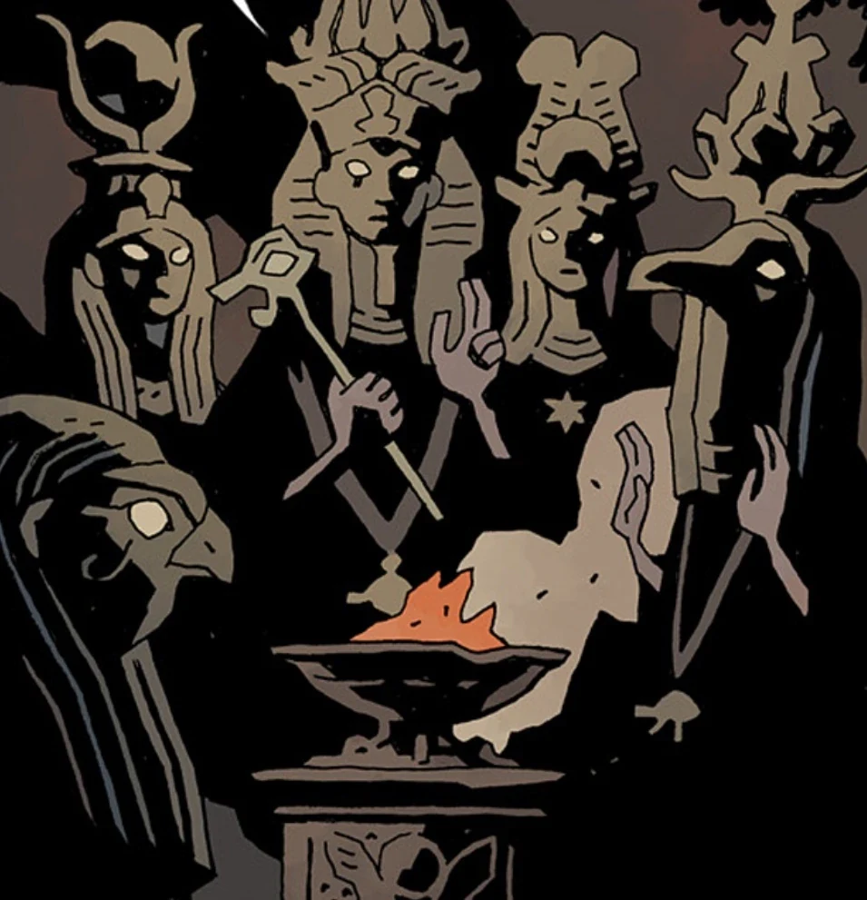

 The **Heliopic Brotherhood of Ra** was a secret society dedicated to preserve ancient and secret knowledge.

## History

In 1728, Eugene Remy, an untalented French textile merchant, claimed to have visited the secret chamber under the Great Pyramid of Egypt. There he was met by a mysterious being known as [Larzod](/entry/Larzod), and learned the secret knowledge of Atlantis, Mu, and Lemuria. Remy's eccentric claims attracted a few intrigued persons. In 1729, Remy's rich patrons financed the Temple of Heliopolis. The temple served as the base of the Heliopic Brotherhood of Ra, founded by Remy to preserve Larzod's secret teachings and pass on the secret wisdom to those worthy of receiving it.

In 1738, members of the Brotherhood engaged in a fierce argument over the Egyptian god [Atum](/entry/Atum) - central to Larzod's teachings - on whether he was self-created (supported by the majority) or he was "born from the primal sea" (supported by the minority). Eventually, those who supported the later theory left the Brotherhood and formed the [Oannes Society](/entry/Oannes_Society), which rivaled the Brotherhood for more than a century. Despite the loss of some members, the upheaval of France after 1745, and the death of Eugene Remy, who was crushed under the wheels of a cart, the Brotherhood continued to grow. In the years leading up to the French Revolution, the H.B.R. supported Napoleon Bonaparte in which he, in a gesture of good friendship, donated to the organization the Egyptian artifacts from his 1798 Egyptian Expedition.

From the mid-19th century, the H.B.R. gained worldwide membership and settled its establishments in London and New York City. In 1866, six members of the Brotherhood visited the mystic Miss E.T. Hatton at the home of Lord Charles Burly and conducted a seance. The spirit Larzod again appeared to this group and charged them with living to see the end of mankind and to look for the coming of a king. This group split from the H.B.R. and formed the [Osiris Club](/entry/Osiris_Club).

The late 19th century saw the public decline of the H.B.R., in large part due to the efforts of [Sir Edward Grey](/entry/Edward_Grey). By 1890 the original Heliopic Brotherhood Temple in Paris was closed down. The **Golden Lodge of the Heliopic Brotherhood** in New York City was also closed by 1890. The London **Universal Temple of the Heliopic Brotherhood of Ra** shut down in 1893 following an attack by an angry mob. The Brotherhood continued to act as a secret society for years afterward. They were thought to be responsible for the 1906 San Francisco Earthquake and the Tunguska Forest Explosion in Siberia in 1908. Tunguska glass was later discovered by the Russian [Special Sciences Service](/entry/Special_Sciences_Service) to be very similar to [Enkeladite](/entry/Enkeladite), a substance developed as a result of nuclear testing in a geomantic area.

## Gallery

## Members

- Eugene Remy (founder)
- [Tefnut Trionus](/entry/Tefnut_Trionus) ("second incarnation of Eugene Remy" and Grand Mistress)
- [Doctor Carp](/entry/Dr._Carp%27s_Experiment) (Grand Master of the Golden Lodge)
- [Lord Adam Glaren](/entry/Lord_Glaren)
- [August Swain](/entry/August_Swain)
- [Albert Mayhew](/entry/Albert_Mayhew)
- [Dennis Peters](/entry/Dennis_Peters)
- [Reginald Sheldrake](/entry/Reginald_Sheldrake)
- [William Bright](/entry/William_Bright)

## Chartered Branches & Splinter Groups

- Knights of the Silver Star
  - This branch was foiled in their attempt to fully summon the demon Amdusias in their Chicago hideout by Sir Edward Grey in 1916.
- Knights of Abydos
- The [Oannes Society](/entry/Oannes_Society) (split off from H.B.R. in 1738)
- The [Osiris Club](/entry/Osiris_Club) (split off from H.B.R. in 1866)

[pt-br:Irmandade Heliópica de Rá](/entry/pt-br%3AIrmandade_Heli%C3%B3pica_de_R%C3%A1)
