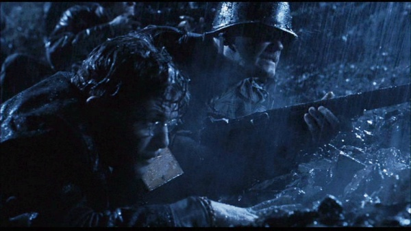
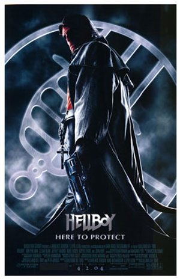
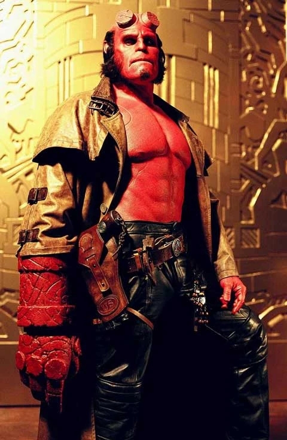
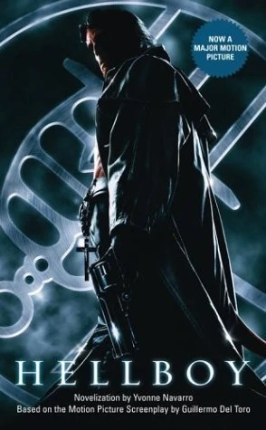

***Hellboy*** is a 2004 American action horror film directed and co-written by [Guillermo del Toro](/entry/Guillermo_del_Toro), starring [Ron Perlman](/entry/Ron_Perlman), [John Hurt](/entry/John_Hurt) and [Selma Blair](/entry/Selma_Blair). The film is loosely based upon the Dark Horse comic book series *[Hellboy](/entry/Hellboy_%28series%29)* by [Mike Mignola](/entry/Mike_Mignola), in particular the original four-issue miniseries *[Seed of Destruction](/entry/Seed_of_Destruction)*.

In the film, the half-demon [Hellboy](/entry/Hellboy_%282004%E2%80%932008_film_character%29) – summoned to Earth by Nazis during WWII and rescued by Allied forces – secretly protects the modern-day world from supernatural threats from within a [top-secret government organization](/entry/Bureau_for_Paranormal_Research_and_Defense).

A sequel, *[Hellboy II: The Golden Army](/entry/Hellboy_II%3A_The_Golden_Army)*, also directed by del Toro and starring Perlman, was released in 2008. A franchise [reboot](/entry/%E5%9C%B0%E7%8B%B1%E7%94%B7%E7%88%B5%EF%BC%9A%E8%A1%80%E7%9A%87%E5%90%8E%E5%B4%9B%E8%B5%B7)) was released in 2019[1], and a [second reboot](/entry/Hellboy%3A_The_Crooked_Man_%28film%29) was released in 2024[2].

## Plot

In 1944, with the help of [Grigori Rasputin](/entry/Grigori_Rasputin), the Nazis build a dimensional portal off the coast of Scotland, intending to free the [Ogdru Jahad](/entry/Ogdru_Jahad), monstrous deities imprisoned in deep space, to aid them in defeating the Allies. An Allied team is sent to destroy the portal, guided by a young [Trevor Bruttenholm](/entry/Trevor_Bruttenholm). The Nazis are killed, and the portal destroyed, taking Rasputin with it, while his servants [Ilsa Haupstein](/entry/Ilsa_Haupstein) and [Karl Ruprect Kroenen](/entry/Karl_Ruprect_Kroenen) escape. The Allied team discovers that an infant demon with a right hand of stone came through the portal; they dub him "[Hellboy](/entry/Hellboy_%282004%E2%80%932008_film_character%29)" and Bruttenholm adopts him.

Sixty years later, FBI agent John Myers is transferred to the [Bureau for Paranormal Research and Defense](/entry/Bureau_for_Paranormal_Research_and_Defense) (BPRD) at the request of Bruttenholm, where he meets the adult Hellboy and the amphibious humanoid [Abe Sapien](/entry/Abe_Sapien). He learns that a third BPRD member, [Liz Sherman](/entry/Liz_Sherman), has recently checked into a mental hospital to protect others from her volatile pyrokinetic abilities. Despite regular visits and coaxing from Hellboy, she is determined not to return. Kroenen and Haupstein resurrect Rasputin in the mountains of Moldova and the three unleash the hellhound [Sammael](/entry/Sammael). Rasputin imbues Sammael with the power to reincarnation, allowing two of the creature's eggs to hatch each time one dies. Rasputin visits Liz as she sleeps, activating her powers and almost destroying the hospital. Myers convinces her to return to the Bureau.

As Sammael's ability to multiply becomes a problem, it is concluded their eggs are in the sewers, and Hellboy, Abe, and several BPRD agents go down to destroy them. Abe is injured while searching for eggs, while Kroenen kills most of the agents. Kroenen, whose undead body is run by clockwork mechanisms, shuts himself down, pretending to be dead as his body is brought to bureau HQ. While BPRD director [Tom Manning](/entry/Tom_Manning) is angered by Hellboy's recklessness, Myers takes Liz out for coffee. Hellboy, jealous, covertly follows them, leaving HQ unguarded. Kroenen then reanimates himself and Rasputin reappears at the bureau, confronting and finally killing Professor Bruttenholm.

Manning takes over the BPRD and locates Rasputin's mausoleum in an old cemetery outside Moscow. A team led by Manning and Hellboy enter the mausoleum, but quickly become separated. Hellboy and Manning find their way to Kroenen's lair and defeat him. Hellboy reunites with Liz and Myers at Sammael's new nest, but the creatures overwhelm them. Liz uses her pyrokinetic powers to incinerate the Sammaels and their eggs. Hellboy, Liz and Myers lose consciousness and are captured by Rasputin and Haupstein. As Rasputin sucks Liz's soul from her body, he tells Hellboy to release the [Ogdru Jahad](/entry/Ogdru_Jahad) in return for her soul. Hellboy awakens his true power as Anung un Rama, the Beast of the Apocalypse, and begins to release the Ogdru Jahad by entering his stone right hand, the Right Hand of Doom, into a massive stone monolith recovered by Rasputin. Myers breaks out of his restraints, subdues Haupstein, and reminds Hellboy that he can defy his destiny. Remembering his true self, Hellboy breaks off his regrown horns, reseals the Ogdru Jahad and stabs Rasputin with one of the broken horns.

A tentacled Behemoth bursts out of Rasputin's dying body and grows to immense size, crushing him and Haupstein. Hellboy allows himself to be swallowed by the beast, detonating a belt of [hand grenades](/entry/Vulcan_Grenades), and destroying the creature from the inside. He returns to Liz, whispering something in her ear, returning her soul. The film ends with Liz and Hellboy sharing a kiss while engulfed in Liz's gentle flame.

## Cast

- [Ron Perlman](/entry/Ron_Perlman) as [Hellboy](/entry/Hellboy_%282004%E2%80%932008_film_character%29)
- [John Hurt](/entry/John_Hurt) as [Trevor Bruttenholm](/entry/Trevor_Bruttenholm)
  - Kevin Trainor as Young Broom
- [Selma Blair](/entry/Selma_Blair) as [Liz Sherman](/entry/Liz_Sherman)
- [Rupert Evans](/entry/Rupert_Evans) as [John Myers](/entry/John_Myers)
- Karel Roden as [Grigori Rasputin](/entry/Grigori_Rasputin)
- [Jeffrey Tambor](/entry/Jeffrey_Tambor) as [Tom Manning](/entry/Tom_Manning)
- [Doug Jones](/entry/Doug_Jones) as [Abe Sapien](/entry/Abe_Sapien)
  - [David Hyde Pierce](/entry/David_Hyde_Pierce) (uncredited) as the voice of Abe Sapien
- Brian Steele as [Sammael](/entry/Sammael)
- Ladislav Beranas as [Karl Ruprecht Kroenen](/entry/Karl_Ruprecht_Kroenen)
- Biddy Hodson (credited as Bridget Hodson) as [Ilsa Haupstein](/entry/Ilsa_Haupstein)
- Corey Johnson as [Agent Clay](/entry/Agent_Clay)
- Brian Caspe as Agent Lime
- James Babson as Agent Moss
- Stephen Fisher as Agent Quarry
- Garth Cooper as Agent Stone

## Production

[Del Toro](/entry/Guillermo_del_Toro) and [*Hellboy*](/entry/Hellboy_%28series%29) creator [Mike Mignola](/entry/Mike_Mignola) envisioned the film as a Ray Harryhausen film. The film was shopped and rejected by various studios for years due to studios disliking the title, script, and the fact that [Perlman](/entry/Ron_Perlman) was cast as [Hellboy](/entry/Hellboy_%28character%29). Harryhausen was invited by Del Toro to teach the film's animators what made his effects techniques unique but declined, feeling that modern films were too violent.

### Writing

The film is loosely based on the debut comic *[Hellboy: Seed of Destruction](/entry/Seed_of_Destruction)*. While writing the script, Del Toro researched occult Nazi philosophies and used them as a reference for the film's opening scene. In an early version of the script, the gyroscope portal was described being made out of rails that formed into pentagrams, hexagrams, and inverted stars to illustrate the film's magic and occult elements. Del Toro chose to alter the origin from the comic to give main characters interconnected origins.

Labyrinths became a motif for the film to represent Hellboy's conflict of "choosing the right path." This was reflected in the film's opening titles. Del Toro felt that labyrinths represent the film's themes regarding "choices and taking different turns and choosing different destinies," Del Toro stated, "A labyrinth, it is said, is not a place to be lost, but a place to find yourself." Del Toro chose to add context to the BPRD logo by rooting the film's version in Catholic mythology by adding archangels in Broom's office. Del Toro wrote Hellboy's dialogue with Perlman in mind for the role, prior to casting him. Del Toro noted that he tried to emulate Jack Kirby and Harryhausen's action style for the film's action scenes.

Hellboy was given a special gun, "[The Samaritan](/entry/The_Samaritan)", for the film to illustrate the BPRD's techno-magic. Del Toro approached the love story with a reverse Beauty and the Beast approach, stating, "I wanted the beauty to turn into a beast in the end to fully assume her mortal gifts... and when she accepts herself for what she is, a monster, then she can love the monster \[Hellboy\]." The idea of Hellboy spying on Liz and Myers was originally written for a separate script titled *Meat Market, A Love Story*. While Broom's death happened early in the comics, Del Toro wished to delay it to have audiences become attached to the character and "make it painful to lose that character."

### Pre-production

Aside from working with Perlman before, Del Toro chose him for the title role because he felt Perlman could deliver subtlety and nuance with makeup. Vin Diesel was linked to the role when the film was being proposed at Universal Pictures, and Jeremy Renner was offered the "title role" but turned it down due to having no attachment to the source material. Del Toro assigned his real-life friend, Santiago Segura, to play the train driver who assaults Hellboy. [David Hyde Pierce](/entry/David_Hyde_Pierce) was hired to provide the voice for Abe Sapien due to Pierce being a "bigger name" and having a "more recognizable sound". Pierce refused to take credit, perform press tours, or attend the premiere out of respect for [Doug Jones](/entry/Doug_Jones).

### Filming

The film was shot 6 days a week for 130 days, Mondays through Saturdays without a second unit in 2003. Sundays were reserved for editing. Del Toro noted that the film could have commenced filming in 1998, however, the film had difficulty finding a committed studio due to the stigma Hollywood associated superhero and comic book films with, at the time. The action scenes were staged after Harryhausen films with little to no camera movement using wide shots. The cemetery sequence was filmed in a real cemetery in Prague.

## Trivia

[M1 Garands](/entry/%3AFile%3AM1_garand.jpg) wielded by Allied forces

- During the opening sequence of the film, Sgt. Whitman and several other soldiers use M1 Garands.
- Hellboy was Guillermo del Toro's favorite superhero long before he made the movie.[3]

## Awards

### Won

- **Image Award, 2004**
  - Best Director — Feature Film.
- **Saturn Award, 2005**
  - Best Make-Up

### Nominated

- **Teen Choice Award, 2004**
  - Choice Movie — Drama/Action Adventure.
- **VES Award, 2005**
  - Outstanding Performance by an Animated Character in a Live Action Motion Picture.
- **IHG Award, 2005**
  - Best Movie
- **Bram Stoker Award, 2005**
  - Screenplay
- **Saturn Award, 2005**
  - Best Fantasy Film
  - Best Special Edition DVD Release
  - Best Costumes

## Gallery

### Trailers

- \[<http://www.sonypictures.com/cthe/hellboy/helltrailer_high.asx>? First Trailer\]
- [Second trailer](http://www.sonypictures.com/movies/hellboy/video/trailer2/trailer2_high.asx?affiliateId=)

## Links

- [*Hellboy*](http://www.imdb.com/title/tt0167190/) at the Internet Movie Database
- [*Hellboy*](/entry/wikipedia%3AHellboy_%282004_film%29) Wikipedia article
- [*Hellboy*](http://www.allmovie.com/cg/avg.dll?p=avg&sql=1:287448) at allmovie.com
- [Hellboy](http://www.rottentomatoes.com/m/hellboy/) at rottentomatoes.com
- [Hellboy Hype!](http://www.superherohype.com/hellboy/) at superhero hype!
- [*Hellboy* film official site](http://www.sonypictures.com/movies/hellboy/)
- [*Hellboy* official site](http://www.hellboy.com/)
- [The Doug Jones Experience *Hellboy* film page](http://www.thedougjonesexperience.com/Hellboy.htm) \*[Hellboy](http://flaregamer.com/b2article.php?p=89&more=1) at FLAREgamer
- [Screenplay — Production Draft](http://sfy.ru/sfy.html?script=hellboy)
- [Hellboy](http://www.fanhistory.com/wiki/Hellboy) at FanHistory
- [Detailed Comparison between Theatrical release (PG-13) and Director's Cut](http://www.movie-censorship.com/report.php?ID=1905&In=WikE)

## References

[1] 'Hellboy' Release Date Pushed Back 3 Months to April 2019 (hollywoodreporter.com)

[2] ‘Hellboy: The Crooked Man’ Plot And Production Details Revealed (deadline.com)

[3] 12 Burning Facts About Hellboy | Mental Floss
