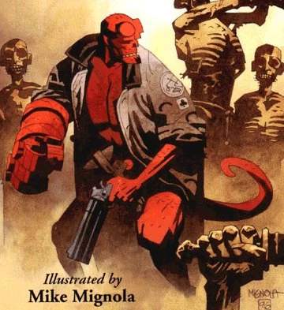
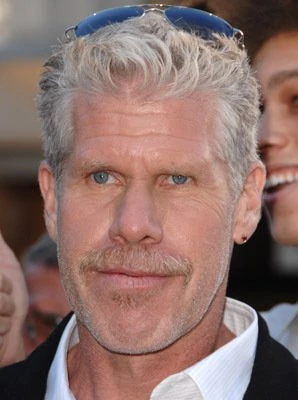

**Hellboy** is the title character and protagonist of the film *[Hellboy](/entry/Hellboy_(2004_film))* (2004) and its sequel *[Hellboy II: The Golden Army](/entry/Hellboy_II__The_Golden_Army)* (2008). An adaptation of [the character of the same name](/entry/Hellboy_(character)) from [the comic series *Hellboy*](/entry/Hellboy_(series)), much of the film character's backstory is similar to what is presented in the comic miniseries *[Seed of Destruction](/entry/Seed_of_Destruction)*.

A half-demon, parented by a human woman and a demonic father, Hellboy was summoned to earth through a dimensional portal on October 9th, 1944. Adopted by Professor [Trevor Bruttenholm](/entry/Trevor_Bruttenholm), Hellboy's existence is kept a secret from the world at large. Over the next sixty years, he operates as an agent of the [Bureau for Paranormal Research and Defense](/entry/Bureau_for_Paranormal_Research_and_Defense), brought out of headquarters on brief occasions and under supervision to battle monsters. In the 2000s, Hellboy learns more of his true nature during a conflict with the resurrected [Rasputin](/entry/Grigori_Rasputin)): he is Anung un Rama, the Beast of the Apocalypse. A few years later, Hellboy reveals his existence to the world in a series of events that builds to his resignation from the Bureau. Hellboy also begins a romantic relationship with the pyrokinetic [Liz Sherman](/entry/Elizabeth_Sherman).

In the films, Hellboy is portrayed by [Ron Perlman](/entry/Ron_Perlman). The first choice of both comic creator [Mike Mignola](/entry/Mike_Mignola) and film writer/director [Guillermo del Toro](/entry/Guillermo_del_Toro) for the role, Perlman continued to voice the character in several additional projects.

## History

*See also: [Hellboy (2004 film)#Plot](/entry/Hellboy_(2004_film)#Plot) and [Hellboy II: The Golden Army#Plot](/entry/Hellboy_II__The_Golden_Army)*

Biographic notes by [Guillermo del Toro](/entry/Guillermo_del_Toro) were included in prerelease promotional materials. Though some elements are readily apparent in the final film, it is unclear how much of this text is considered canon to the final films.

*GDT's Movie Bio: Hellboy*

**HELLBOY**  
**Anung Un Rama**  
Oct 9th 1944  
6'9". 350 lbs. Black hair, red skin, golden eyes, stone hand.

LIKES: The look of Liz in the golden light of dusk. The look of Liz in the morning. The look of Liz from a distance. The look of Liz nearby. Her voice, her smell, her clothes, her skin... having her fall asleep on his shoulder, well, you get the idea. He looks up to Professor Broom but feels like James Dean in *East of Eden*. He adores beer, pizza, chili, nachos, pumping iron, a good cigar, a bad cigar, traveling, cats, candy -specially Baby Ruth- old UPA cartoons, old Fleischer cartoons, Polaroid photos -Liz taught him that- Zippos -he collects them- ding-dongs and twinkies, cookies and milk, greasy burgers and hot dogs, shaving his horns. He is easily amused by flatulence -thinks *Dumb and Dumber* is a masterpiece- and loves to bawl with B&W movies -especially Chaplin's *City Lights* and *Brief Encounter*. Beating the crap out of monsters. Getting his coat fixed and ready. His big, bad gun "The Samaritan", its bullets. Bruce Willis. Tom Waits, Nick Cave, the Pixar movies -thinks that *Monsters, Inc.* is a better name for the BPRD -Abe takes offence- and watching *Toy Story* 1 and 2 with Liz makes for a perfect afternoon. Loves the Three Stooges, the Marx Brothers, Harold Lloyd, Buster Keaton.

DISLIKES: Vegetables -beets especially- oysters, jalapeno peppers, salads, Yanni, Charlotte Church, *People* Magazine, *The Enquirer*, Photographers, Abe burping -those damn eggs are nasty- or getting sanctimonious. Thinking of his origin, learning about it. People staring at his forehead. Being locked up for more than 4 months without an "outing." Being called a demon.

**BIOGRAPHY by Guillermo del Toro:**

To understand Hellboy one has to know a bit about his family. His real family, that is.

His Mother was born 1681. Her name was Catherine Tanner-Tremaine and was born in East Bromwich, England. A rich heiress to a Tobacco merchant, she studied harpsichord and singing and was adept at most feminine arts. Her parents died when she turned 19 and for the longest time, she lived alone in her palatial home, reading and painting. Immersed in German literature, she dreamt of spirits and magic. Cautiously, she acquired texts and grimoire from her London Bookseller and eventually came to own an important collection of magic artifacts and lore -including Dr. John Dee's fabled magical box- and displayed them in her private library/study. She summoned a high-ranking Demon and willingly found intimacy with him. This was both the highest and the most terrifying moment in her life.

She was a changed woman, her soul had probed darkness and its acrid aftertaste made the rest of her life a road of repentance. But Sin has its own ways of staying and in spite of her charity and her pious marriage to a minister and the edification of many a church and chapel, she died out of grace. By her feet lay her two human children: a nun and a pastor. She confessed her transgressions and cried bitterly. She begged them to save her soul for it would be claimed by her Dark paramour. But just as she exhaled her last breath, her lover reclaimed her body, slaughtering her earthly children so swiftly that a gust of wind shuddered all the windows in Tremaine Manor. Their souls joined, he wooed her and promised that -in his eyes- she would always look young and that within her still lay her unborn spiritual son. Awaiting to incarnate and fall to earth. And she lay dormant, like an insect in amber until her child was summoned forth by Grigory Effimovich Rasputin one fateful Autumn night in '44.

The details of Hellboy's birth have been properly consigned in the BPRD archives and so has his eventual transfer to a New Mexico army base by Professor Trevor Broom. It was Broom's finding of the child that prompted him to stay permanently in the United States, accepting from President Roosevelt the charge of Director of Operations at the head of the BPRD.

Hellboy grew fast and was incredibly inquisitive. He had the most vivacious eyes and showed interest in most mechanical things -frequently smashing them to pieces with his stone hand. Under the supervision of General Norton Rycker daily tests were arranged and frequent biopsies were done to obtain tissue samples. Hellboy showed incredible resistance to pain, but cried bitterly every time. A sample of the stone in his glove required the use of a high-tension diamond drill bit and provided less than a square millimeter of material before exploding into a shower of sparks and debris.

Professor Broom taught Hellboy the language. First they communicated with signs, then a few sounds and finally with words. The child also had a great affinity with animals and for a while he could "talk" to the base dog mascot (an ability that he would lose over the years) and considered it a more evolved species than humans. Perhaps because of this Hellboy wasn't "potty-trained" until his later childhood years. In a private session Broom was asked by the president to conceal Hellboy's existence from the rest of the world and bowed to provide funding for a larger BPRD building.

In spite of the secrecy, now and then Hellboy was introduced to many a celebrity. Einstein flew to new Mexico in order to spend an afternoon with the creature and found him delightful and bright. Hellboy compared hairstyles between Broom and Einstein and expressed his predilection for the latter. In 1946 he threw a rock at Babe Ruth's head and -in a most impolite manner- kept calling Clark Gable "Sewer breath". Photos were shown to Josef Stalin that depicted HELLBOY as a USA secret weapon. Stalin liked his color but believed him a hoax. 1n 1949 Hellboy met the Soviet Dictator, who kept pinching him in the cheek and fondling his horns. Hellboy started shaving them shortly thereafter. In 1951 he was released into Professor's Broom full-time custody and moved into the BPRD headquarters - back then in Boston, MA.

The early 50's proved particularly active for the Bureau as Adolf Hitler waged his secret war with the USA from South America. Hellboy proved his enormous talent as an agent in the field and beating a Cybernetic Hitler with his own mechanical leg may prove to be one of his greatest triumphs. At the end of the decade, the BPRD moved into its new headquarters. The building that presently houses the Bureau was created in the 1940's and was intended by the federal government as one of their COLD WAR strategic bunker-shelter to lodge all branches of Government.

Hellboy's room used to be the building's safe and is ensconced by the rock of a cliff and a concrete and steel armature.

Broom kept Hellboy's origins nebulous to his "son" until 1959, when they had a "heart-to-heart" in view of Broom's first bout with cancer. Hellboy was so upset that he decided never to probe into that subject again. His dreams were inevitably assaulted by apocalyptic scenarios every now and then and a chip was placed on his shoulder: Every time he punched an alien creature he exorcised his own "otherness". He is incredibly sensitive about being "stared upon" or "photographed" except by Liz.

Through the years Hellboy remained the sole non-human component of the BPRD until 1978 when Abe Sapien joined the ranks of the organization. Hellboy and Abe started their friendship on the wrong foot. Abe was everything Hellboy was not: introspective, laconic, an avid reader (Hellboy always favored old issues of *Popular Mechanics* and a dozen Silver Age comic books like *Sugar and Spike* and *Little Lulu*) and an extremely private guy. Hellboy was jealous of Broom's attention towards Abe and the Fishman's propensity to take offense every time Hellboy would bestow a new nickname upon him.

In 1988 Liz Sherman joined the BPRD and Hellboy fell in love at first sight. From that moment on, Hellboy, the invulnerable, knew the meaning of pain.

## Characterization

### Appearance

Hellboy ages differently than humans: though approximately 60 years of age in 2004, he is roughly 20–30 in terms of physical and mental maturity.

His hair, which recedes from the top of his head, is styled into a samurai-style topknot. His facial hair is trimmed to muttonchops and a goatee.

Demonstrative of his demonic heritage, Hellboy has red skin, yellow eyes, a tail, cloven hooves, and a pair of horns. He prefers to keep his horns ground down with a belt sander, often expressing distaste for people staring at his forehead. When grown out, they extend over a foot in length and arc upwards.

His right arm has a massive stone hand and forearm, the [Right Hand of Doom](/entry/Right_Hand_of_Doom). Arcane spiral patterns are carved into the Hand, continuing up to Hellboy's torso.

### Powers and Abilities

Hellboy is fireproof.

Hellboy's preferred sidearm is [The Samaritan](/entry/The_Samaritan), a massive custom-made revolver. Capable of holding four shots, he frequently utilizes handmade, specially-modified bullets to combat supernatural beings. Hellboy also wields [Big Baby](/entry/Big_Baby), a six round shotgun-like weapon, using it to kill a [Forest God](/entry/The_Last_Elemental).

He is also equipped with a brown russet leather utility belt, which was fabricated in 1968 by order of acting B.P.R.D. head [Norbert Ricker](/entry/Norton_Ricker). It features pouches and rings to carry or hang various amulets and items. He carries a variety of items, such as holy relics, horseshoes, and herbs in his utility belt, as well as a variety of [grenades](/entry/Vulcan_Grenades) and other demolition tools; these often come in handy when fighting supernatural beasts.

He also huge appetite as he eats six meals a day.

### Differences from comic character

> 
>
> When we started on the second picture, the original idea was to go back and pick a story from the comic and adapt it to film. But that first film strayed so far away from its comic book roots that there was really no way to go back to the comic. So what we had to do was come up with a sequel to the film, as opposed to another comic book adaptation. \[...\] del Toro and I came up with the original story together.  
> The Hellboy character in that second picture is so far away from my version of Hellboy, because you had the whole love interest thing, which had morphed into this first-year marriage squabbling kind of thing, which is totally alien to my character. \[...\] In fact, there was a moment where I said, “Well, Hellboy wouldn’t do that.” and del Toro said, “Your Hellboy wouldn’t, mine would.”
>
> 
>
> —[Mike Mignola](/entry/Mike_Mignola), *Geek's Guide to the Galaxy* podcast interview, 2012

  

Though the first film is a loose adaptation of *Seed of Destruction*, changes were made that maintained the spirit of the story while making it more compelling as a film narrative. These differences built up and grew more pronounced in the sequel (which is largely an original tale featuring distinct plot and characters), to the point where several prominent elements of Hellboy are wholly distinct from [his original comic depiction](/entry/Hellboy_(character)). The most notable differences include:

- Hellboy's existence is kept a secret from the world at large. This secrecy extends to the existence of the B.P.R.D. as a whole, and one of Director [Thomas Manning](/entry/Thomas_Manning)'s duties is to "debunk" Hellboy sightings. Hellboy is kept under constant supervision by a B.P.R.D. "handler" well into the 2000s. Much of the drama in the second film is driven by Hellboy's unauthorized decision to publicly reveal himself, as he grapples with the choice to defend a world that does not understand (or even fears and hates) him.
  - By contrast, the comic character's existence is well-known and rarely provokes any kind of reaction: he was revealed to the world in 1947 and awarded honorary human status in 1952, he also appeared on the cover of *LIFE* magazine several times over the years.
- In the films Hellboy displays emotional maturity similar to that of a teenager, perhaps as a consequence of his sheltered existence; similarly, Hellboy approaches his job with a certain degree of reluctance, often preferring to relax in his room or otherwise avoid conflict.
  - In the comics, Hellboy matured by the 1960s;  his downtime and personal life are rarely shown.
- Liz Sherman is Hellboy's romantic partner. Hellboy was lovestruck at first sight, carrying a torch for her for years; the two become a couple at the end of the first movie and are starting a family by the second.
  - In the comics, though Hellboy's fireproof nature allowed him and Liz to develop a close "brother-and-sister connection", it never progressed into romance; although Hellboy has demonstrated romantic interest with other women (e.g. *[Hellboy in Love](/entry/Hellboy_in_Love)*), these never developed into longstanding relationships or led to starting a family.

> 
>
> When I see an adaptation that is absolutely faithful to the book to the point of castrating the movie, it's very boring. If you see "Lord of the Rings," it's not verbatim, but it is the best movie you can make from that book. It has the spirit. But sometimes you paraphrase, sometimes you make analogies, sometimes you extrapolate, and that's what this movie is about.
>
> 
>
> —[Guillermo del Toro](/entry/Guillermo_del_Toro), *Wizard* magazine interview, 2004

Other, relatively more minor, differences include smaller character attributes or visual differences.

- Hellboy was summoned to Earth in 1944, but the specific day varies: October 9 in the movie, and December 23 in the comics.
- Both versions of Hellboy age differently than humans, though the specifics vary.
  - The film character is explained as aging slowly (in "reverse dog years"), appearing youthful while in his sixties, though at eleven years old resembled an average human child of that age.
  - The comics character similarly appears in his physical prime well into his sixties, but appeared fully-grown by the age of eight.
- The Right Hand of Doom in the films is depicted with large spiral carvings. The fingers are more blocky, bending at joints rather than curving smoothly along their length.
- Hellboy's garments are slightly different:
  - His trench coat is a bulkier duster-style greatcoat with a "cape" for his shoulders; the right sleeve fastens with large buckles to allow room for the Right Hand of Doom.
  - His belt buckle includes the B.P.R.D. logo, compared to the blank red circle of the comics. A B.P.R.D. tracker is attached to his belt, a discrete gadget rather than integrated into the circular piece as in the comics.
  - He typically wears long leather pants and boots, rather than shorts and footwear that exposes his hooves, likely to avoid leg prosthetics for both the comfort of the actor and efficiency in the production.
- This version of Hellboy seems to fare better with and more readily use firearms than his comic book counterpart; nonetheless, he still describes his aim as needing some work. His favored handgun, The Samaritan, does not have [a direct comic book counterpart](/entry/Hellboy's_gun).
- Hellboy enjoys smoking cigars.
  - In the comics, the character typically prefers to smoke cigarettes.
  - This penchant for cigars is shared by Hellboy actor Ron Perlman.
- Hellboy has a great fondness for cats, keeping many in his room.
  - The comic character does not own pets, but did spend time with [a friendly dog](/entry/Mac) as a child.

## Behind the scenes

Hellboy was portrayed by [Ron Perlman](/entry/Ron_Perlman).

*Hellboy II: The Golden Army* features a prologue with an 11-year-old Hellboy. Young Hellboy was portrayed by makeup artist Montse Ribé, who co-created the character's look with business partner and fellow artist David Martí.

## Gallery

Hellboy on the poster of the 2004 film

Close-up of Hellboy's face on the novelization of *The Golden Army*

Hellboy brandishes the "[Big Baby](/entry/Big_Baby)" in *The Golden Army*

Hellboy and his B.P.R.D. compatriots in *The Golden Army*

Hellboy attacks [the Golden Army](/entry/The_Golden_Army).

## Trivia

- Perlman would also voice Hellboy in the [Hellboy Animated](/entry/Hellboy_Animated) series.
