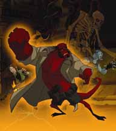

 ***Hellboy Animated*** is a pair of original straight-to-DVD animated films and a series of tie-in comics. *[Sword of Storms](/entry/Hellboy_Animated%3A_Sword_of_Storms)* and *[Blood & Iron](/entry/Hellboy_Animated%3A_Blood_%26_Iron)*, were made with the approval of [Mike Mignola](/entry/Mike_Mignola) and [Guillermo del Toro](/entry/Guillermo_del_Toro). A third film was planned but has since been abandoned.

## Cast

[Ron Perlman](/entry/Ron_Perlman), [Selma Blair](/entry/Selma_Blair), and [John Hurt](/entry/John_Hurt), who played [Hellboy](/entry/Hellboy_%28character%29), [Liz Sherman](/entry/Elizabeth_Sherman) and [Professor Trevor Bruttenholm](/entry/Trevor_Bruttenholm) in the [2004](/entry/Hellboy_%28film%29) and [2008](/entry/Hellboy_II%3A_The_Golden_Army) live-action films, reprise their roles for the *Hellboy Animated* versions of the characters. [Abe Sapien](/entry/Abraham_Sapien) is voiced by [Doug Jones](/entry/Doug_Jones), who played Abe in the live-action films. These films mark the first time he provided the voice of Abe. ([David Hyde Pierce](/entry/David_Hyde_Pierce) provided the vocal performance for Abe in the first live-action film.)

- Ron Perlman as Hellboy
- Selma Blair as Liz Sherman
- Doug Jones as Abe Sapien
- John Hurt as Professor Trevor Bruttenholm
- [Peri Gilpin](/entry/Peri_Gilpin) as Kate Corrigan

## Films

### *[Sword of Storms](/entry/Hellboy_Animated%3A_Sword_of_Storms)*

In *Sword of Storms*, Hellboy and [Kate Corrigan](/entry/Kate_Corrigan) are dispatched to [Japan](/entry/Japan) to solve the mystery of a professor possessed by the Japanese demons Thunder and Lightning. The demons wish to get their hands on a powerful haunted sword, which will free them, and allow them to unleash their [brothers](/entry/Ogdru_Jahad) and destroy the world. While Hellboy is sent into an alternate dimension, facing Youkai on the way, his [B.P.R.D.](/entry/Bureau_for_Paranormal_Research_and_Defense) teammates, Abe Sapien and Liz Sherman, try to stop one of the Dragons on the first wave of the coming chaos.

### *[Blood & Iron](/entry/Hellboy_Animated%3A_Blood_%26_Iron)*

*Blood & Iron* deals with Professor Trevor Bruttenholm's experience with a vampiress (the blood countess) in 1934 and the present day. Hellboy also faces off against Hecate.

### *[Iron Shoes](/entry/Iron_Shoes_%28film%29)* (short film)

The *Hellboy Animated: Blood & Iron* DVD also includes a bonus short film, based on the short comic *[The Iron Shoes](/entry/The_Iron_Shoes)*.

### *The Phantom Claw*

The abandoned third film. It was to be the debut of [Lobster Johnson](/entry/The_Lobster) in the series, though it was to primarily feature Hellboy and Kate.

On March 19, 2008, a message was posted on the *Hellboy Animated* site by producer Tad Stones stating that no work is being done on this film. However, Stones also wrote that some smaller animated projects may be done for internet release, and hinted that the release of *[Hellboy II: The Golden Army](/entry/Hellboy_II%3A_The_Golden_Army)* may affect the future of the animated film series.

All work on *The Phantom Claw* has since been suspended indefinitely.

### *[The Dark Below](/entry/The_Dark_Below)* (short film)

*The Dark Below* is a five minute short film released in 2010 and currently available through streaming services. The short features Hellboy falling into an ancient underground ruin where he comes up against a lake monster.

## Comics

[Dark Horse Comics](https://en.wikipedia.org/wiki/Dark_Horse_Comics) have released a number of volumes under the *Hellboy Animated* banner. These continue the adventures of the animated characters.

- *Hellboy Animated – Volume 1: The Black Wedding* (80 pages, October 2006, [ISBN 978-1-59307-700-6](/entry/Special%3ABookSources/978-1-59307-700-6)) contains:
  - *[The Black Wedding](/entry/The_Black_Wedding)* (written by [Jim Pascoe](/entry/Jim_Pascoe) with art by [Rick Lacy](/entry/Rick_Lacy))
  - *[Pyramid of Death](/entry/Pyramid_of_Death)* (written by [Tad Stones](/entry/Tad_Stones) with art by [Fabio Laguna](/entry/Fabio_Laguna))
- *[Hellboy Animated: Phantom Limbs](/entry/Phantom_Limbs)* (25 pages, February 2007, included with *[Hellboy Animated: Sword of Storms](/entry/Hellboy_Animated%3A_Sword_of_Storms)* DVD, written by Jim Pascoe with art by Rick Lacy)
- *[Hellboy Animated: The Yearning](/entry/The_Yearning)* (May 2007, included with *[Hellboy Animated: Blood & Iron](/entry/Hellboy_Animated%3A_Blood_%26_Iron)* DVD, written by Jim Pascoe with art by [Ben Stenbeck](/entry/Ben_Stenbeck))
- *Hellboy Animated – Volume 2: Judgment Bell* (80 pages, June 2007, [ISBN 978-1-59307-799-0](/entry/Special%3ABookSources/978-1-59307-799-0)) contains:
  - *[The Judgment Bell](/entry/The_Judgment_Bell)* (written by Jim Pascoe with art by Rick Lacy)
  - *[The Menace of the Mechanical Monster](/entry/The_Menace_of_the_Mechanical_Monster)* (written and drawn by Tad Stones)
- *Hellboy Animated – Volume 3: The Menagerie* (80 pages, December 2007, [ISBN 978-1-59307-861-4](/entry/Special%3ABookSources/978-1-59307-861-4)) contains:
  - *[The Menagerie](/entry/The_Menagerie)* (written by [Jason Hall](/entry/Jason_Hall_%28writer%29) with art by Rick Lacy)
  - *[Small Victories](/entry/Small_Victories)* (written by [Nate Piekos](/entry/Nate_Piekos) with art by Fabio Laguna)

## Merchandise

[Gentle Giant](/entry/Gentle_Giant), famed for its statues, has been given the license for the *Hellboy Animated* action figures. A first-look Hellboy figure shrinkwrapped to a copy of the *Blood & Iron* DVD was released as a [Best Buy](/entry/wikipedia%3ABest_Buy) exclusive.

## External links

- [Official *Hellboy Animated* production blog](http://hellboyanimated.typepad.com/)
- [*Hellboy Animated*](/entry/wikipedia%3AHellboy_Animated)
