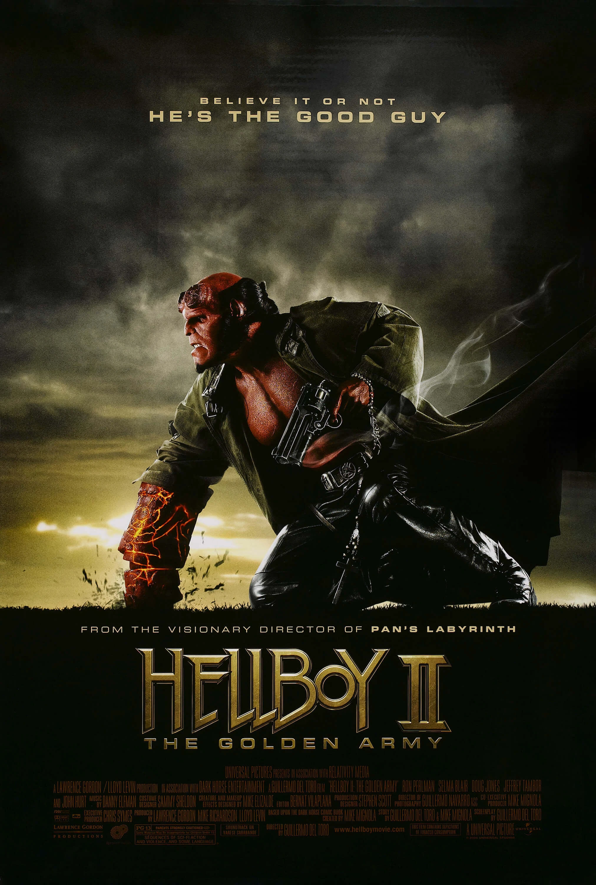

***Hellboy II: The Golden Army*** is a 2008 American fantasy action horror film directed by [Guillermo del Toro](/entry/Guillermo_del_Toro), starring [Ron Perlman](/entry/Ron_Perlman), [Selma Blair](/entry/Selma_Blair) and [Doug Jones](/entry/Doug_Jones), and loosely based upon the Dark Horse comic book series *[Hellboy](/entry/Hellboy_%28series%29)* by [Mike Mignola](/entry/Mike_Mignola). It is the sequel to 2004’s *[Hellboy](/entry/Hellboy_%282004_film%29)*, also directed by del Toro and starring Perlman.

In the film, [Hellboy](/entry/Hellboy_%282004%E2%80%932008_film_character%29) and the [B.P.R.D.](/entry/Bureau_for_Paranormal_Research_and_Defense) must prevent a rebellious elven prince from awakening an unstoppable clockwork army that can be used to wipe out humanity and return the world to magical creatures.

While a third film was planned by del Toro, no further installments were produced.

## Plot

During Christmas 1955, a young [Hellboy](/entry/Hellboy_%282004%E2%80%932008_film_character%29) is told a bedtime story by his adoptive father, [Trevor Bruttenholm](/entry/Trevor_Bruttenholm), of an ancient war between human and magical creatures. After the magical creatures are driven back by the humans, the goblin blacksmiths extend an offer to Balor, king of the elves, to build him an indestructible mechanical army. Encouraged by his son Prince Nuada, Balor accepts; the Golden Army subsequently decimates humanity. Regretting his actions, Balor forms a truce with the humans, that they will keep to the cities and the magical creatures to the forests. The crown to command the Golden Army, which can only be worn by one of royal blood, is split into three pieces. Nuada, disagreeing with the truce, leaves in exile.

In the present, Nuada returns and begins gathering the pieces of the crown. He collects the first piece from an auction, killing everyone at the site by unleashing [tooth fairies](/entry/Tooth_fairy), and kills his father for the second piece. His twin sister, Princess Nuala, escapes with the final piece. Meanwhile, at the [B.P.R.D.](/entry/Bureau_for_Paranormal_Research_and_Defense), Hellboy is having issues with his girlfriend [Liz](/entry/Liz_Sherman), and dislikes that their organization must operate in secrecy. Investigating the auction slaughter, Hellboy allows himself to be revealed to the world. In the commotion, [Abe Sapien](/entry/Abraham_Sapien) discovers Liz is pregnant; she swears him to secrecy. Furious at Hellboy's actions, the Bureau's superiors send the ectoplasmic medium [Johann Kraus](/entry/Johann_Kraus) to rein him in. With Krauss in charge, the team tracks the tooth fairies to a secret market under the Brooklyn Bridge. Abe finds Nuala, who has obtained a map leading to the Golden Army, and falls in love with her. Hellboy fights and kills Nuada's accomplice Wink, and an elemental forest god that Nuada summons against him. During the fight Nuada questions why he fights for the humans when they have driven the magical creatures into hiding, of which he too is one. Nuala is taken under the B.P.R.D.'s protection.

Nuada tracks his sister to the B.P.R.D. headquarters using their magical bond, which causes them to share wounds and read each other's thoughts. Nuala hides the final crown piece before Nuada finds her, and he battles Hellboy. Nuada critically wounds Hellboy with his spear and abducts Nuala, promising her return in exchange for the crown piece. Unable to remove the spear shard in his wound, Liz, Abe, and Krauss take Hellboy to the Golden Army's location in the Giants Causeway in Northern Ireland. They encounter the Bethmoora goblin master blacksmith who brings them before the Angel of Death to retrieve the spear shard. Though warned Hellboy will doom humanity if he lives, and that she will suffer the most from it, Liz pleads for Hellboy's life. The Angel removes the shard from Hellboy's chest and tells Liz to give him a reason to live. She reveals to Hellboy that he will be a father, and he recovers.

The goblin leads the team to the resting place of the Golden Army, where Nuada awaits them. Abe gives him the last piece of the crown and Nuada awakens the Golden Army, and commands them to kill the team. Hellboy challenges Nuada for the right to command the army; as Hellboy is a member of Hell's royal family, Nuada must accept the challenge. Hellboy defeats Nuada and spares his life, but Nuada tries stabbing him. Nuala commits suicide to stop her brother; the dying Nuada tells Hellboy he will have to choose whether humanity or magical beings must die. Abe psychically shares his feelings with Nuala before she dies. Liz melts the crown apart, deactivating the Golden Army. Hellboy, Liz, Abe, and Johann resign from the B.P.R.D., and Hellboy contemplates his future life with Liz and their baby. Liz corrects «babies», revealing that she is pregnant with twins.

## Cast

- [Ron Perlman](/entry/Ron_Perlman) as [Hellboy](/entry/Hellboy_%282004%E2%80%932008_film_character%29)
- [Selma Blair](/entry/Selma_Blair) as [Liz Sherman](/entry/Liz_Sherman)
- [Doug Jones](/entry/Doug_Jones) as [Abe Sapien](/entry/Abraham_Sapien), the [Angel of Death](/entry/Angel_of_Death), and the Chamberlain
- John Alexander and James Dodd as [Johann Krauss](/entry/Johann_Kraus)
  - Alexander also portrays the legless Bethmoora Goblin
  - [Seth MacFarlane](/entry/Seth_MacFarlane) as the voice of Johann Krauss
- [Luke Goss](/entry/Luke_Goss) as [Prince Nuada](/entry/Prince_Nuada)
- [Anna Walton](/entry/Anna_Walton) as [Princess Nuala](/entry/Princess_Nuala)
- [Jeffrey Tambor](/entry/Jeffrey_Tambor) as [Tom Manning](/entry/Tom_Manning)
- [John Hurt](/entry/John_Hurt) as [Trevor Bruttenholm](/entry/Trevor_Bruttenholm)
- Brian Steele as [Mr. Wink](/entry/Mr._Wink), the [Fragglewump](/entry/Fragglewump), the [Cronie Troll](/entry/Cronie_Troll) and Cathedral Head
- Andrew Hefler as Agent Flint
- Ivan Kamaras as Agent Steel
- Mike Kelley as Agent Marble
- Jeremy Zimmermann as Auctioneer

## Production

The film *[Hellboy](/entry/Hellboy_%282004_film%29)* was released theatrically on April 2, 2004. Shortly afterwards, iIn May 2004, a sequel entered development at Revolution Studios with the first film's writer-director [Guillermo del Toro](/entry/Guillermo_del_Toro) returning with producers Lawrence Gordon, Mike Richardson, and Lloyd Levin. [Mike Mignola](/entry/Mike_Mignola), creator of the comic [character](/entry/Hellboy_%28character%29) and [series](/entry/Hellboy_%28series%29), was asked to develop a story with del Toro for the sequel, with actor [Ron Perlman](/entry/Ron_Perlman) to reprise the title role.[1] The following September, del Toro expressed interest in making *Hellboy* into a trilogy with Mignola, with the first sequel slated for a 2006 release.[2]

In August 2006, *Hellboy II* was orphaned by then-defunct Revolution Studios, and Universal Pictures acquired the project to be slotted for a summer 2008 release. Production was slated to begin in April 2007 in Budapest and London.[3] Del Toro, who had been in negotiations to film *Halo*, instead chose to stay with *Hellboy II* for "artistic and personal reasons."[4] In October 2006, del Toro shared his plan to recreate the classic versions of Frankenstein, Dracula and The Wolf Man as antagonists for the film.[5] The director also reiterated plans for a third *Hellboy* to create a trilogy.[6]

With the success of del Toro's *Pan's Labyrinth*, the director was able to fast-track production of the sequel to *Hellboy*.[7] *Hellboy II* began filming in June 2007 in Budapest and concluded in December of that year.[8] The official trailer for *Hellboy II* was made available on Thursday, December 20th.

In February 2007, Mignola described the story he had developed with del Toro as one that focused on folklore and fairy tales, rather than the more pulp elements of the first film.

## Tie-in Comic

In January 2008, a 12-page promotional comic named *[The Golden Army](/entry/The_Golden_Army_%28promo%29)* was released.

## Gallery

## Trivia

- Doug Jones is rumored to have done all his own stunts for this movie. This was attributed to his athletic ability in gymnastics.
- Neil Gaiman spent several days on the set to get pointers on directing from [Guillermo del Toro](/entry/Guillermo_del_Toro) for use in his own upcoming directorial debut, *Death and Me*.[9]

## References

<references />

## Links

- [Official site and trailer](http://www.hellboymovie.com/)
- [*Hellboy II: The Golden Army*](http://www.imdb.com/title/tt0411477/) at the Internet Movie Database

[1] ['Hellboy II'' Confirmed!](http://movies.ign.com/articles/515/515970p1.html) Stax, ign.com, 2004-05-14

[2] [Guillermo, Blair Talk *Hellboy* Sequel](http://movies.ign.com/articles/544/544125p1.html) Brian Linder, ign.com, 2004-09-02

[3] ['Hellboy' in U turn](http://www.variety.com/article/VR1117947953.html?categoryid=1350&cs=1) Michael Fleming, *Variety*, 2006-08-03

[4] [Tyro helmer wears 'Halo'](http://www.variety.com/article/VR1117948239.html?categoryid=1236&cs=1) Gabriel Snyder, *Variety*, 2006-08-09

[5] [Exclusive: Hellboy vs. the Universal Monsters?](http://movies.ign.com/articles/739/739203p1.html) Scott Collura, ign.com, 2006-10-16

[6] [Exclusive: *Hellboy 2* Leads to *Hellboy 3*](http://movies.ign.com/articles/739/739228p1.html) Scott Collura, ign.com, 2006-10-16

[7] [*Pan's Labyrinth* Duo Use Oscar Clout To Make *Hellboy II* Their Way](http://www.vh1.com/movies/news/articles/1552289/20070212/story.jhtml) Larry Carroll, vh1, 2007-02-13 (archived)

[8] [‘HELLBOY 2’ UPDATE](http://www.wizarduniverse.com/magazine/wizard/005779781.cfm) Andy Serwin, Wizard Entertainment, 2007-08-28

[9] [Del Toro Wants Gaiman On *Death*](http://www.scifi.com/scifiwire/index.php?category=0&id=45051)
