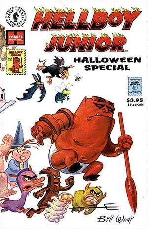
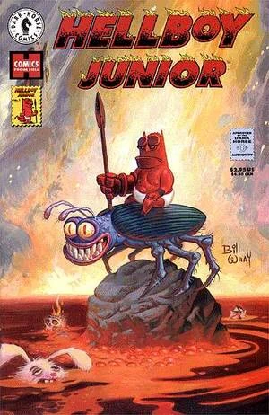
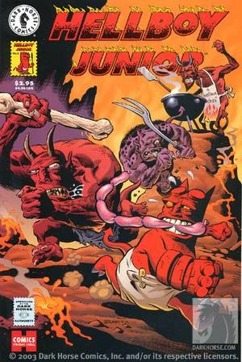
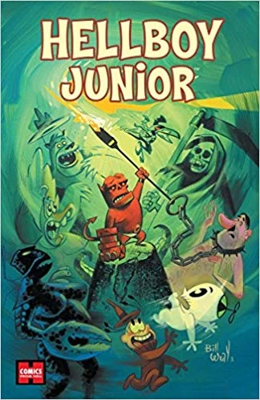

***Hellboy Junior*** is a non-canonical, adult humor comic book series published by [Dark Horse Comics](/entry/Dark_Horse_Comics), written by [Bill Wray](/entry/Bill_Wray) and [Mike Mignola](/entry/Mike_Mignola), with art provided by both in addition to a number of other artists.

Most of the stories contained within *Hellboy Junior* star a young [Hellboy](/entry/Hellboy_(character)) living in [Hell](/entry/Hell) during his formative years. These stories take place before he was summoned to earth as part of [Project Ragna Rok](/entry/Project_Ragna_Rok) during which he lost his memories. As such, his personality, temperament and morals do not align with those he possesses following [Trevor Bruttenholm](/entry/Trevor_Bruttenholm) raising him. Hellboy Junior is partially a parody of the Harvey Comics character Hot Stuff, and several back-up stories are based on other Harvey characters.

## Issues

*Hellboy Junior* was published as a one shot that was then followed, two years later, by a two issue mini-series. Each of the three issues is made up of a number of stories, some are interconnected while others are standalone.

Issue
Published
Cover
Story
Writer(s)
Artist(s)
Additional Materials

&#10;
Halloween Special
October 15, 1997

BILL WRAY
Maggots, Maggots, Everywhere
Bill Wray
Pin-up by Kevin Nowlan

Wheezy The Sick Little Witch
Bill Wray
Stephen DeStefano

The Ginger-Beef Boy
Bill Wray
Hilary Barta

The Creation of Hellboy Jr.
Bill Wray &amp; Mike Mignola

Somnambo The Sleeping Giant
Bill Wray
Dave Cooper

The Devil Don’t Smoke
Bill Wray &amp; Mike Mignola
Mike Mignola

1
October 20, 1999

BILL WRAY
Magical Mushroom Trip
Bill Wray
Dave Cooper
Pin-ups by Glenn Barr &amp; Stephen DeStefano

The Wolvertons
Bill Wray
Pat McEown

Squid of Man
Bill Wray
Mike Mignola

2
November 17, 1999

HILARY BARTA
The House of Candy Pain
Bill Wray
Hilary Barta
Pin-up by Stephen DeStefano

Sparky Bear
Bill Wray

Baby Huey parody
Bill Wray
Stephen DeStefano

Hellboy Jr. Gets a Car
Mike Mignola

## Trade Paperback

Three years after the release of *Hellboy Junior \#2*, a trade paperback was published. The trade paperback collected all the stories and pin-ups of the individual issues. Additionally, it includes a new story, *[Hellboy Jr. vs Hitler](/entry/Hellboy_Jr._vs_Hitler)*, written and drawn by [Bill Wray](/entry/Bill_Wray).

Title
Date Published
Cover
Material Collected
Additional Materials

&#10;
Hellboy Junior
January 21, 2004

BILL WRAY

<li>Hellboy Junior Halloween Special</li>
<li>Hellboy Junior #1-2</li>
<li>Hellboy Jr. vs Hitler</li>

<li>Foreword by Steve Niles</li>
<li>Six Page Sketchbook</li>

## External Links

- Hellboy Junior Halloween Special product page on DarkHorse.com
- Hellboy Junior #1 product page on DarkHorse.com
- Hellboy Junior #2 product page on DarkHorse.com
- Hellboy Junior Collection product page on DarkHorse.com
