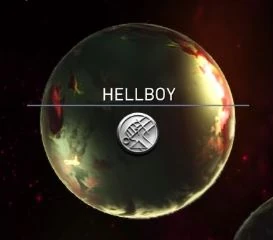

Hellboy has a Legendary Multiverse in [Injustice 2](/entry/Injustice_2).

## Description

Acoss the Multiverse, Monsters fear the name "Hellboy". then there is Atrocitus of Ryut 5842. His rage burns his fears away. He is a monster that does not fear you. Put him Down.

### EVENT ONE: PRICELESS

Atrocitus of Ryut 5842 put a price on your head. Not cool. Handle these freaks.

### EVENT TWO: NO MATCH

You were enjoying a nice cigar when these goons showed up. Sock 'em in the jaw.

### EVENT THREE: DEMON DUEL

Atrocitus put a cramp in your style today. Show this wannabe what a real demon can do.

### BONUS EVENT: RAISING HELL

You have proven yourself to be a true legend of the Multiverse, now reap the benefits of your labor.

### FINAL EVENT: NOT INTO IT

Harley wants to know if you'll join her gang. Answer her with a pair of cuffs.

## Characters

[Hellboy](/entry/Hellboy_(Injustice))

Atrocitus of Ryut-5842

Harley Quinn of Earth-5842

## Gallery
