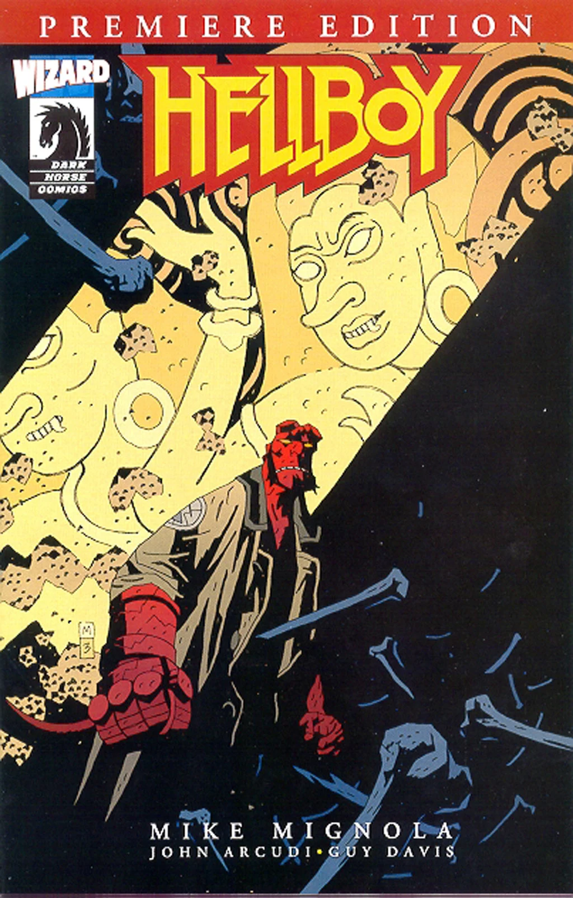
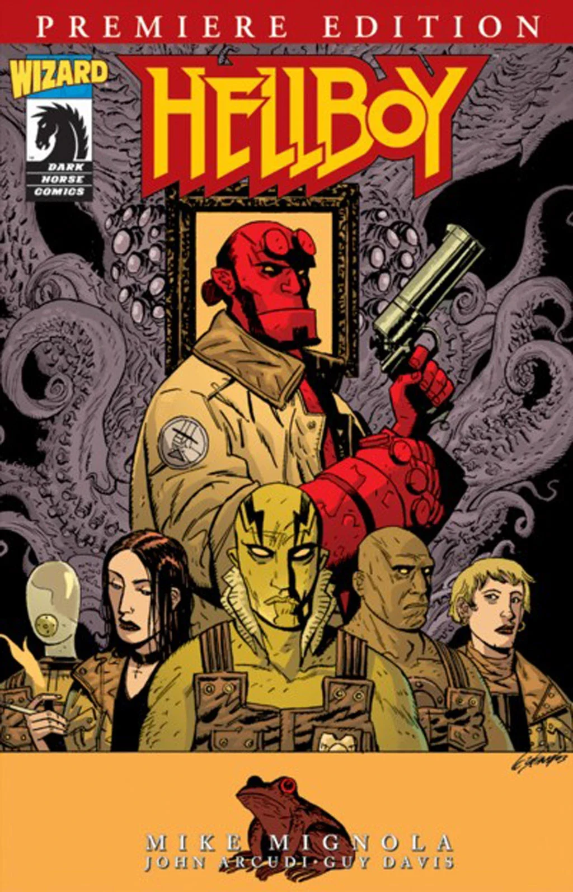
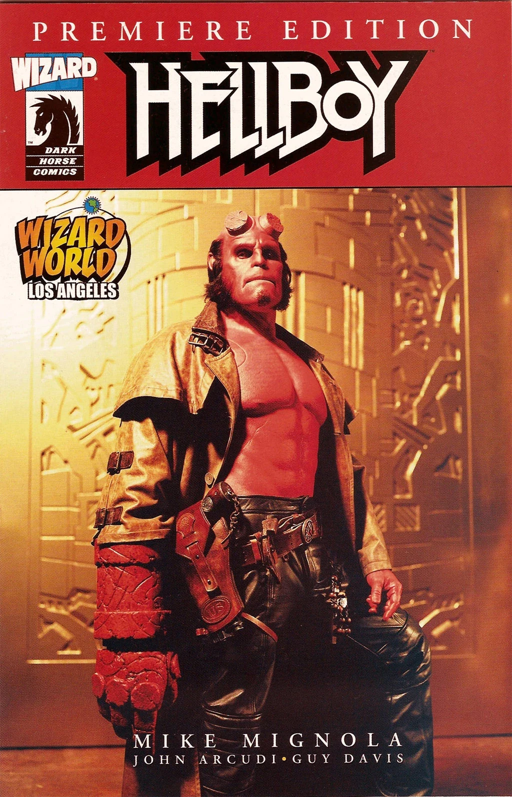

***Hellboy Premiere Edition*** is an exclusive comic published through *Wizard* magazine \#148. It contains two new Hellboy Universe stories: *[Hellboy](/entry/Hellboy_%28series%29)* story *[The Penanggalan](/entry/The_Penanggalan)* and *[B.P.R.D.](/entry/B.P.R.D._%28series%29)* story *[Born Again](/entry/Born_Again)*. The issue was published with 3 covers, one by [Mike Mignola](/entry/Mike_Mignola) showing an image from *The Penanggalan*, one by [Guy Davis](/entry/Guy_Davis) showing the members of the [B.P.R.D.](/entry/B.P.R.D.) and Hellboy, and a cover exclusive to the Los Angeles Wizard World showing a picture of [Ron Perlman](/entry/Ron_Perlman) as [Hellboy](/entry/Hellboy_%28character%29).

## Gallery

 Mignola cover

 Davis cover

 Angeles Wizard World exclusive cover
