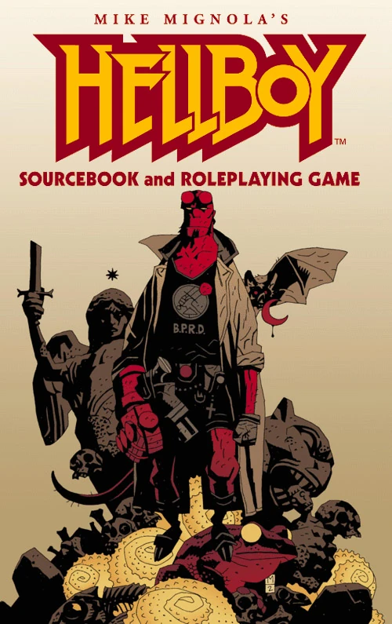

The ***Hellboy Sourcebook and Roleplaying Game*** was written by Phil Masters and Jonathan Woodward and published by Steve Jackson Games. It was a tabletop roleplaying game built on the Generic Universal Role Playing System (GURPS), Third Edition, focusing on the Lite ruleset.

The game included two new stories:

- *Dakini*, a prose story by [Christopher Golden](/entry/Christopher_Golden)
- *[The Kabandha](/entry/The_Kabandha)*, a comic by Jai Nitz, Philip Reed, and [Zach Howard](/entry/Zach_Howard) with assistance from [Mike Mignola](/entry/Mike_Mignola)

Additionally, a flyer in comic format was produced to promote the Sourcebook:

- *[The Astromagnet](/entry/The_Astromagnet)*, a comic by Jai Nitz, Philip Reed, and [Peter Bergting](/entry/Peter_Bergting)
