In addition to [the comics](/entry/Hellboy_%28series%29), the Hellboy Universe is also explored in a line of prose novels and a number of short fiction stories.

## Novels

To date there have been eleven original novels published in the "Hellboy Universe", ten under the *[Hellboy](/entry/Hellboy_%28series%29)* publication line and one under the *[Lobster Johnson](/entry/Lobster_Johnson_%28series%29)* publication line. Additionally, the first two *Hellboy* films, *[Hellboy](/entry/Hellboy_%282004_film%29)* and *[Hellboy II: The Golden Army](/entry/Hellboy_II__The_Golden_Army)*, each have a novelization.

### Original Novels

Title
Date Published
Author
Cover

<tbody>

<em>[Hellboy: The Lost Army](/entry/Hellboy__The_Lost_Army)</em>
June 1, 1997 
February 4, 2020 (audiobook)<a href="#fn1" class="footnote-ref" id="fnref1" role="doc-noteref">1</a>
Christopher Golden 
<em>with illustrations by</em> 
Mike Mignola
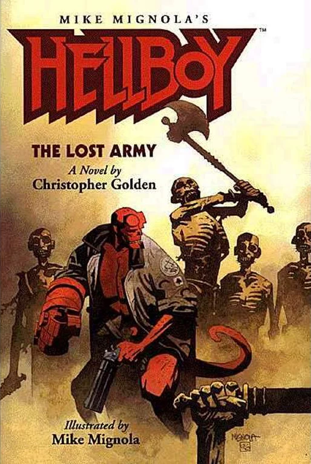MIKE MIGNOLA

<em>[Hellboy: The Bones of Giants](/entry/Hellboy__The_Bones_of_Giants_%28prose_novel%29)</em>
December 5, 2001 
February 25, 2020 (audiobook)<a href="#fn2" class="footnote-ref" id="fnref2" role="doc-noteref">2</a>
Christopher Golden 
<em>with illustrations by</em> 
Mike Mignola
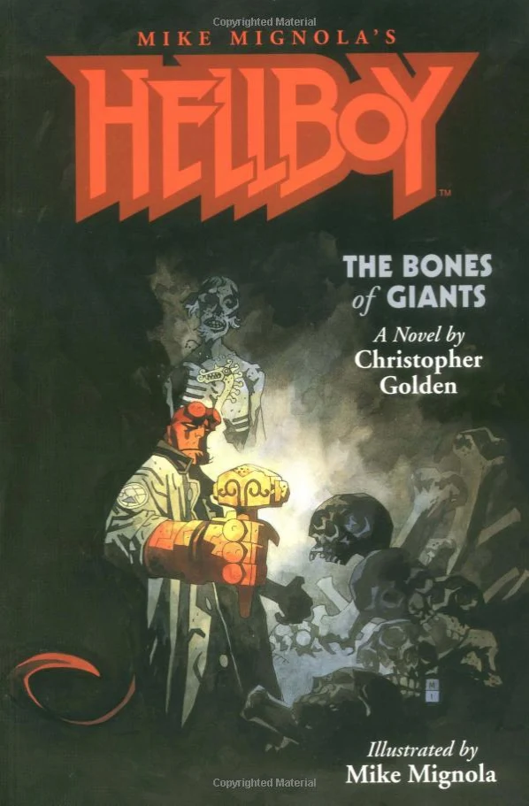MIKE MIGNOLA

<em>[Hellboy: On Earth as it is in Hell](/entry/Hellboy__On_Earth_as_it_is_in_Hell)</em>
September, 2005
Brian Hodge
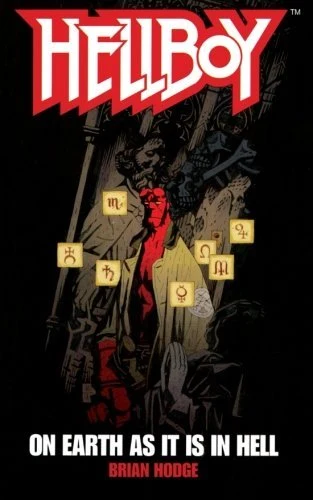MIKE MIGNOLA

<em>[Hellboy: Unnatural Selection](/entry/Hellboy__Unnatural_Selection)</em>
March, 2006
Tim Lebbon
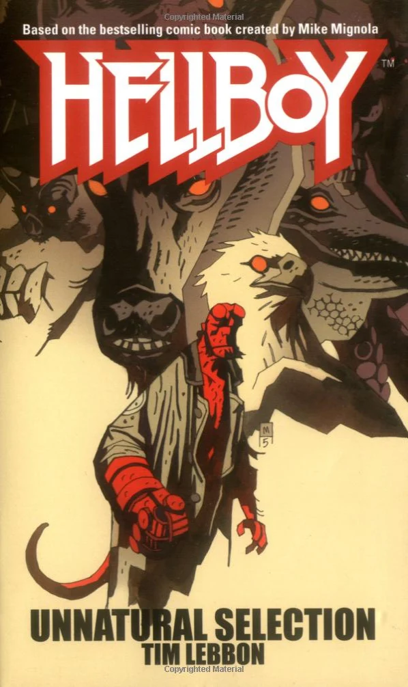MIKE MIGNOLA

<em>[Hellboy: The God Machine](/entry/Hellboy__The_God_Machine)</em>
July, 2006
Thomas E. Sniegoski
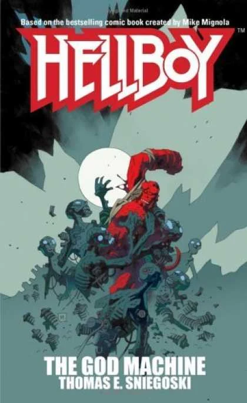MIKE MIGNOLA

<em>[Hellboy: The Dragon Pool](/entry/Hellboy__The_Dragon_Pool)</em>
March, 2007
Christopher Golden
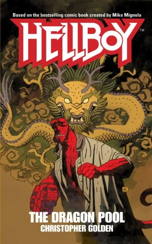MIKE MIGNOLA

<em>[Hellboy: Emerald Hell](/entry/Hellboy__Emerald_Hell)</em>
February 13, 2008 
March 17, 2020 (audiobook)<a href="#fn3" class="footnote-ref" id="fnref3" role="doc-noteref">3</a>
Tom Piccirilli
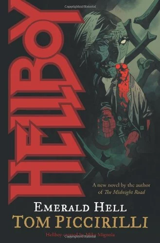MIKE MIGNOLA

<em>[Hellboy: The All-Seeing Eye](/entry/Hellboy__The_All-Seeing_Eye)</em>
October 22, 2008 
April 7, 2020 (audiobook)<a href="#fn4" class="footnote-ref" id="fnref4" role="doc-noteref">4</a>
Mark Morris
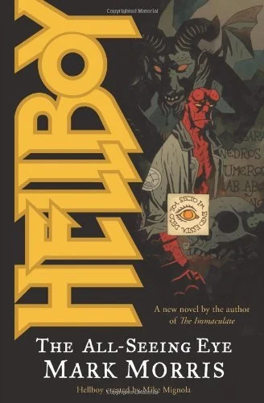MIKE MIGNOLA

<em>[Hellboy: The Fire Wolves](/entry/Hellboy__The_Fire_Wolves)</em>
April 1, 2009 
April 14, 2020 (audiobook)<a href="#fn5" class="footnote-ref" id="fnref5" role="doc-noteref">5</a>
Tim Lebbon
DUNCAN FEGREDO

<em>[Lobster Johnson: The Satan Factory](/entry/Lobster_Johnson__The_Satan_Factory)</em>
July 22, 2009
Thomas E. Sniegoski
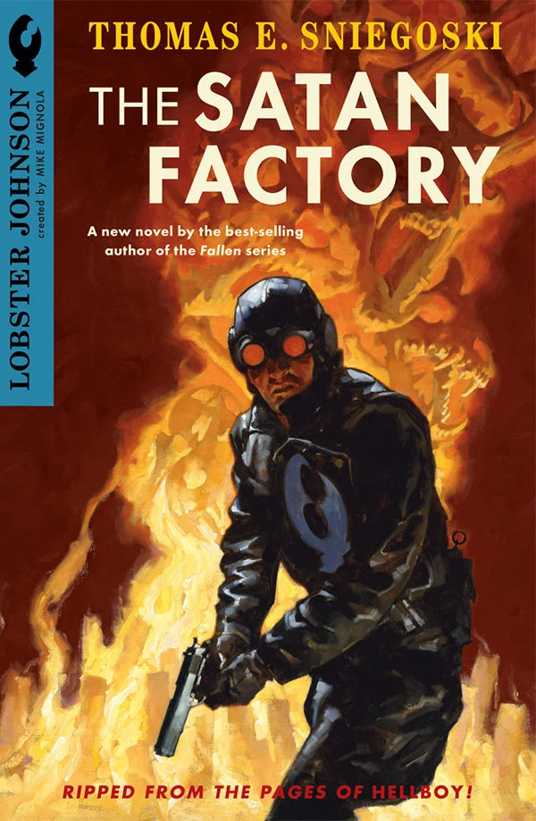GREGORY MANCHESS

<em>[Hellboy: The Ice Wolves](/entry/Hellboy__The_Ice_Wolves)</em>
September 30, 2009 
April 21, 2020 (audiobook)<a href="#fn6" class="footnote-ref" id="fnref6" role="doc-noteref">6</a>
Mark Chadbourn
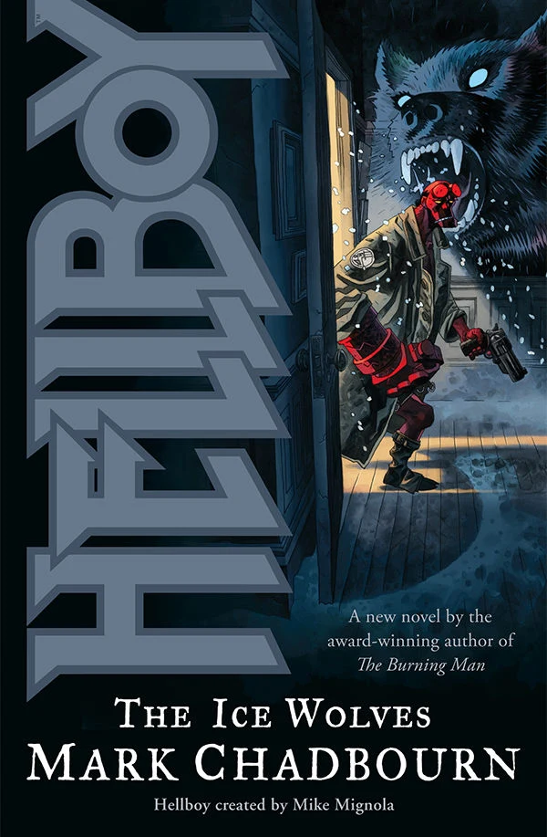DUNCAN FEGREDO

</tbody>

<aside id="footnotes" class="footnotes footnotes-end-of-document" role="doc-endnotes">

<ol>
<li id="fn1"><a href="https://www.audible.com/pd/Hellboy-The-Lost-Army-Audiobook/1690563753"><em>Hellboy: The Lost Army</em> audiobook</a><a href="#fnref1" class="footnote-back" role="doc-backlink">↩︎</a></li>
<li id="fn2"><a href="https://www.audible.com/pd/Hellboy-The-Bones-of-Giants-Audiobook/1690565551"><em>Hellboy: The Bones of Giants</em> audible</a><a href="#fnref2" class="footnote-back" role="doc-backlink">↩︎</a></li>
<li id="fn3"><a href="https://www.audible.com/pd/Hellboy-Emerald-Hell-Audiobook/1690590394"><em>Hellboy: Emerald Hell</em> audible</a><a href="#fnref3" class="footnote-back" role="doc-backlink">↩︎</a></li>
<li id="fn4"><a href="https://www.audible.com/pd/Hellboy-The-All-Seeing-Eye-Audiobook/1690592141"><em>Hellboy: The All-Seeing Eye</em> audiobook</a><a href="#fnref4" class="footnote-back" role="doc-backlink">↩︎</a></li>
<li id="fn5"><a href="https://www.audible.com/pd/Hellboy-The-Fire-Wolves-Audiobook/1690592087"><em>Hellboy: The Fire Wolves</em> audiobook</a><a href="#fnref5" class="footnote-back" role="doc-backlink">↩︎</a></li>
<li id="fn6"><a href="https://www.audible.com/pd/Hellboy-The-Ice-Wolves-Audiobook/1690592028"><em>Hellboy: The Ice Wolves</em> audiobook</a><a href="#fnref6" class="footnote-back" role="doc-backlink">↩︎</a></li>
</ol>
</aside>

### Film Novelizations

Title
Film
Author
Date Published
Cover

<tbody>

<em>Hellboy</em>
<em>[Hellboy](/entry/Hellboy_%282004_film%29)</em>
Yvonne Navarro
March 2004

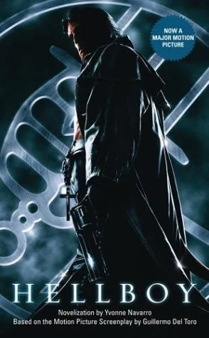
Hellboy_novelization_cover.jpg

<em>Hellboy II: The Golden Army</em>
<em>[Hellboy II: The Golden Army](/entry/Hellboy_II__The_Golden_Army)</em>
Robert Greenberger
June 18, 2008

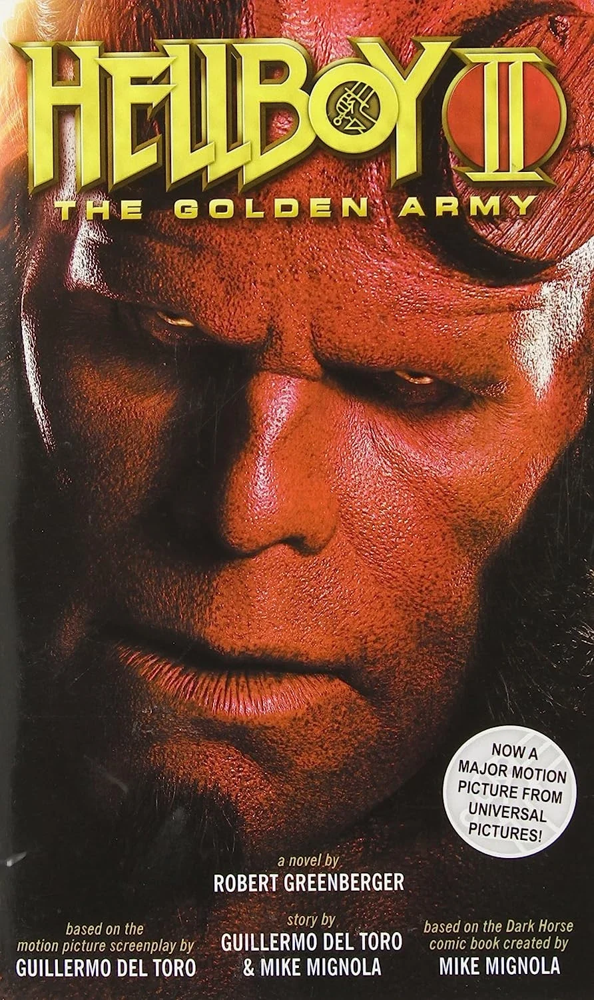
Hellboy_II_novelization_cover.jpg

</tbody>

## Short Fiction

The bulk of short fiction from the Hellboy Universe is collected in a series of anthologies. However, two short stories have been included in other publications.

### Anthology Collections

The anthology collections were all edited by Christopher Golden.

Title
Cover
Date Published
Story
Author(s)

<tbody>

<em>[Hellboy: 
Odd Jobs](/entry/Hellboy__Odd_Jobs)</em>
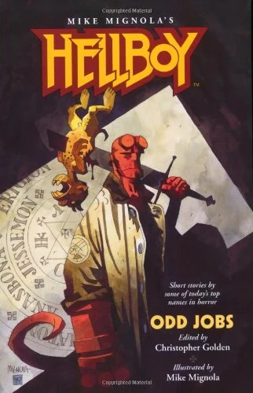MIKE MIGNOLA
December 15, 1999 
February 11, 2020 (audiobook)<a href="#fn1" class="footnote-ref" id="fnref1" role="doc-noteref">1</a>
<em>Medusa's Revenge</em>
Yvonne Navarro

<em>Jigsaw</em>
Stephen Bissette

<em>A Mother Cries at Midnight</em>
Philip Nutman

<em>Delivered</em>
Greg Rucka

<em>Folie á Deux</em>
Nancy Holder

<em>Demon Politics</em>
Craig Shaw Gardner

<em>A Grim Fairy Tale</em>
Nancy A. Collins

<em>Scared Crows</em>
Rick Hautala 
<em>and</em> Jim Connolly

<em>Where Their Fire Is Not Quenched</em>
Chet Williamson

<em>I Had Bigfoot's Baby!</em>
Max Allan Collins

<em>The Nuckelavee</em>
Christopher Golden 
<em>and</em> Mike Mignola

<em>A Night at the Beach</em>
Matthew J. Costello

<em>Burn, Baby, Burn</em>
Poppy Z. Brite

<em>Far Flew the Boast of Him</em>
Brian Hodge

<em>[Hellboy: 
Odder Jobs](/entry/Hellboy__Odder_Jobs)</em>
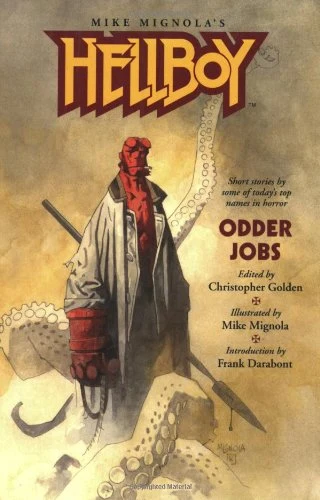MIKE MIGNOLA
October 6, 2004 
March 10, 2020 (audiobook)<a href="#fn2" class="footnote-ref" id="fnref2" role="doc-noteref">2</a>
<em>The Brotherhood of the Gun</em>
Frank Darabont

<em>From an Enchanter Fleeing</em>
Peter Crowther

<em>Down in the Flood</em>
Scott Allie

<em>Newford Spook Squad</em>
Charles de Lint

<em>Water Music</em>
David J. Schow

<em>The Vampire Brief</em>
James L. Cambias

<em>Unfinished Business</em>
Ed Gorman 
<em>&amp;</em> Richard Dean Starr

<em>Saint Hellboy</em>
Tom Piccirilli

<em>Sleepless in Manhattan</em>
Nancy Kilpatrick

<em>The Wish Hounds</em>
Sharyn McCrumb

<em>Act of Mercy</em>
Thomas E. Sniegoski

<em>The Thrice-Named Hill</em>
Graham Joyce

<em>Of Blood, of Clay</em>
James A. Moore

<em>A Full and Satisfying Life</em>
Ray Garton

<em>The Glass Road</em>
Tim Lebbon

<em>Tasty Teeth</em>
Guillermo del Toro 
<em>&amp;</em> Matthew Robbins

<em>[Hellboy: 
Oddest Jobs](/entry/Hellboy__Oddest_Jobs)</em>
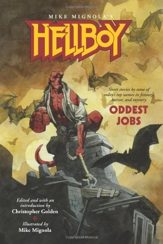MIKE MIGNOLA
July 9, 2008 
March 24, 2020 (audiobook)<a href="#fn3" class="footnote-ref" id="fnref3" role="doc-noteref">3</a>
<em>Jiving with Shadows and Dragons and Long, Black Trains</em>
Joe R. Lansdale

<em>Straight, No Chaser</em>
Mark Chadbourn

<em>Second Honeymoon</em>
John Skipp 
<em>&amp;</em> Cody Goodfellow

<em>Danny Boy</em>
Ken Bruen

<em>Strange Fishing in the Western Highlands</em>
Garth Nix

<em>Salamander Blues</em>
Brian Keene

<em>The Thursday Men</em>
Tad Williams

<em>Produce</em>
Amber Benson

<em>Repossession</em>
Barbara Hambly

<em>In Cupboards and Bookshelves</em>
Gary A. Braunbeck

<em>Feet of Sciron</em>
Rhys Hughes

<em>Monster Boy</em>
Stephen Volk

<em>Evolution and Hellhole Canyon</em>
Don Winslow

<em>A Room of One's Own</em>
China Miéville

<em>[Hellboy: 
An Assortment of Horrors](/entry/Hellboy__An_Assortment_of_Horrors)</em>
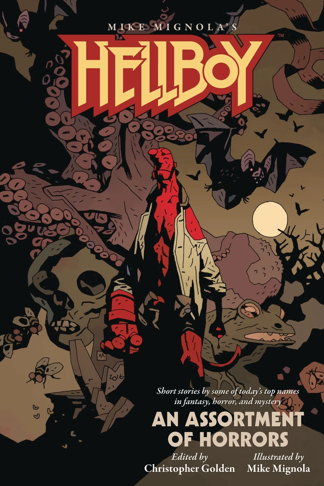MIKE MIGNOLA
August 16, 2017 
January 28, 2020 (audiobook)<a href="#fn4" class="footnote-ref" id="fnref4" role="doc-noteref">4</a>
<em>The Promised Smile</em>
Rio Youers

<em>When Doves Cry</em>
Delilah S. Dawson

<em>The Other Side of Summer</em>
Chris Roberson

<em>The Hellboyness of Hellboy</em>
Chris Priestley

<em>One More Radical Stone Fox</em>
Chelsea Cain

<em>The Duelist</em>
Jonathan Maberry

<em>A Quiet Night in the Library</em>
E. Lily Yu

<em>Fire Is the Devil’s Only Friend</em>
Michael Rowe

<em>A Huge Damn Vampire</em>
Richard Kadrey

<em>The Other Government Guys</em>
Weston Ochse

<em>Her Red Right Hand</em>
Paul Tremblay

<em>To Bell the Cat</em>
Angela Slatter

<em>Versteckdt</em>
Kealan Patrick Burke

<em>Of Boys and Two-headed Dogs</em>
Laird Barron

<em>Burning Girls</em>
Seanan Mcguire

<em>Tales of the Worm Lord</em>
Nathan Ballingrud

</tbody>

<aside id="footnotes" class="footnotes footnotes-end-of-document" role="doc-endnotes">

<ol>
<li id="fn1"><a href="https://www.audible.com/pd/Hellboy-Odd-Jobs-Audiobook/1690565616"><em>Hellboy: Odd Jobs</em> audiobook</a><a href="#fnref1" class="footnote-back" role="doc-backlink">↩︎</a></li>
<li id="fn2"><a href="https://www.audible.com/pd/Hellboy-Odder-Jobs-Audiobook/1690590335"><em>Hellboy: Odder Jobs</em> audiobook</a><a href="#fnref2" class="footnote-back" role="doc-backlink">↩︎</a></li>
<li id="fn3"><a href="https://www.audible.com/pd/Hellboy-Oddest-Jobs-Audiobook/1690589035?qid=1583382532"><em>Hellboy: Oddest Jobs</em> audiobook</a><a href="#fnref3" class="footnote-back" role="doc-backlink">↩︎</a></li>
<li id="fn4"><a href="https://www.audible.com/pd/Hellboy-An-Assortment-of-Horrors-Audiobook/1690563818"><em>Hellboy: An Assortment of Horrors</em> audiobook</a><a href="#fnref4" class="footnote-back" role="doc-backlink">↩︎</a></li>
</ol>
</aside>

### Short Fiction Included in Other Publications

Story
Author(s)
Containing Publication
Date Published
Cover

<tbody>

<em>[Dakini](/entry/Dakini)</em>
[Christopher Golden](/entry/Christopher_Golden)
''[Hellboy Sourcebook and Roleplaying Game](/entry/Hellboy_Sourcebook_and_Roleplaying_Game)
August 2002
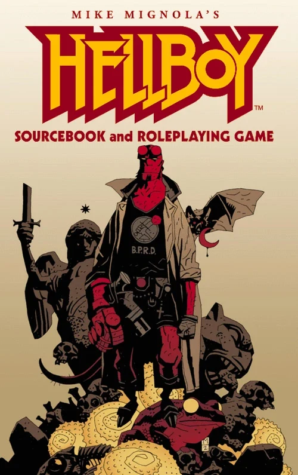MIKE MIGNOLA

<em>[The City in the Sea](/entry/The_City_in_the_Sea)</em>
[Christopher Golden](/entry/Christopher_Golden) &amp; [Mike Mignola](/entry/Mike_Mignola)
<em>Weird Tales</em> #367
May 2023
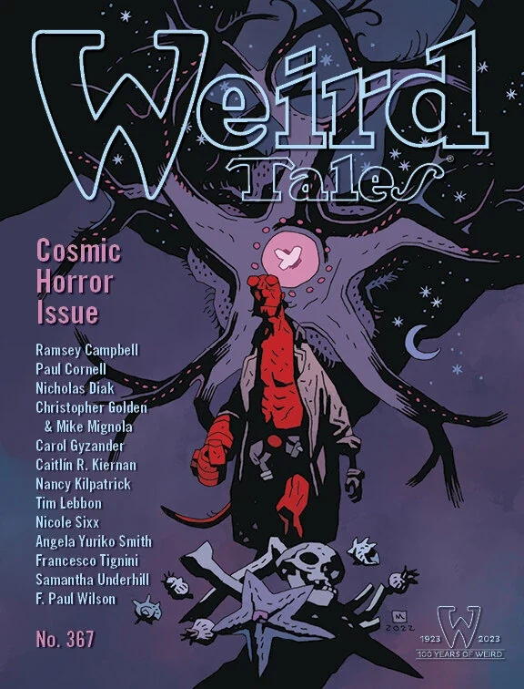MIKE MIGNOLA

</tbody>

## Canon

Author [Christopher Golden](/entry/Christopher_Golden) has written several *Hellboy* [novels](/entry/wikipedia%3ANovel). The first two, *The Lost Army* and *The Bones of Giants*, were both included in the comic's official timeline featured in *[Hellboy: The Companion](/entry/Hellboy__The_Companion)*, as was the short story *The Nuckelavee*. Additionally, the Golden-penned character [Anastasia Bransfield](/entry/Anastasia_Bransfield) was also described in *The Companion*, despite having never actually appearing in a comic at the time of its publication (though she had been referenced indirectly in *[Abe Sapien: The Drowning](/entry/The_Drowning)*).

In a 2017 interview, [Mike Mignola](/entry/Mike_Mignola), Christopher Golden, and [Chris Roberson](/entry/Chris_Roberson) discussed which of the prose stories were canon.[1] Roberson said that Ginny (from *The Other Side of Summer*) would appear in the comics in a flashback, and Golden hinted that we may see Anastasia in a future comic. Anastasia has since been incorporated into comic series, co-staring in the *[Hellboy in Love](/entry/Hellboy_in_Love)* series, while Jenny would make her comic debut in *[Fearful Symmetry](/entry/Fearful_Symmetry)*. They went on to state that the novels written by Golden along with the short fiction written by Roberson and Rio Youers should be considered canon.

Officially, the canon prose stories are:

- *[Hellboy: The Lost Army](/entry/Hellboy__The_Lost_Army)*
- *[Hellboy: The Bones of Giants](/entry/Hellboy__The_Bones_of_Giants_%28prose_novel%29)* - When asked about the changes for the [comic adaptation](/entry/The_Bones_of_Giants_%28comic_miniseries%29), Golden stated that where the prose novel and the comics conflict, the comic should be considered canon.
- *The Nuckelavee* (from *[Hellboy: Odd Jobs](/entry/Hellboy__Odd_Jobs)*)
- *[Hellboy: The Dragon Pool](/entry/Hellboy__The_Dragon_Pool)*
- *The Promised Smile* (from *[Hellboy: An Assortment of Horrors](/entry/Hellboy__An_Assortment_of_Horrors)*)
- *The Other Side of Summer* (from *[Hellboy: An Assortment of Horrors](/entry/Hellboy__An_Assortment_of_Horrors)*)
- *The City in the Sea* (from *Weird Tales \#367*)

## References

<references />

[1] <http://www.multiversitycomics.com/interviews/mignolaverse2017-part1/>
