  

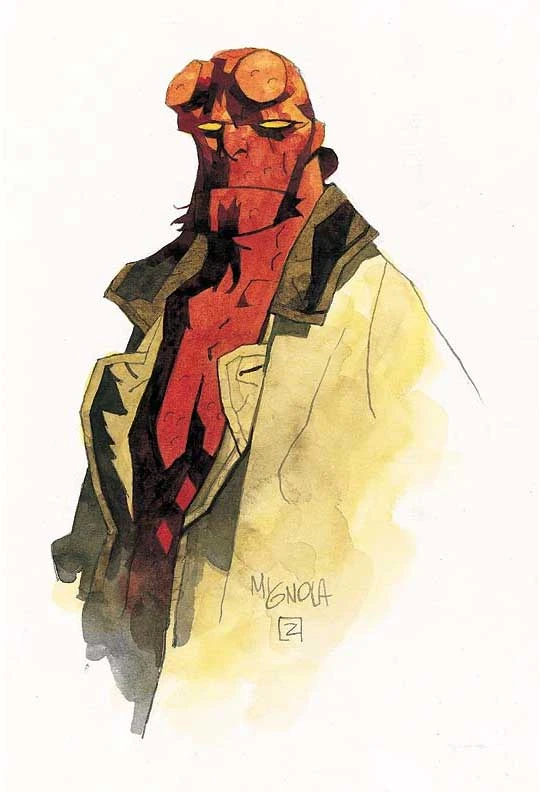

**The Hellboy Wiki** is a collaborative database for everything related to [Mike Mignola](/entry/Mike_Mignola)'s ***[Hellboy](/entry/Hellboy_(series))*** series and [its related titles](/entry/The_Hellboy_Universe_Comics), and its appearances in all other media such as films, novels, and [games](/entry/Hellboy%3A_The_Board_Game). Anyone can create and edit any page on the site, so we can all work together to create a comprehensive database. Be sure to check out the **[Help pages](https://community.fandom.com/wiki/Help:Contents)** to get started!

Over **200** stories have individual articles! This includes **every** comic featuring [Hellboy](/entry/Hellboy_(character)) as the title character. See the list **here**. For all the latest news, including the latest solicitations and links to previews for new books, head over to **The Official Hellboy Forum** on Comic Book Resources.

There are many pages that need work, especially the stub pages and clean-up pages.  
  

***Join the conversation on the Mignolaverse Discord***  
(There's even a channel specifically for discussing work on the Hellboy Wiki.)

  

|                  |
|:-----------------|
| Publishing Lines |

  

|              |
|:-------------|
| Publications |

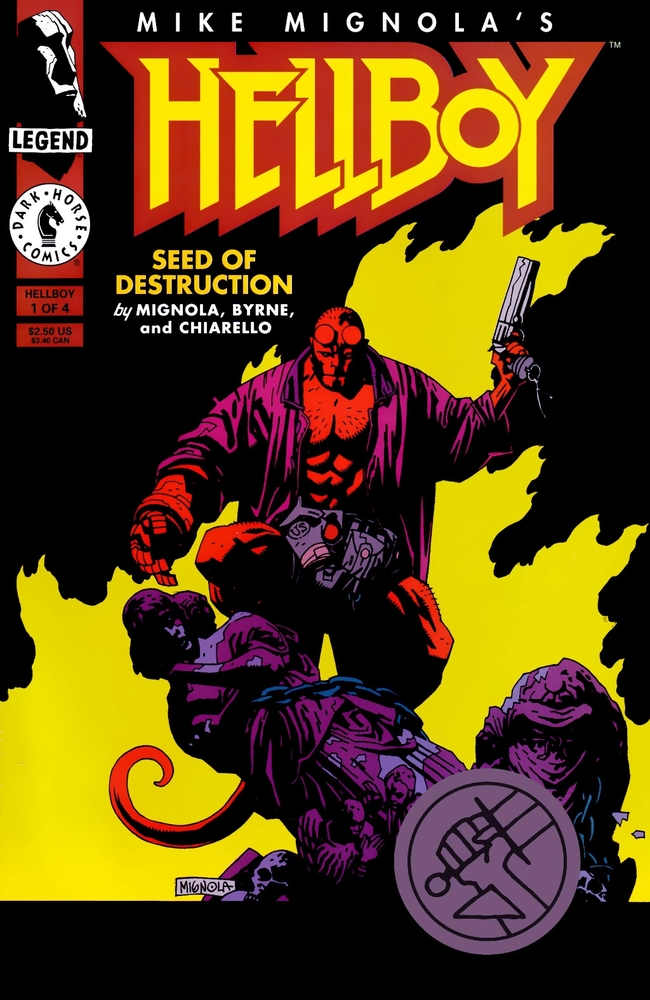

Individual Issues

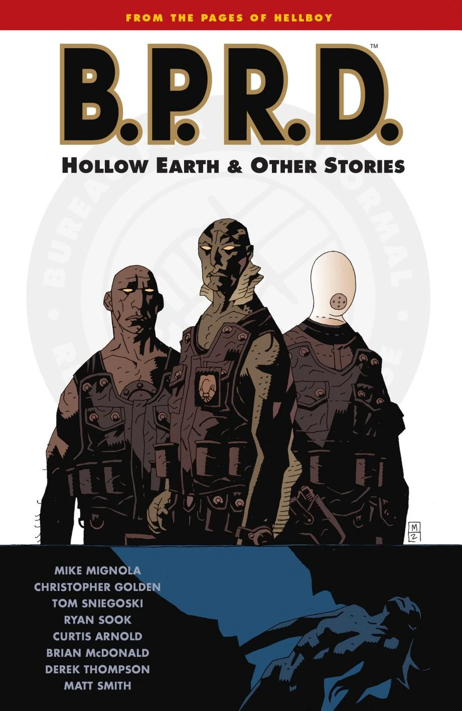

Trade Collections

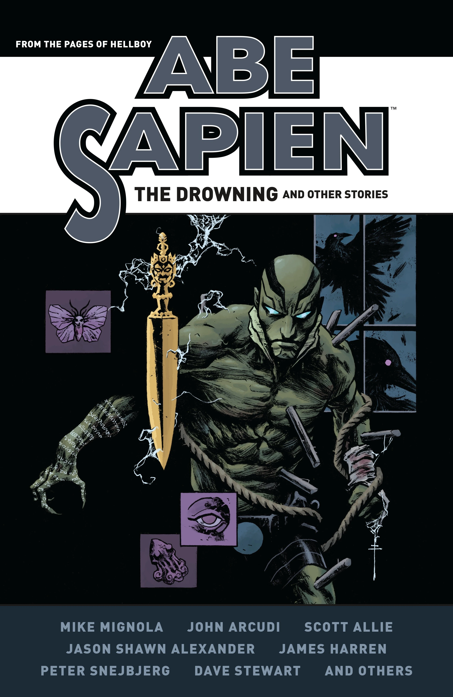

Omnibus Editions

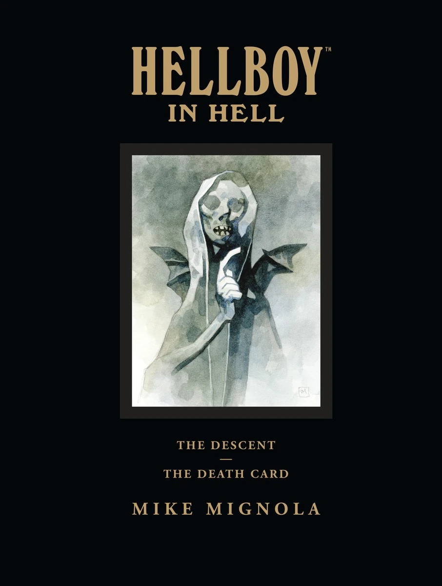

Library Editions

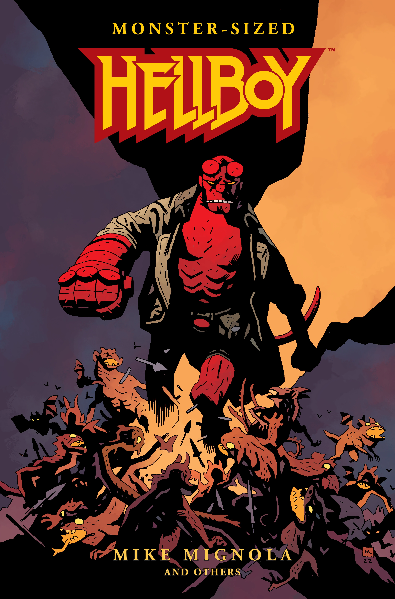

Compendium Edition

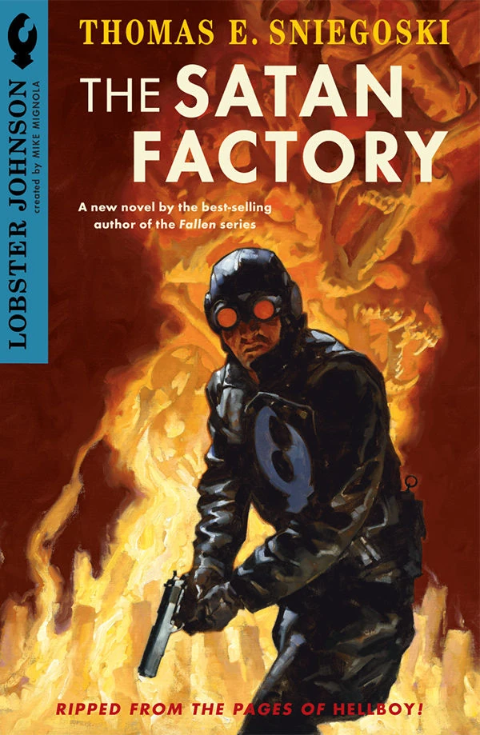.jpg)

Prose Stories

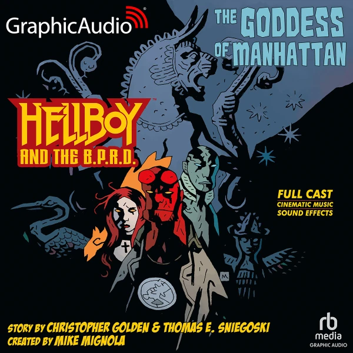

Audio Dramas

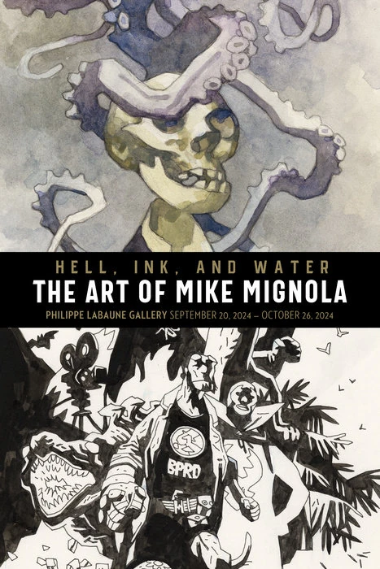

Art Books

  

|       |
|:------|
| Films |

Hellboy (2004 film)
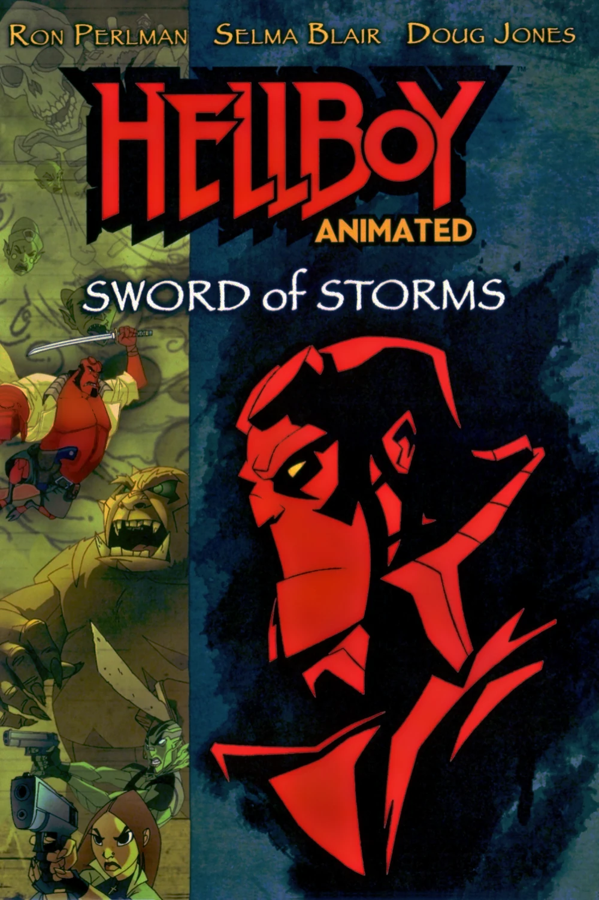
Hellboy Animated:
Sword of Storms
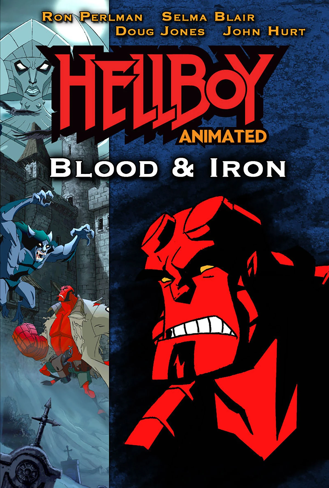
Hellboy Animated:
Blood &amp; Iron

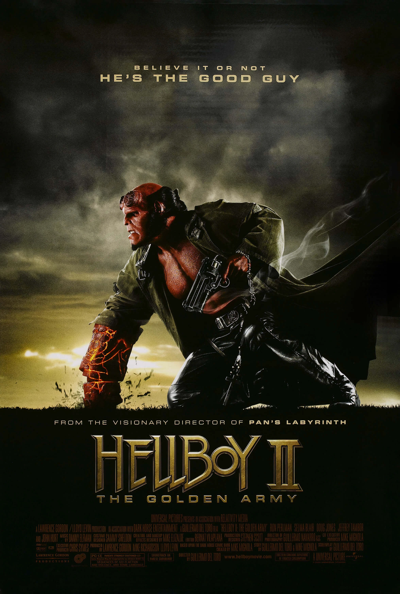
Hellboy II: The Golden Army
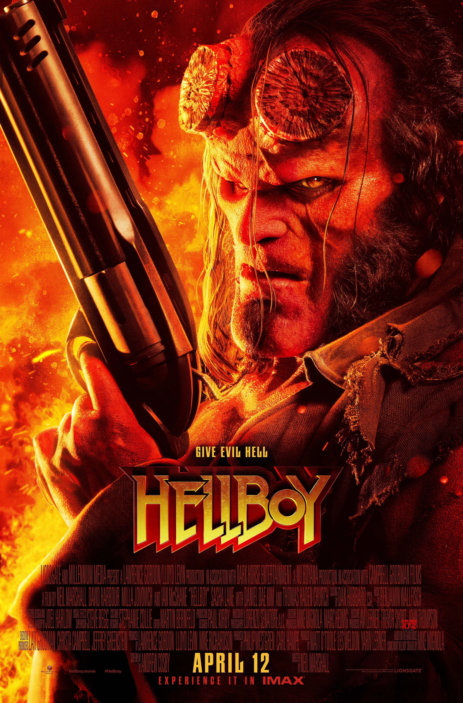
Hellboy (2019 film)

Hellboy: The Crooked Man

  

|                   |
|:------------------|
| Upcoming Releases |

|         |      |          |
|---------|------|----------|
| SINGLES |      |          |
| Cover   | Info | Creators |

COLLECTIONS

Cover
Info
Creators

&#10;
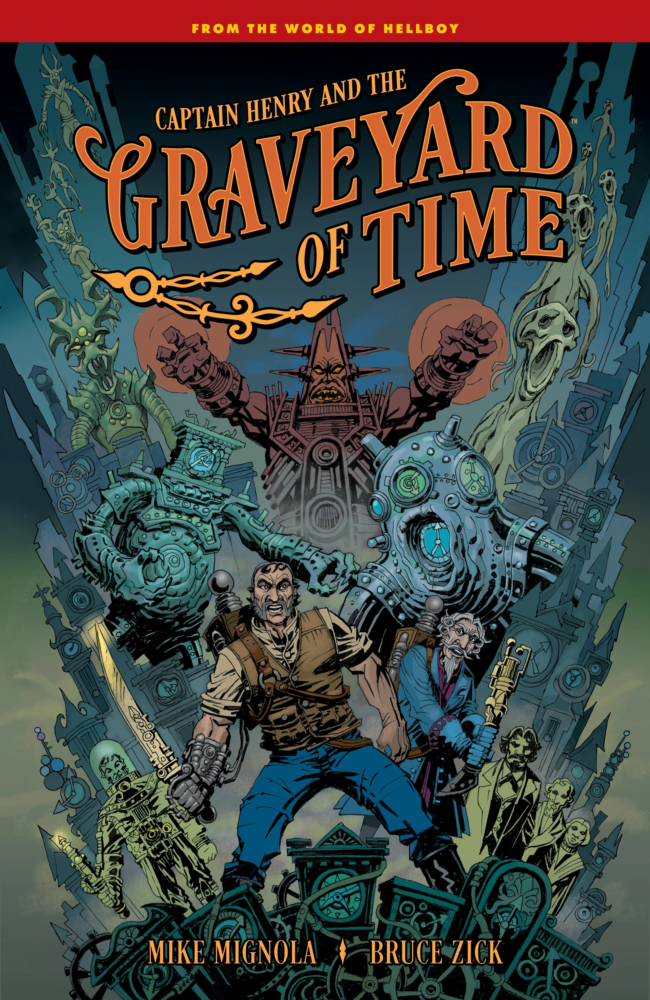
July 21, 2026

Captain Henry and the Graveyard of Time

Explore a new corner of the Hellboy comics universe in this time-traveling tale to another dimension!

On a dark night in 1880s England, the ever-adventurous Whittier family, along with Edward Grey, are attempting to send a man into the realm between reality and the Beyond to free the trapped spirit of a Whittier uncle. But his expedition into space—and time—will take him to places beyond even the Witchfinder’s knowledge.

Captain Henry and the Graveyard of Time follows an intrepid time-travelling explorer on a journey to a new dimension. He soon discovers that the monsters he encounters aren’t his only problem, as time itself might be the even greater danger.

Mike Mignola and Bruce Zick cowrite, and Zick (Thor, The Atomic Legion) draws this new series that explores an uncharted corner of the Hellboy universe!

Collects Captain Henry and the Graveyard of Time #1–4 along with bonus material.

STORY
Mike Mignola
Bruce Zick

ART
Bruce Zick

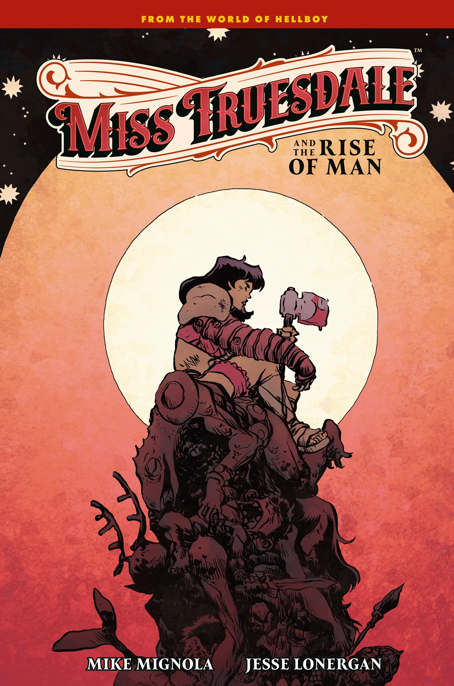
August 18, 2026

Miss Truesdale and the Rise of Man

Hellboy creator Mike Mignola and artist Jesse Lonergan continue their acclaimed Miss Truesdale saga in this new comics miniseries.

Finally at peace with her past lives, Anum Yassa now must fight to protect the future as a dark force endeavors destroy it.

The fate of mankind rests in her hands.

The secretary Miss Truesale turned gladiator Anum Yassa wanders the forest to learn about her lives—past, present, and future. Monster after monster, foe after foe, Anum Yassa fights them off—but something or someone is behind them all. The gladiator-secretary must protect the future of man before a powerful evil can stop mankind’s destiny and replace it with a darker fate—and the evil forces will not be stopped so easily.

Collects Miss Truesdale and the Rise of Man #1–4 and bonus material.

STORY
Mike Mignola

ART
Jesse Lonergan

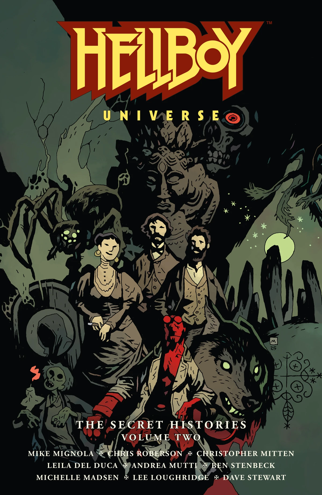
September 22, 2026

Hellboy Universe: The Secret Histories – Volume Two

Four stories of fascinating side characters are explored in full, collected in this second volume of standalone comics stories perfect for any Hellboy fan's library.

Before the Black Flame threatened the B.P.R.D.—and the world—what was the source of his power? Who was Hellboy’s Uncle Simon, and what occult mysteries did he and the Silver Lantern Club investigate? Can Silver Lantern Club member and detective Sarah Jewell find the killer in a locked-room murder mystery before she becomes a victim herself? And in an idyllic British town that holds unusual traditions, could the village’s history be linked to larger and more significant events than they could even know? Dive into these paranormal secrets, collected in this second volume of standalone stories perfect for any Hellboy fan's library.

Hellboy creator Mike Mignola is joined by writer Chris Roberson and artists Christopher Mitten, Leila del Duca, Andrea Mutti, Ben Stenbeck, and others to bring these mysteries of the Hellboy universe to light.

Collects Rise of the Black Flame #1–5, The House of Lost Horizons #1–5, British Paranormal Society: Time Out of Mind #1–4, Hellboy: The Silver Lantern Club #1–5, and bonus material.

STORY
Mike Mignola
Chris Roberson

ART
Christopher Mitten
Leila Del Duca
Andrea Mutti
Ben Stenbeck

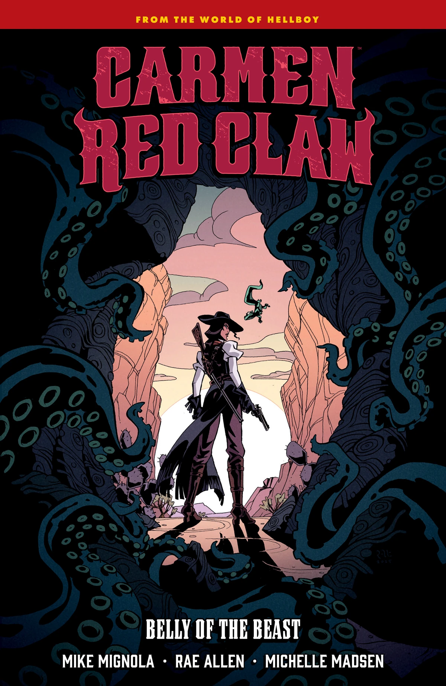
September 29, 2026

Carmen Redclaw: Belly of the Beast

A descendant of El Bogavante fights chupacabras, gangsters, and more in this Wild West paranormal adventure!

Supernatural gun-for-hire and shape-shifting descendent of the notorious El Bogavante, Carmen Red Claw faces a new type of monster when investigating supposedly cursed ranch land. Something is killing the cattle at ranches all over the area, and along the way she’ll have to battle chupacabras, chase a runaway train, and deal with family drama to boot. But Carmen must find out if it’s really a beast to blame for the killings—or if humans are the real monsters here.

Writer/artist Rae Allen (The Manderfield Devil, Town with a Million Eyes) joins the Hellboy universe in this paranormal western adventure set in 1870s New Mexico territory!

Collects Carmen Red Claw: Belly of the Beast #1–4 and bonus sketchbook material

STORY
Mike Mignola
Rae Allen

ART
Rae Allen

|                                                               |
|:--------------------------------------------------------------|
| Characters |

<li>Hellboy</li>
<li>Liz Sherman</li>
<li>Abe Sapien</li>
<li>Kate Corrigan</li>
<li>Roger</li>
<li>Ben Daimio</li>
<li>Johann Kraus</li>
<li>Panya</li>
<li>Fenix Espejo</li>
<li>Ted Howards</li>
<li>Ashley Strode</li>
<li>Professor J.H. O'Donnell</li>
<li>Professor Trevor Bruttenholm</li>

<li>Simon Anders</li>
<li>Jacob Stegner</li>
<li>Archibald Muraro</li>
<li>Susan Xiang</li>
<li>Woodrow Farrier</li>
<li>Sir Edward Grey</li>
<li>Sarah Jewell</li>
<li>The Lobster (Lobster Johnson)</li>
<li>Harry McTell</li>
<li>Cynthia Tynan</li>
<li>Frankenstein</li>
<li>Koshchei</li>
<li>Varvara</li>

<li>Ogdru Jahad</li>
<li>Hecate</li>
<li>The Black Flame</li>
<li>Satan</li>
<li>Nimue, the Queen of Blood</li>
<li>Grigori Rasputin</li>
<li>Karl Ruprect Kroenen</li>
<li>Leopold Kurtz</li>
<li>Herman von Klempt</li>
<li>The Baba Yaga</li>
<li>Gruagach</li>
<li>Martin Gilfryd (Memnan Saa)</li>
<li>Gustav Strobl</li>

**Fantasy Movies**

*Go to these sites for info or for help with your own wiki!*

The Chronicles of Narnia • How to Train Your Dragon • His Dark Materials • Descendants • Buffyverse • Rickpedia: The Mummy • Fantasy Films • Final Fantasy • Dungeons and Dragons • Harry Potter • Hellboy • Willow • Lord of the Rings • Pirates of the Caribbean • Underworld • The Wizard of Oz

*Want your community included? See how!*

The Hellboy Wiki is affiliated with the Dark Horse Database
