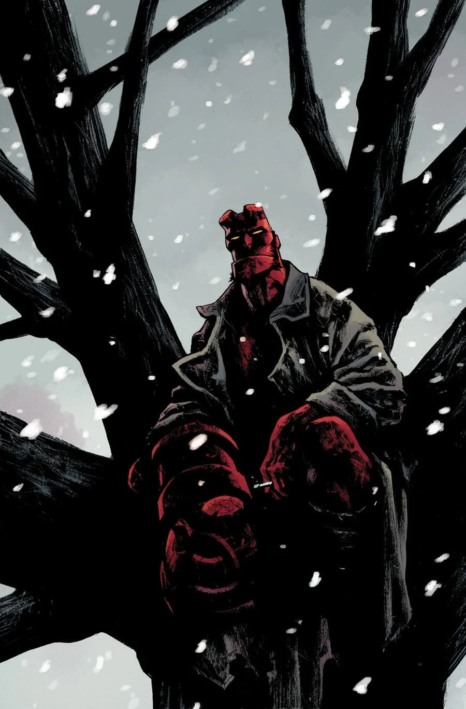
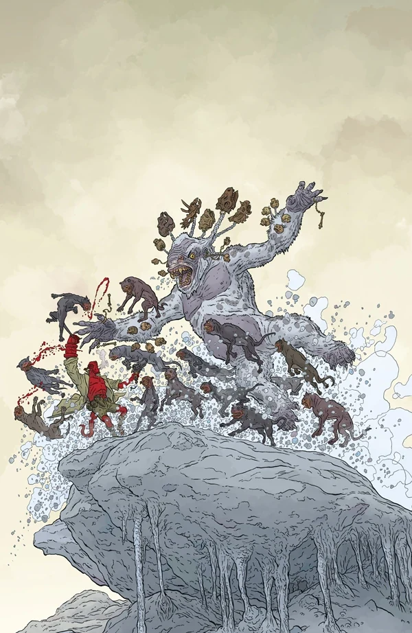
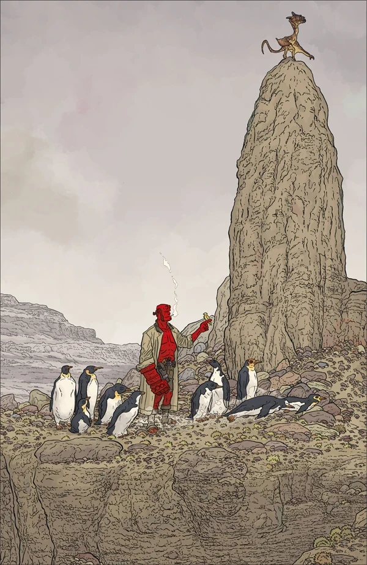

A comic special containing three stories. This comic is the Hellboy Universe debut of Tim Sale, Michael Walsh, Chris Roberson, and Chelsea Cain. This one-shot is the second installment of the *[Hellboy Winter Special](/entry/Hellboy_Winter_Special)* anthology

## Solicitation

Three weird tales show the world of Hellboy through the years, with Edward Grey appearing alongside Sarah Jewell, hero of the recent *Rise of the Black Flame* series in 1890s London. In 1980s New England, Hellboy, Abe Sapien, and Liz Sherman set out on a simple search for some missing kids and encounter a tormented spirit seeking to share its pain.

And Paul Grist (*Kane*, *Jack Staff*) joins the team for a 1950s *Hellboy* story providing a glimpse of the next new title to debut in the Mignolaverse.

## Featuring

- *[The Great Blizzard](/entry/The_Great_Blizzard)* written by Mike Mignola and Chris Roberson with art by Christopher Mitten
- *[God Rest Ye Merry](/entry/God_Rest_Ye_Merry)* written by Mike Mignola and Chris Roberson with art by Paul Grist
- *[The Last Witch of Fairfield](/entry/The_Last_Witch_of_Fairfield)* written by Mike Mignola and Scott Allie with art by Sebastián Fiumara

## Gallery

