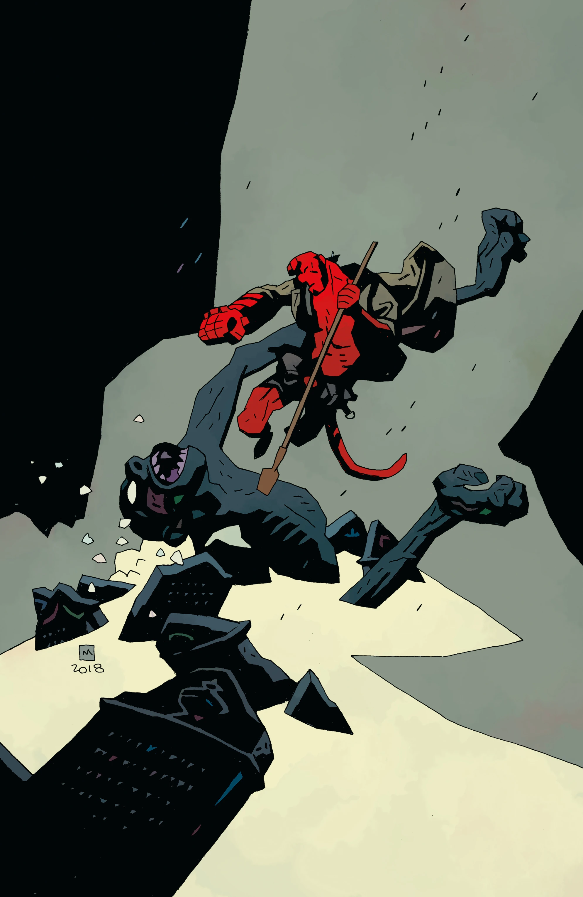
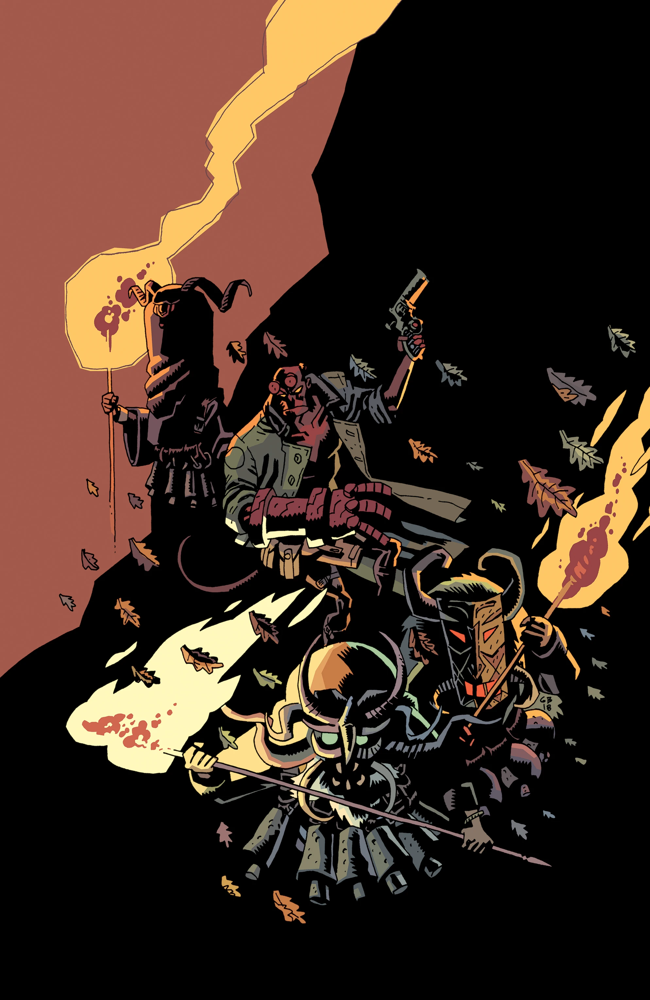
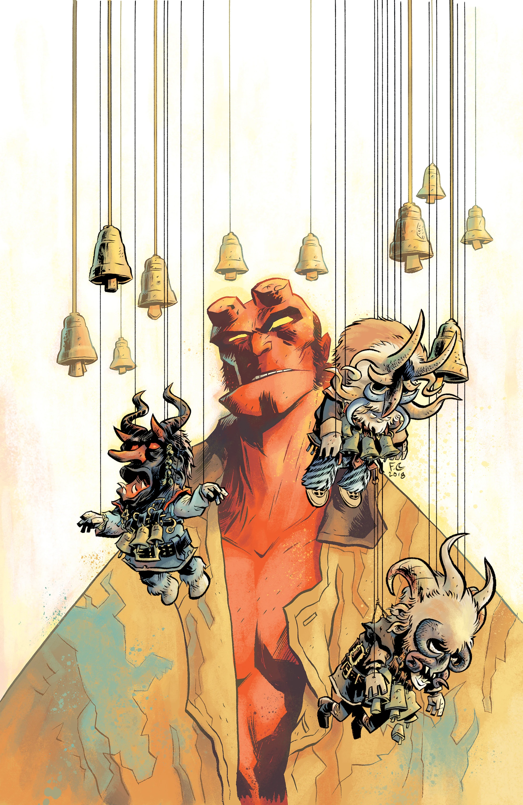

***Hellboy Winter Special (2018)*** is a December 2018 anthology special featuring three stories. This one-shot continues the loose *[Hellboy Winter Special](/entry/Hellboy_Winter_Special)* series.

## Publication History

Editor Katii O'Brien announced the comic during Dark Horse's NCBD Rundown for June 6, 2018.[1] Full solicitations were revealed for San Diego Comic-Con 2018 as a part of the 25th Anniversary of *Hellboy* announcements.

## Solicitation

Three wintery tales featuring a [Mike Mignola](/entry/Mike_Mignola) and Ben Stenbeck team-up about a New Year’s Eve séance gone wrong when Hellboy visits a family’s English home, Fábio Moon and Gabriel Bá revisit B.P.R.D.: Vampire with a new tie-in story, and Tonci Zonjic returns to write and draw Lobster Johnson.

## Featuring

- *[Happy New Year, Ava Galluci](/entry/Happy_New_Year%2C_Ava_Galluci)* written by [Mike Mignola](/entry/Mike_Mignola) with art by [Ben Stenbeck](/entry/Ben_Stenbeck)
- *[Lost Ones](/entry/Lost_Ones)* written and drawn by [Fábio Moon](/entry/F%C3%A1bio_Moon) and [Gabriel Bá](/entry/Gabriel_B%C3%A1)
- *[The Empty Chair](/entry/The_Empty_Chair)* written and drawn by [Tonci Zonjic](/entry/Tonci_Zonjic)

## Cover Gallery

## References

<references />

[1] [Katii O'Brien discusses the Hellboy Universe on Dark Horse's NCBD Rundown, June 6, 2018](https://www.youtube.com/watch?v=0VCS7AWbOi4&feature=youtu.be&t=759)
