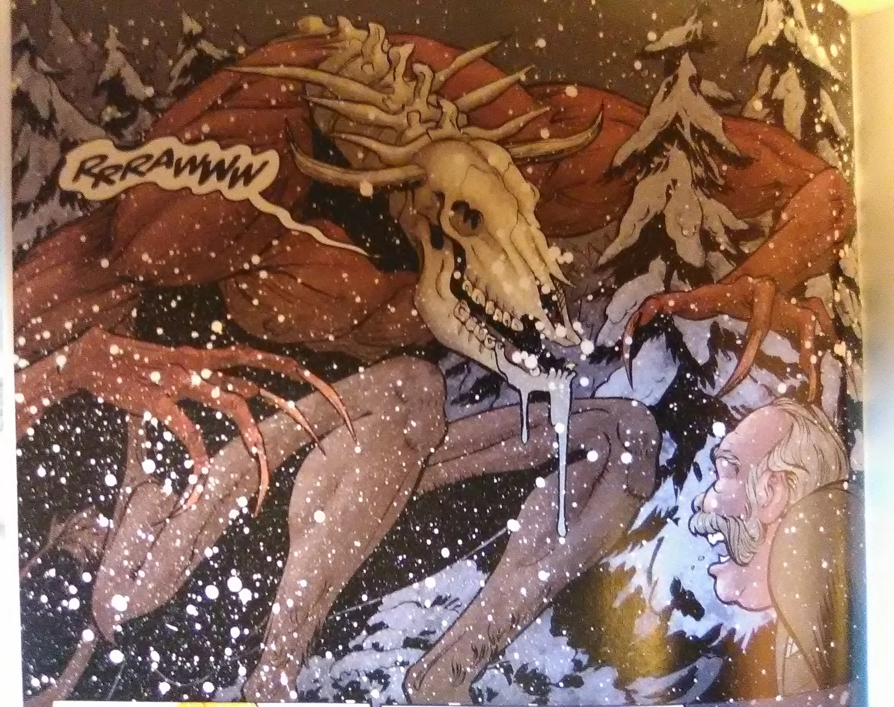
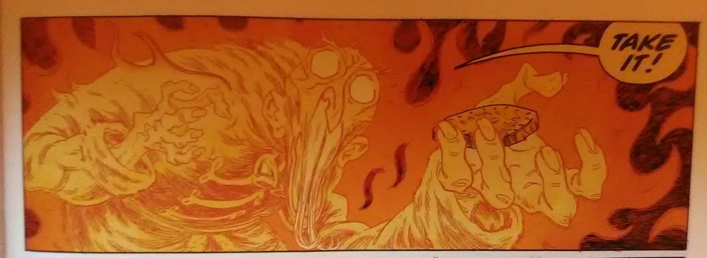

A comic special containing three stories. This comic is the Hellboy Universe debut of Márk László, Leila del Duca, and Andrea Mutti. This one-shot is the fourth installment of the *Hellboy Winter Special* anthologies. Curiously, although this is the 2019 special, it came out in 2020.

## Solicitation

Celebrate the season in true Hellboy fashion!

Meet a ghostly miser in an alternate reality, fear the Boogam of rural New York, and embrace the wrath of St. Hagan in this trio of occult winter tales! The familiar faces of Hellboy, Sarah Jewell, and the legendary Knights of St. Hagan will help you ring in the new year with all the shivers you can take—and not all of them from the cold!

Three short stories in one issue!

## Featuring

- *[The Miser's Gift](/entry/The_Miser's_Gift)* written by [Mike Mignola](/entry/Mike_Mignola) with art by [Márk László](/entry/M%C3%A1rk_L%C3%A1szl%C3%B3)
- *[The Longest Night](/entry/The_Longest_Night)* written by [Chris Roberson](/entry/Chris_Roberson) with art by [Leila del Duca](/entry/Leila_del_Duca)
- *[The Beast of Ingelheim](/entry/The_Beast_of_Ingelheim)* written by [Scott Allie](/entry/Scott_Allie) with art by [Andrea Mutti](/entry/Andrea_Mutti)

## Gallery

Hellboy Winter Special 2019  
Cover by [Mike Mignola](/entry/Mike_Mignola)  
with [Dave Stewart](/entry/Dave_Stewart)

|braithwood boogam

|tobok the miser
