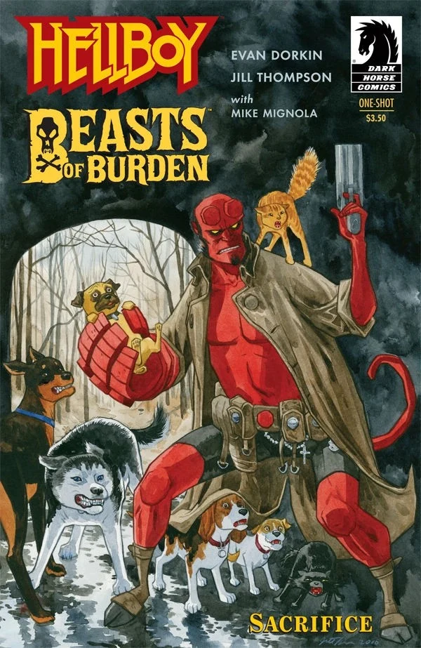

*Hellboy / Beasts of Burden: Sacrifice* is a crossover comic published by [Dark Horse Comics](/entry/Dark_Horse_Comics). It was jointly written by *Beast of Burden* writer [Evan Dorkin](/entry/Evan_Dorkin) with *Hellboy* writer [Mike Mignola](/entry/Mike_Mignola). Regular *Beast of Burden* artist [Jill Thompson](/entry/Jill_Thompson) provided the interior art.

## Plot Synopsis

After taking care of a vampire problem for an Amish community in Lancaster County, Pennsylvania, [Hellboy](/entry/Hellboy_(character)) is approached by a stray dog. The stray leads him to the Wise Dog Society and then disappears. The Wise Dog Society then enlists Hellboy's help in investigating the ritualistic killing of three cats. They discover a blood ritual to resurrect the warlock Karl. Pugsley, a member of the Wise Dog Society, urinates on the ritual thus contaminating it. The contamination makes the resurrected warlock weak enough to be defeated by Hellboy.

After the warlock's defeat Hellboy spots the stray once more and follows him just for the dog to vanish again. It is then revealed that the stray was an astral projection of another dog who led Hellboy to the Wise Dog Society at the cost of its life. It is also revealed that the dog had done this at least once before, that time leading [The Lobster](/entry/The_Lobster).

## Cover Gallery

Cover by [Jill Thompson](/entry/Jill_Thompson)

Variant cover by [Mike Mignola](/entry/Mike_Mignola) and [Dave Stewart](/entry/Dave_Stewart)

## External Links

- Hellboy / Beasts of Burden: Sacrifice product page on DarkHorse.com

## Gallery

|Cover by Jill Thompson
