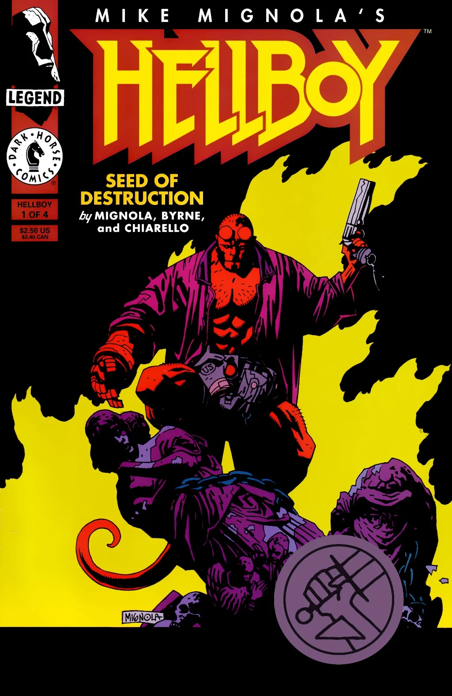
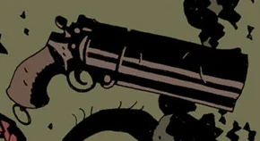
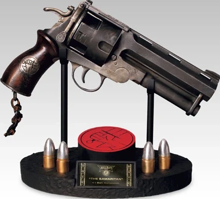

*For the revolver wielded by [Hellboy in the 2004–2008 films](/entry/Hellboy_(2004%E2%80%932008_film_character)), see [The Samaritan](/entry/The_Samaritan).*

Several **guns** have been wielded by [Hellboy](/entry/Hellboy_(character)) across [the comic series](/entry/Hellboy_(series)), most prominently a single-shot handgun that he carried for a half-century.

## Single-shot pistol

Hellboy has most frequently been depicted with an oversized single-shot break-action pistol. This weapon was given to him by [the Torch of Liberty](/entry/The_Torch_of_Liberty); the Torch also instructed Hellboy in marksmanship. This gun was eventually lost somewhere at [the bottom of the ocean](/entry/The_Third_Wish), sometime after October 2002.

The handgun is depicted as having wooden grips, sometimes these have three or four grooves carved near their base. Occasionally, the tattered ends of a lanyard are tied to a ring at its base.

Though this gun only holds a single bullet and must be reloaded after every shot, it has occasionally been illustrated with a grooved cylinder that implies revolver-style multiple chambers; this would not work mechanically with the oversized barrel. Artists drawing the barrel this way may have been confused by Mignola's distinctive rendering style, which draws thick black lines on the cylinder and barrel to indicate shadows.

Hellboy reloads his gun

Revolver chamber depicted by [Duncan Fegredo](/entry/Duncan_Fegredo)

Revolver-like gun drawn by [Mike Mignola](/entry/Mike_Mignola)

Action figures, statues, and other merchandise of Hellboy most commonly depict him with this gun, albeit frequently with the revolver-like cylinder discussed above.

## Other guns

### B.P.R.D. service revolver

During [Hellboy's early career](/entry/Hellboy_and_the_B.P.R.D.) as an agent of the [Bureau for Paranormal Research and Defense](/entry/Bureau_for_Paranormal_Research_and_Defense), he was armed with a standard-issue service revolver.

On some occasions, he would wield a standard semiautomatic pistol (presumably an M1911) during this stage of his career.

### Modern B.P.R.D. pistol

In May 1994, Hellboy brought a new gun on [a mission to Griart](/entry/The_Wolves_of_Saint_August). However, before he could use it, this weapon was lost when the floor collapsed beneath Hellboy and fellow B.P.R.D. agent [Kate Corrigan](/entry/Katherine_Corrigan).

### Zinco pistol

In March 1997, Hellboy was equipped with a [Zinco Corporation](/entry/Zinco_Corporation)-branded semiautomatic pistol when deploying to Castle Giurescu. Though this gun briefly worked well in fending off [bird women](/entry/Witches), it quickly locked up and soon exploded in Hellboy's hand.

### M1911A1 pistol

In June 2007, Hellboy washed ashore near the home of [Harry Middleton](/entry/Harry_Middleton), resting with the man's ghost for a month. When Hellboy prepared to take his leave, Middleton presented him with a 1941 M1911A1 as a replacement for his lost sidearm. The gun was even in a left-handed holster, fitting for Hellboy's southpaw shooting stance.

Revolver (*[Occult Intelligence](/entry/Occult_Intelligence)* \#1)

"I'm trying to get modern."

Hellboy's Zinco pistol misfires in dramatic fashion.

"1941, U.S. Army .45 in a left-handed holster."

## Trivia

> 
>
> That's it! No more guns. No more god damn machines! What I need... something with no moving parts.
>
> 
>
> —Hellboy, expressing his frustration after the Zinco pistol fails

- Hellboy is a notoriously poor shot, typically preferring to fight by throwing punches or with melee weapons.
  - [Mike Mignola](/entry/Mike_Mignola) once described Hellboy as frequently *drawing* his gun, but rarely ever *firing* it. "He mostly uses it to hit things with."
- Hellboy typically shoots left-handed, as the fingers of the [Right Hand of Doom](/entry/Right_Hand_of_Doom) are too large to fit inside a normal trigger guard.
- Hellboy has been depicted with a large gun in a "US"-stamped holster since his earliest appearances.
  - This holster is left unbuttoned, presumably for ease of access so he does not have to manipulate the button with his Right Hand.
- In 1964, Hellboy shot out the [Baba Yaga](/entry/Baba_Yaga_(character))'s eye with his pistol, starting a grudge that would last for a half-century.

- The 2004 film *[Hellboy](/entry/Hellboy_(2004_film))* and its sequel, *[Hellboy II: The Golden Army](/entry/Hellboy_II__The_Golden_Army)*, depict [Hellboy](/entry/Hellboy_(2004%E2%80%932008_film_character)) wielding a distinctive, massive revolver called "[The Samaritan](/entry/The_Samaritan)". The popularity of the films, and this weapon in particular, have lead many to incorrectly assume that the name and/or design originate from or otherwise can be seen in the comics.
  - The Samaritan's design does share some minor similarities with the single-shot revolver from the comics (large size, carried in a leather U.S. holster, shortened lanyard attached to loop), but they are ultimately substantially different.
  - No gun wielded by Hellboy in the comics has ever been given a special name like "The Samaritan".
  - The Samaritan's popularity has also led to many other adaptations of Hellboy depicting him with a revolver, such as in *[Injustice 2](/entry/Injustice_2)*, [in the 2019 film](/entry/Hellboy's_revolver_(2019_film)), or in *[The Crooked Man](/entry/Hellboy%3A_The_Crooked_Man_(film))*; these revolvers are not officially called "Samaritan" either.

## See Also

- [The Samaritan](/entry/The_Samaritan)
- [Hellboy's revolver (2019 film)](/entry/Hellboy's_revolver_(2019_film))
