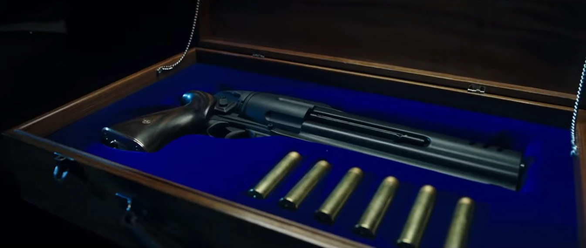

.png)

A special **revolver** is wielded by [Hellboy](/entry/Hellboy_(character)) in the 2019 film *[Hellboy](/entry/Hellboy_(2019_film))*.

## Weapon Specifications

The revolver is Hellboy's signature, customized weapon, distinct from standard-issue [Bureau for Paranormal Research and Defense](/entry/Bureau_for_Paranormal_Research_and_Defense) firearms. Aesthetically, the weapon has a modernized design featuring a streamlined cylinder and elongated barrel. Its cylinder holds six bullets, chambered in .55 cal.

### Design

The revolver is built off a vintage steel Gasser M1870 revolver. It was customized and designed by Marin Takov, the film's lead armorer. Adjustments were undertaken to make it appear more powerful and fantastical, extending and expanding the cylinder, barrel, frame, and handle. A total of four custom revolvers were constructed for the film, two that fired blanks and two non-firing versions for close-ups and detail.

## Gallery

A Gasser M1870 in the process of modification.

The finished revolver, displayed in its B.P.R.D. carrying case.

Hellboy brandishes his revolver in the film's poster.

## Trivia

- Though the gun does not officially have a unique name, production staff informally called it the "devil revolver".
  - Some fans incorrectly assume this gun is named "The Samaritan", as [the revolver from the 2004-2008 film series](/entry/The_Samaritan) was called. However, this name has never been officially connected to the 2019 film.
    - Officially-licensed merchandise refers to the gun with generic terms like "customized revolver" or "Hellboy's sidearm".
    - A replica handgun, labeled "Samaritan", was exhibited by Chronicle Collectibles at New York Comic Con 2018. However, this was a pistol rather than the specialized revolver; comments from Chronicle staff indicated that the label was an error. Ultimately, no *Hellboy* firearm replica (revolver or pistol) was ever released by Chronicle Collectibles.

## Appearances

- *[Hellboy](/entry/Hellboy_(2019_film))* (2019)
