***Hellboy: Dogs of the Night*** is a 2000 American PC game, developed by Cryo Studios. In 2003, it was ported to the PlayStation as ***Hellboy: Asylum Seeker*** by Hoplite Research.

[Hellboy](/entry/Hellboy_(character)) is voiced by David Gasman.

## Plot

The game takes place in January 1962, Prague, during Hellboy's early work with the [B.P.R.D.](/entry/B.P.R.D.) (Bureau for Paranormal Research and Defense). One of the Bureau's informants recently suffered from a sudden debilitating illness, which he claimed was brought on by the evil machinations of the [Nohox Kanis](/entry/Nohox_Kanis). Nearly 700 years ago, the Nohox Kanis attempted to enter our world and bring about eternal night. At that time they were defeated by a monk named [Mitri](/entry/Mitri).

Now, an imminent eclipse of the moon will offer the Nohox Kanis another chance enter our world. [Peter Johnson](/entry/Peter_Johnson), one of the Bureau's best reconnaissance agents, was dispatched to an asylum in Czechoslovakia which had long been the source of unsettling rumors. Now it seems that the asylum was connected with the return of the Nohox Kanis all along and Peter has disappeared.

Hellboy and [Sara Courteville](/entry/Sara_Courteville) are investigating their missing agent Peter. It's up to Hellboy to uncover the events surrounding that disappearance, and set things right.

## Characters

### Main

- [Hellboy](/entry/Hellboy_(character))
- [Sara Courteville](/entry/Sara_Courteville)
- [Peter Johnson](/entry/Peter_Johnson)
- [Mitri](/entry/Mitri)

### Enemies

- [Zombies](/entry/Zombies)
- [Giant Bird](/entry/Giant_Bird)
- [Nohox Kanis](/entry/Nohox_Kanis)
- [Nurse](/entry/Nurse)
- [Igors](/entry/Igors)
- [Sanchez](/entry/Sanchez)
- [Giant Monkey](/entry/Giant_Monkey)
- [Inquisitor](/entry/Inquisitor)
- [Kalin](/entry/Kalin)

## Gameplay

Players control Hellboy in a third-person perspective across six levels. Levels consist of separate stages broken up by puzzles and enemies that can differ across each. The game plays mainly as a graphic adventure where the player must solve puzzles in order to advance with some fights with enemies scattered throughout the game. To combat opponents, Hellboy uses either his fists including his stone "right hand of doom" or different weapons that can be found throughout the game including a torch, a gun, and a sword.

## Reception

The Windows version has a score of 11.50% at GameRankings. Jason Babler of the Official U.S. PlayStation Magazine (October 2003) rated the game 0.5 out of 5.

## Gallery

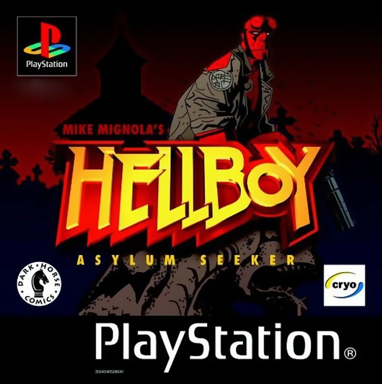

|Hellboy: Asylum Seeker PS cover.

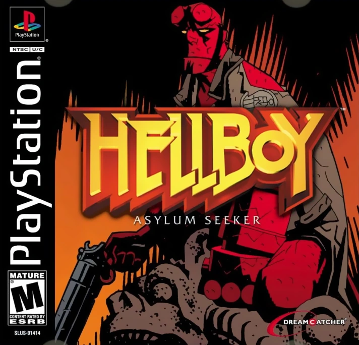

|Hellboy: Asylum Seeker PS another cover.

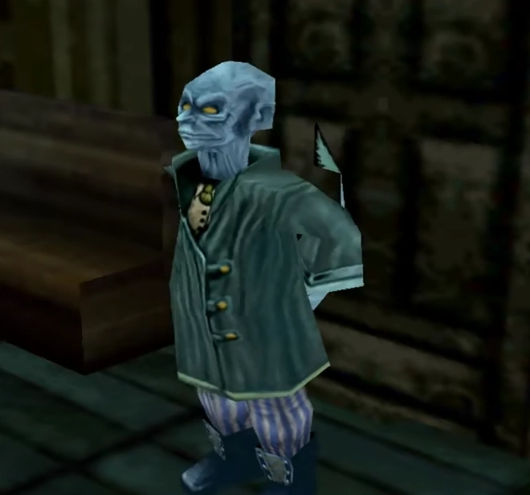

|

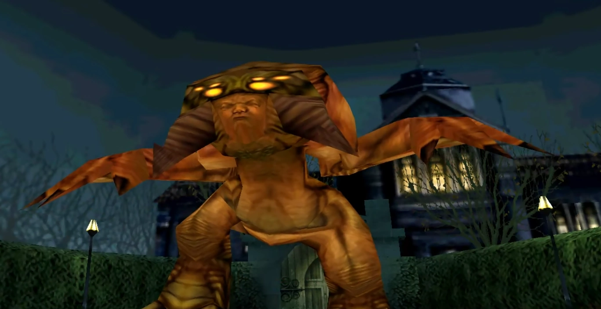

|

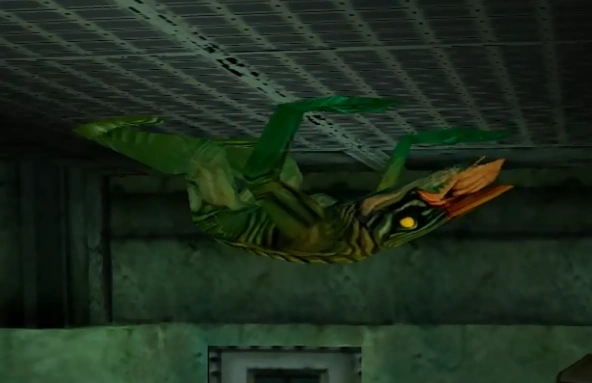

|

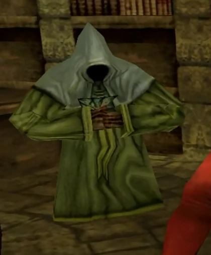

|

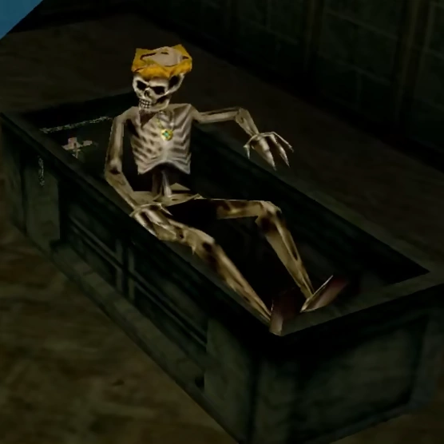

|

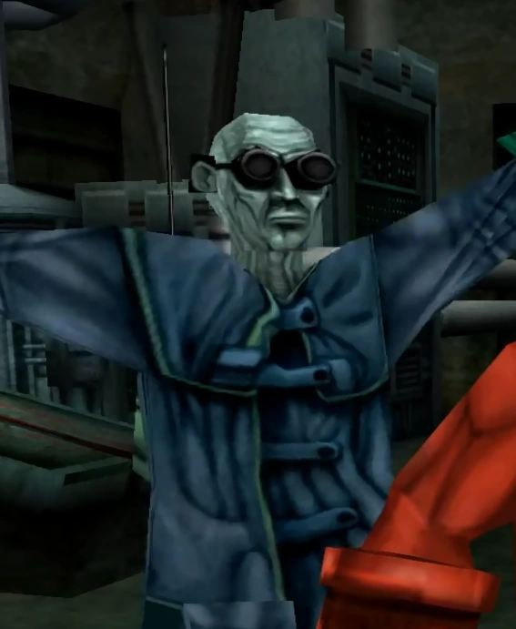

|

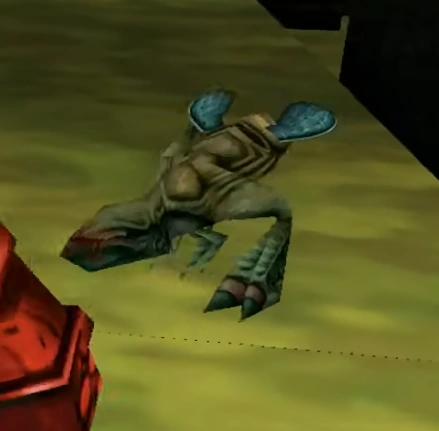

|

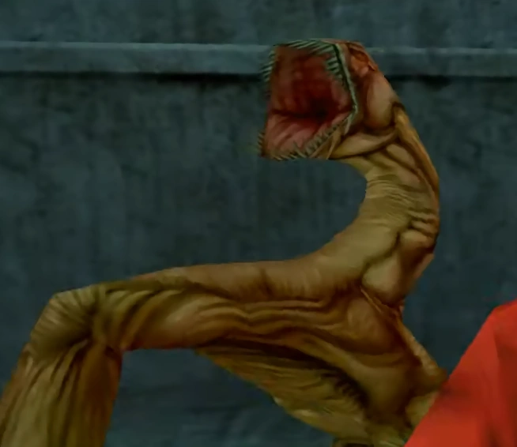

|

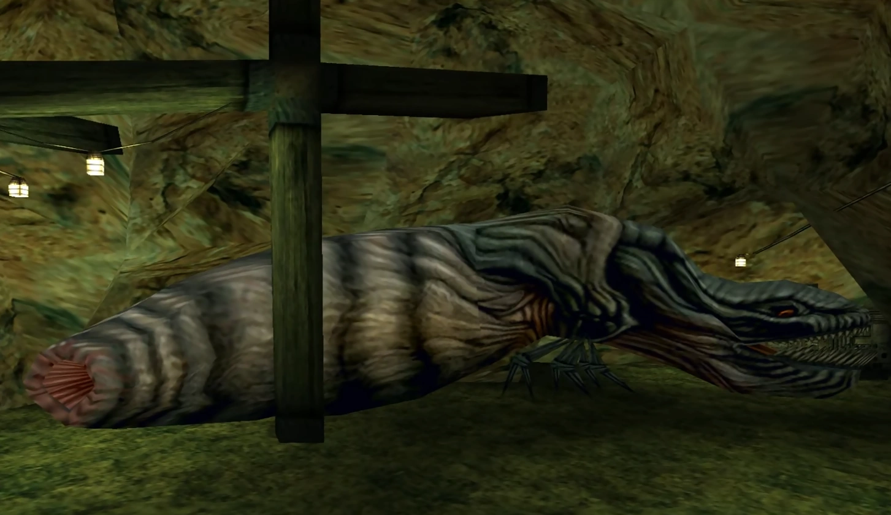

|

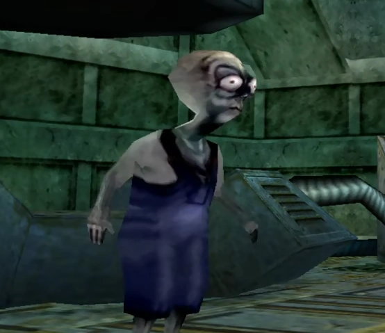

|

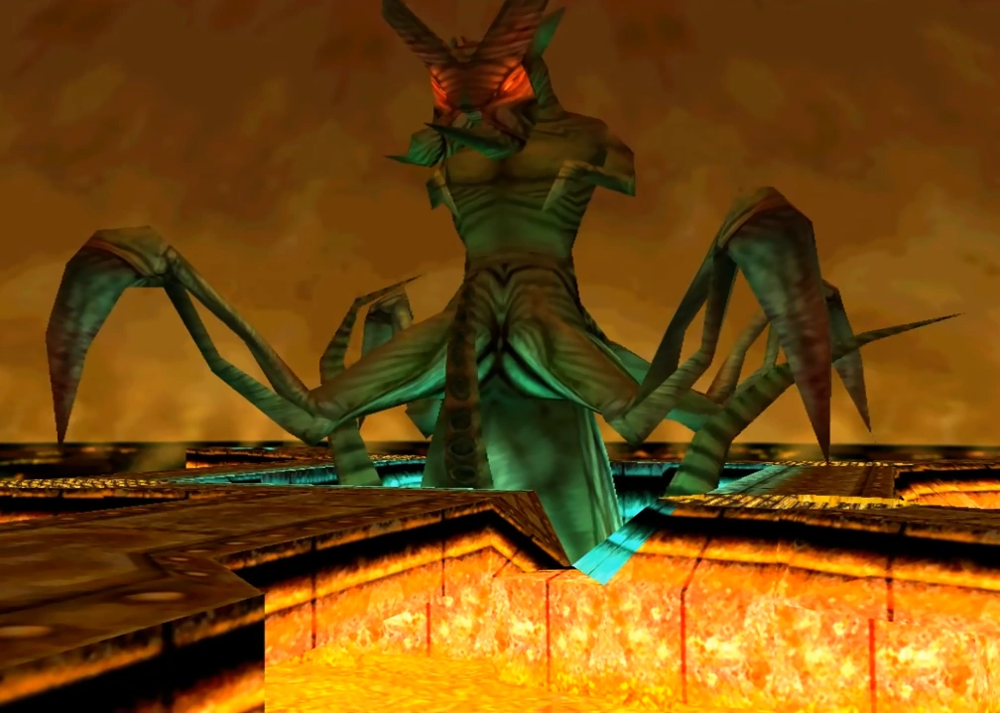

|
### Covers

*Hellboy: Dogs of the Night* PC cover.

*Hellboy: Asylum Seeker* PS cover.

*Hellboy: Asylum Seeker* PS another cover.

### Unnamed characters/creatures

### Movies

Hellboy Asylum Seeker - All Cutscenes (Game Movie - 1080p)

Cutscene compilation (PSX)

## Trivia

- *Dogs of the Night* was the first *[Hellboy](/entry/Hellboy_(series))* video game, with Gasman serving as the first actor to voice the character.

## External Links

- Hellboy: Dogs of the Night at MobyGames
