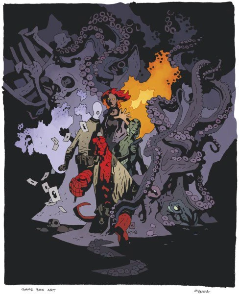

.jpg)

***Hellboy: The Board Game*** is a 2019 board game created by Mantic Games and designed by James M. Hewitt and Sophie Williams of Needy Cat Games. The project was first announced on January 5, 2018 with a press release about an upcoming April Kickstarter campaign for the game. As per the deal with Dark Horse, *[Hellboy](/entry/Hellboy_(series))* creator [Mike Mignola](/entry/Mike_Mignola) has final approval rights on all game aspects.

## Base Game

Includes three B.P.R.D. scenarios and everything required to play the game. Although [Johann Kraus](/entry/Johann_Kraus) didn't join the [B.P.R.D.](/entry/Bureau_for_Paranormal_Research_and_Defense) until 2002 (see *[B.P.R.D.: Hollow Earth](/entry/Hollow_Earth)*), Mike Mignola specifically requested the character be one of the four core agents for the base game.

- Rule book
- 4 Heroes ([Hellboy](/entry/Hellboy_(character)), [Liz Sherman](/entry/Elizabeth_Sherman), [Abe Sapien](/entry/Abraham_Sapien), [Johann Kraus](/entry/Johann_Kraus))
- Game tiles
- Door and furniture tokens
- Custom dice
- HQ board
- Action cubes
- 18 Minions
- 3 Bosses ([Rasputin](/entry/Grigori_Rasputin), [Tentacle monster](/entry/Sadu-Hem), [Giant frog monster](/entry/Frog_monster))
- Cards:
  - Core Agent cards
  - Encounter Deck
  - Requisition Deck
  - Deck of Doom
  - Case File Deck
  - Enemy Deck

## Expansions

### *Conqueror Worm*

Includes the [*Conqueror Worm*](/entry/Conqueror_Worm_(story)) scenario.

- New game tiles
- 15 Nazi troopers
- 1 Boss ([Conqueror Worm](/entry/Conqueror_Worm_(Ogdru_Hem)))
- Cards:
  - New Encounter Deck cards
  - New Requisition Deck cards
  - New Deck of Doom cards
  - *Conqueror Worm* Case File Deck
  - *Conqueror Worm* Enemy Deck

### B.P.R.D. Archives

Includes elements to create your own scenarios.

- 18 beasts and monsters
- Cards:
  - New Encounter Deck cards
  - B.P.R.D. Archives Case File Deck
  - B.P.R.D. Archives Enemy Deck

### *Helboy in Mexico* (limited edition)

Includes two *[Hellboy in Mexico](/entry/Hellboy_in_Mexico)* scenarios. This expansion will not be commercially available. It can only be bought through the Kickstarter or at conventions.

- 4 Heroes (Luchador Hellboy, [Esteban and his brothers](/entry/Hellboy_in_Mexico_(story)))
- Game tiles
- 15 Minions
- 1 Boss (Camazotz)
- Cards:
  - Agent cards
  - New Encounter Deck cards
  - New Requisition Deck cards
  - New Deck of Doom cards
  - *Hellboy in Mexico* Case File Deck
  - *Hellboy in Mexico* Enemy Deck

### *Darkness Calls*

Includes two *[Darkness Calls](/entry/Darkness_Calls)* scenarios.

- 1 Hero ([Henry Hood](/entry/Henry_Hood))
- 1 Back-up Agent (wolf)
- Game tiles
- 15 Undead Minions
- 1 Boss ([Koshchei](/entry/Koshchei_(character)))
- 2 Mini Bosses (witches)
- Cards:
  - Agent cards
  - New Encounter Deck cards
  - New Requisition Deck cards
  - New Deck of Doom cards
  - *Darkness Calls* Case File Deck
  - *Darkness Calls* Enemy Deck

### Future Expansions

Mantic plans to continue releasing expansions exploring *[Hellboy](/entry/Hellboy_(series))* and *[B.P.R.D.](/entry/B.P.R.D._(series))* storylines. Future expansions will include classic characters such as [Ben Daimio](/entry/Benjamin_Daimio).

## 2018 Kickstarter Campaign

Mantic Games launched a Kickstarter campaign for the game on April 25, 2018. The game reached its £100,000 funding goal within the first few hours and passed \$1,000,000 US within the first 26 hours. It ended up being Mantic's most successful Kickstarter to date, unlocking all sixty-four stretch goals.

### Stretch Goals

- Agents:
  - [Roger](/entry/Roger)
  - [Lobster Johnson](/entry/The_Lobster)
  - [The Visitor](/entry/The_Visitor_(character))
- Enemies:
  - [Hecate](/entry/Hecate) + confrontation
  - [Unmensch](/entry/Unmensch) + confrontation
  - [Herman von Klempt](/entry/Herman_von_Klempt) + confrontation
  - [Kriegaffe](/entry/Kriegaffe) + confrontation
  - [Baba Yaga](/entry/Baba_Yaga_(character)) + scenario
  - [Saint Leonard's Worm](/entry/The_Nature_of_the_Beast) + confrontation
  - [Vladimir Giurescu](/entry/Vladimir_Giurescu) + confrontation (*Box Full of Evil*)
  - [Floating Heads](/entry/Heads) (*Box Full of Evil*)
  - Oni (*Box Full of Evil*)
  - [Igor Bromhead](/entry/Igor_Bromhead) (*Box Full of Evil*)
- Scenarios:
  - New Giant Frog Monster scenario
  - New Rasputin scenario
  - New Tentacle Monster scenario
  - New Conqueror Worm scenario
  - Alternate Baba Yaga scenario
  - Herman von Klempt scenario
- Tokens:
  - Upgraded Information Gathered tokens
  - Right Hand of Doom token
  - Flame trackers
  - Target Priority busts (Hellboy, Liz, Abe, Johann, Roger, Lobster Johnson)
  - Upgraded Clue tokens
  - Upgraded Wound counters
- Item cards:
  - [Zinco](/entry/Zinco_Corporation) Rocket Pack
  - [Iron Shoes](/entry/The_Iron_Shoes)
  - [Pancakes](/entry/Pancakes)
  - [Father Budzen's Head](/entry/Wake_the_Devil)
  - Lich Candle
  - Disguise
  - Cigarette
  - Hand of Glory
  - 5 new Requisition cards
- Extra set of custom game dice
- Upgrade game tile thickness
- Case Files upgraded to tarot card size
- Cards upgrades to 310GSM
- \$20 Dark Horse Digital voucher

### Kickstarter Exclusive Stretch Goals

- Agents:
  - [Professor Trevor Bruttenholm](/entry/Trevor_Bruttenholm)
  - ["Pancakes" Hellboy](/entry/Pancakes)
  - [Kate Corrigan](/entry/Katherine_Corrigan)
  - [Horned Hellboy](/entry/Wake_the_Devil)
  - [Scott Clark](/entry/Scott_Clark)
  - [Sidney Leach](/entry/Sidney_Leach)
  - [Bud Waller](/entry/Bud_Waller)
- Enemies:
  - "He's Got a Gun!" minifigure
  - Alternate Iron Maiden [Hecate](/entry/Hecate) + confrontation
  - Alternate [Ragna Rok](/entry/Ragna_Rok) [Rasputin](/entry/Grigori_Rasputin) + confrontation
  - [Ilsa Haupstein](/entry/Ilsa_Haupstein) + scenario
  - [Kroenen](/entry/Karl_Ruprect_Kroenen) + confrontation
  - [Ualac](/entry/Ualac) + confrontation
  - [Evil Turkey](/entry/Hellboy_in_Mexico_(story)) + Deck of Doom card
- Hardcore Deck of Doom
- Rookie Deck of Doom
- Game art print (by [Mike Mignola](/entry/Mike_Mignola) and [Dave Stewart](/entry/Dave_Stewart))
- Black and white game art print (by [Mike Mignola](/entry/Mike_Mignola) and [Dave Stewart](/entry/Dave_Stewart))
- Upgraded box
- *Box Full of Evil* (packing extra)

### Optional Extras

- 3D scenery
- 3D doors
- Folding dice tray
- Extra dice
- B.P.R.D. dice bag
- Resin miniatures
- *Hellboy in Mexico* limited edition expansion
- *Darkness Calls* expansion
- *Box Full of Evil* (includes *Hellboy in Mexico* and *Darkness Calls* expansions)

## 2021 Kickstarter Campaign

Mantic has mentioned on their blog that they will be doing a campaign for further expansions in 2021.
