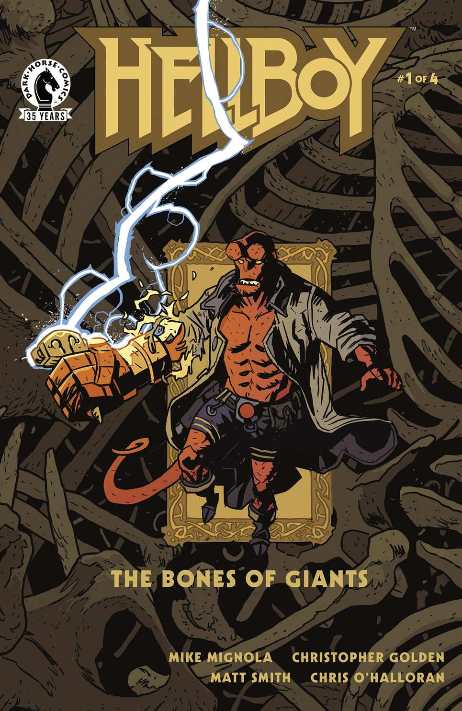
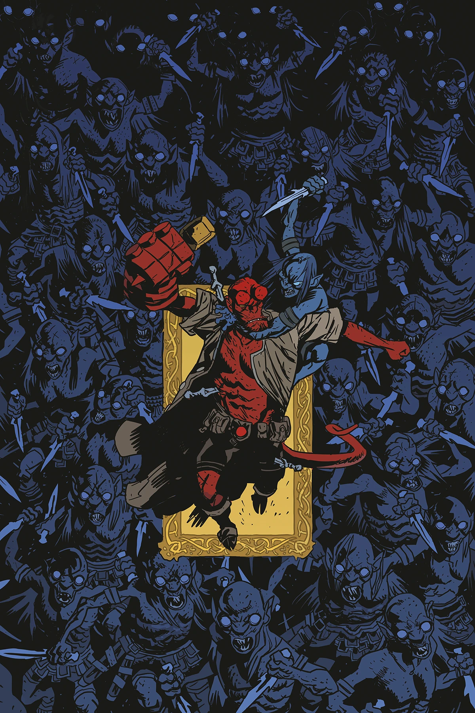
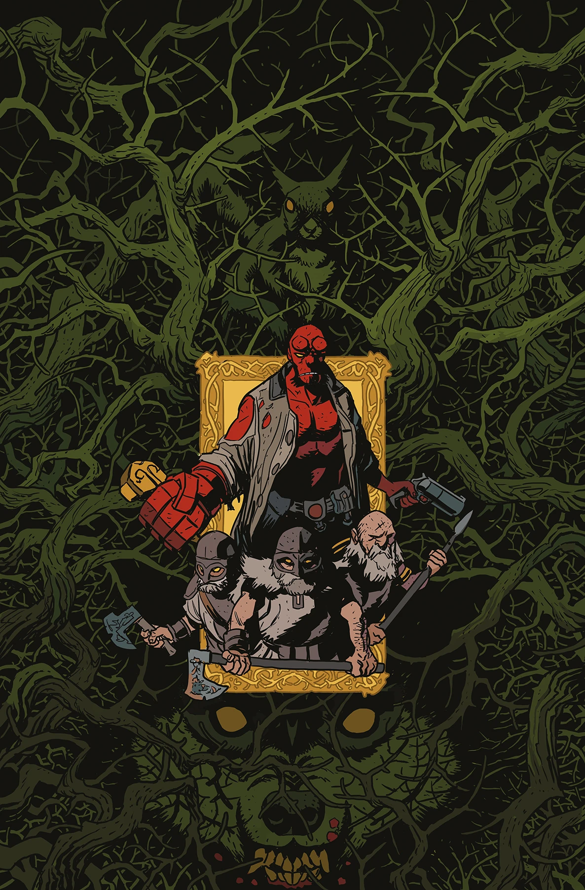
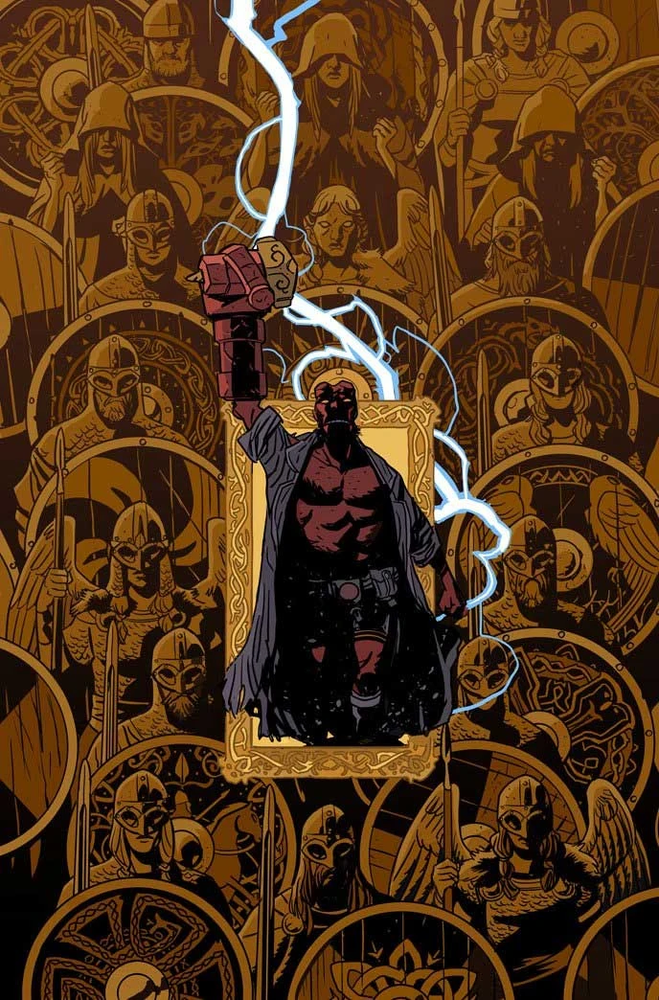

***The Bones of Giants*** is a four-issue miniseries coming out November 2021 written by [Mike Mignola](/entry/Mike_Mignola) and [Christopher Golden](/entry/Christopher_Golden) with art by [Matt Smith](/entry/Matt_Smith). It is an adaptation of the 2001 prose novel *[Hellboy: The Bones of Giants](/entry/Hellboy%3A_The_Bones_of_Giants_%28prose_novel%29)* also written by Mignola and Golden.

## Publication History

## Synopsis

### Part One

When a startling discovery is made in Sweden, the B.P.R.D. sends Hellboy and Abe Sapien to investigate. What ensues is a wild adventure full of Norse legends, mythical creatures, and a threat that could bring not just Earth but the Nine Realms of Norse mythology to their knees.

### Part Two

Acting as an involuntary vessel for the Norse god Thor, Hellboy and his ragtag team pursue the ancient evil that’s been unleashed on the world. But even the might of Mjollnir and the aid of mythological beings may not be enough to prevent the destruction that is to come.

### Part Three

Hellboy, still inhabited by the ghost of the Norse god Thor, has his first confrontation with the newly resurrected Frost King Thrym! But not having recovered his full strength yet, Thrym slips away and leaves Hellboy to follow a grisly path toward their next encounter.

### Part Four

Hellboy and the others make their way to the ghost city of Utgard in search of Thrym. But there’s more than one giant standing between the B.P.R.D. and saving the world. Dwarves, Valkyries, and the Norse god of Thunder himself come together for the ultimate confrontation to close out this stunner of a series!

## Story Chronology

While the original [*Hellboy: The Bones of Giants* prose novel](/entry/Hellboy%3A_The_Bones_of_Giants_%28prose_novel%29) took place in August 1999, the comic book adaptation takes place in February 1988. Christopher Golden has not commented on the reason for the change, but he did say that where the prose novel and the comics conflict, the comic should be considered canon.

## Content

### Characters

#### [B.P.R.D.](/entry/Bureau_for_Paranormal_Research_and_Defense)

- [Hellboy](/entry/Hellboy_%28character%29)
- [Abe Sapien](/entry/Abe_Sapien)

#### Civilians

- [Jan-Olaf Kjell](/entry/Jan-Olaf_Kjell)
- Professor [Karl Aronsson](/entry/Karl_Aronsson)
- [Fredrik Klar](/entry/Fredrik_Klar)
- Dr. [Billing](/entry/Billing)
- Nurse [Elias](/entry/Elias)
- Mr. [Wilton](/entry/Wilton)
- Aickman family
  - [Edmond Aickman](/entry/Edmond_Aickman)
  - [Pernilla Aickman](/entry/Pernilla_Aickman)

#### Norse mythology

- Norse gods
  - [Thor](/entry/Thor)
- Jötunn
  - [Thrym](/entry/Thrym)
  - [Hraesvelg](/entry/Hraesvelg)
  - [Jormungand](/entry/Jormungand) (seen during the flashback of Raganrok)
  - [Fenrir](/entry/Fenrir) (seen during the flashback of Raganrok)
- [King Vold](/entry/King_Vold_%28character%29) (seen in flashback)
- [Ratatosk](/entry/Ratatosk)
- [Svartalves](/entry/Svartalves)
- [Dwarves](/entry/Dwarf)
  - [Brokk](/entry/Brokk)
  - [Eitri](/entry/Eitri)
- [Valkyrjur](/entry/Valkyrjur)
  - [Mist](/entry/Mist)
- [Garm](/entry/Garm)

### Locations

- [Sweden](https://en.wikipedia.org/wiki/Sweden)
  - [Stockholm](https://en.wikipedia.org/wiki/Stockholm)
    - [Stockholm University](https://en.wikipedia.org/wiki/Stockholm_University)
    - [Djurgården](https://en.wikipedia.org/wiki/Djurg%C3%A5rden)
- [Vigrid](/entry/Vigrid) (seen during the flashback of Raganrok)
- [Asgard](/entry/Asgard) (seen during the flashback of Raganrok)
- [Utgard](/entry/Utgard)

### Noteworthy artifacts

- [Mjollnir](/entry/Mjollnir)

## Gallery

All covers are by [Matt Smith](/entry/Matt_Smith).

 \#1

 \#2

 \#3

 \#4
