***Hellboy: Weird Tales*** is a non-canonical comic book series published during the making of the [first *Hellboy* movie](/entry/Hellboy_%282004_film%29). [Mike Mignola](/entry/Mike_Mignola) had been very active during the production of the film and did not have time to work on new *Hellboy* comics. *Hellboy: Weird Tales* was a way to have new *Hellboy* material on shelves during both the lead up to and then the film's release.

The series ran for eight issues from February 2003 to April 2004, published on a bi-monthly basis. Each issue features multiple short stories from different creative teams.

## Issues

Issue Number
Published
Cover
Story
Writer(s)
Artist(s)
Additional Materials

<tbody>

1
February 26, 2003
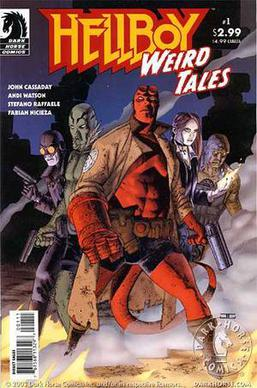[JOHN CASSADAY](/entry/John_Cassaday)
<em>[Big-Top-Hell-Boy](/entry/Big-Top-Hell-Boy)</em>
[John Cassaday](/entry/John_Cassaday)
<em>Sugar Coated Wire feat. Dr. Karl Ruprect Kroenen</em> pin-up by [TyRuben Ellingson](/entry/TyRuben_Ellingson)

<em>[Party Pooper](/entry/Party_Pooper)</em>
[Andi Watson](/entry/Andi_Watson)

<em>[Children of the Black Mound](/entry/Children_of_the_Black_Mound)</em>
[Fabian Nicieza](/entry/Fabian_Nicieza)
[Stefano Raffaele](/entry/Stefano_Raffaele)

<em>[Doc Hollow's Grand Vibro-Destructo Machine: Episode 1](/entry/Doc_Hollow%26)</em>
[John Cassaday](/entry/John_Cassaday)

2
April 23, 2003
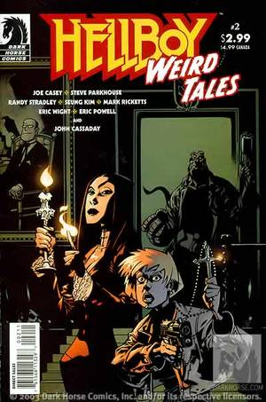[JASON PEARSON](/entry/Jason_Pearson)
<em>[Flight Risk](/entry/Flight_Risk)</em>
[Joe Casey](/entry/Joe_Casey)
[Steve Parkhouse](/entry/Steve_Parkhouse)
NA

<em>[Hot](/entry/Hot)</em>
[Randy Stradley](/entry/Randy_Stradley)
[Seung Kim](/entry/Seung_Kim)

<em>[Curse of the Haunted Doily](/entry/Curse_of_the_Haunted_Doily)</em>
[Mark Ricketts](/entry/Mark_Ricketts)
[Eric Wright](/entry/Eric_Wright)

<em>[Midnight Cowboy](/entry/Midnight_Cowboy)</em>
[Eric Powell](/entry/Eric_Powell)

<em>[Doc Hollow's Grand Vibro-Destructo Machine: Episode 2](/entry/Doc_Hollow%26)</em>
[John Cassaday](/entry/John_Cassaday)

3
June 25, 2003
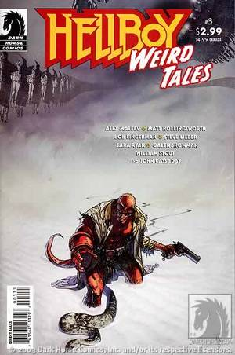[ALEX MALEEV](/entry/Alex_Maleev)
<em>[Still Born](/entry/Still_Born)</em>
[Matt Hollingsworth](/entry/Matt_Hollingsworth) &amp; [Alex Maleev](/entry/Alex_Maleev)
[Alex Maleev](/entry/Alex_Maleev)
<em>Hellboy v. Rasputin</em> pin-up by [Galen Showman](/entry/Galen_Showman) 
&amp; 
<em>Hellboy at the Mountains of Madness</em> pin-up by [William Stout](/entry/William_Stout)

<em>[Downtime](/entry/Downtime)</em>
[Bob Fingerman](/entry/Bob_Fingerman)

<em>[Family Story](/entry/Family_Story)</em>
[Sara Ryan](/entry/Sara_Ryan)
[Steve Lieber](/entry/Steve_Lieber)

<em>[Doc Hollow's Grand Vibro-Destructo Machine: Episode 3](/entry/Doc_Hollow%26)</em>
[John Cassaday](/entry/John_Cassaday)

4
August 27, 2003
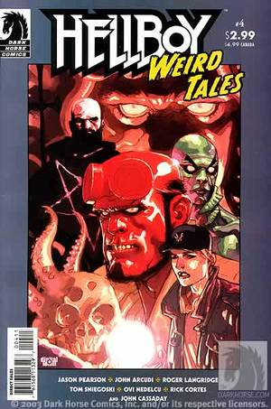[LEINIL FRANCIS YU](/entry/Leinil_Francis_Yu)
<em>[The Dread Within](/entry/The_Dread_Within)</em>
[Jason Pearson](/entry/Jason_Pearson)
<em>Shred</em> pin-up by [Rick Cortes](/entry/Rick_Cortes)

<em>[Abe Sapien: Star of the B.P.R.D.](/entry/Abe_Sapien%3A_Star_of_the_B.P.R.D.)</em>
[John Arcudi](/entry/John_Arcudi)
[Roger Langridge](/entry/Roger_Langridge)

<em>[Haunted](/entry/Haunted)</em>
[Tom Sniegoski](/entry/Tom_Sniegoski)
[Ovi Nedelcu](/entry/Ovi_Nedelcu)

<em>[Doc Hollow's Grand Vibro-Destructo Machine: Episode 4](/entry/Doc_Hollow%26)</em>
[John Cassaday](/entry/John_Cassaday)

5
October 15, 2003
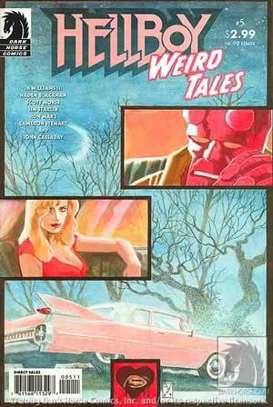[J.H. WILLIAMS III](/entry/J.H._Williams_III)
<em>[Love is Scarier than Death](/entry/Love_is_Scarier_than_Death)</em>
[J.H. Williams III](/entry/J.H._Williams_III) &amp; [Haden Blackman](/entry/Haden_Blackman)
[J.H. Williams III](/entry/J.H._Williams_III)
Pin-up by [Cameron Stewart](/entry/Cameron_Stewart)

<em>[Cool Your Head](/entry/Cool_Your_Head)</em>
[Scott Morse](/entry/Scott_Morse)

<em>[Shattered](/entry/Shattered)</em>
[Ron Marz](/entry/Ron_Marz)
[Jim Starlin](/entry/Jim_Starlin)

<em>[Doc Hollow's Grand Vibro-Destructo Machine: Episode 5](/entry/Doc_Hollow%26)</em>
[John Cassaday](/entry/John_Cassaday)

6
December 10, 2003
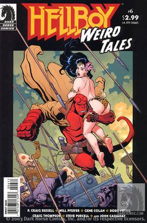[FRANK CHO](/entry/Frank_Cho)
<em>[Command Performance](/entry/Command_Performance)</em>
[Will Pfeifer](/entry/Will_Pfeifer)
[P. Craig Russell](/entry/P._Craig_Russell)
Pin-up by [Steve Purcell](/entry/Steve_Purcell)

<em>[Friday](/entry/Friday)</em>
[Doug Petrie](/entry/Doug_Petrie)
[Gene Colan](/entry/Gene_Colan)

<em>[My Vacation in Hell](/entry/My_Vacation_in_Hell)</em>
[Craig Thompson](/entry/Craig_Thompson)

<em>[Doc Hollow's Grand Vibro-Destructo Machine: Episode 6](/entry/Doc_Hollow%26)</em>
[John Cassaday](/entry/John_Cassaday)

7
February 11, 2004
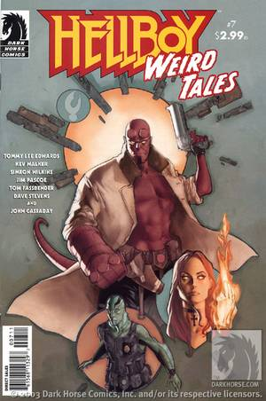[PHIL NOTO](/entry/Phil_Noto)
<em>[A Love Story](/entry/A_Love_Story)</em>
[Tommy Lee Edwards](/entry/Tommy_Lee_Edwards)
[Tommy Lee Edwards](/entry/Tommy_Lee_Edwards) with [Don Cameron](/entry/Don_Cameron)
Pin-up by [Dave Stevens](/entry/Dave_Stevens)

<em>[Theater of the Dead](/entry/Theater_of_the_Dead)</em>
[Jim Pascoe](/entry/Jim_Pascoe) &amp; [Tom Fassbender](/entry/Tom_Fassbender)
[Simeon Wilkins](/entry/Simeon_Wilkins)

<em>[Long Distance Caller](/entry/Long_Distance_Caller)</em>
[Kev Walker](/entry/Kev_Walker)

<em>[Doc Hollow's Grand Vibro-Destructo Machine: Episode 7](/entry/Doc_Hollow%26)</em>
[John Cassaday](/entry/John_Cassaday)

8
April 14, 2004
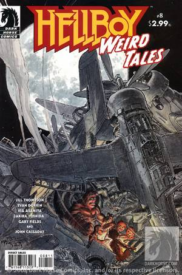[MICHAEL W. KALUTA](/entry/Michael_W._Kaluta)
<em>[Fifteen Minutes...](/entry/Fifteen_Minutes...)</em>
[Jill Thompson](/entry/Jill_Thompson)
Pin-up by [Gary Fields](/entry/Gary_Fields)

<em>[Toy Soldier](/entry/Toy_Soldier)</em>
[Akira Yoshida](/entry/Akira_Yoshida) &amp; [Kia Asamiya](/entry/Kia_Asamiya)
[Kia Asamiya](/entry/Kia_Asamiya)

<em>[Professional Help](/entry/Professional_Help)</em>
[Evan Dorkin](/entry/Evan_Dorkin)

<em>[Doc Hollow's Grand Vibro-Destructo Machine: Episode 8](/entry/Doc_Hollow%26)</em>
[John Cassaday](/entry/John_Cassaday)

</tbody>

## Collected Editions

The series was first collected in two trade paperbacks and then later in a single hardcover omnibus. The omnibus was then rereleased in the trade paperback format. Additionally, select stories were also reprinted in a digest sized collection.

### Trade Paperback Collections

Each of the two initial trade paperbacks collect four sequential individual *Hellboy: Weird Tales* issues.

Title
Date Published
Cover
Material Collected

<tbody>

<em>Hellboy Weird Tales: Volume 1</em>
December 17, 2003
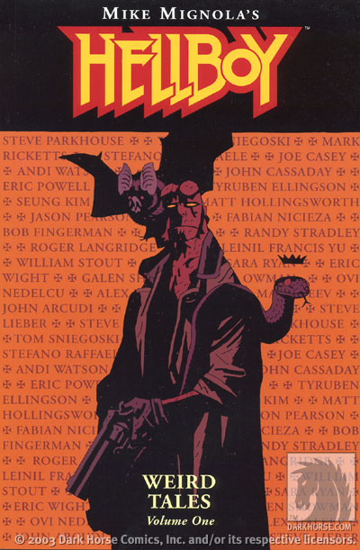MIKE MIGNOLA
<em>Hellboy Weird Tales</em> #1–4

<em>Hellboy Weird Tales: Volume 2</em>
October 27, 2004
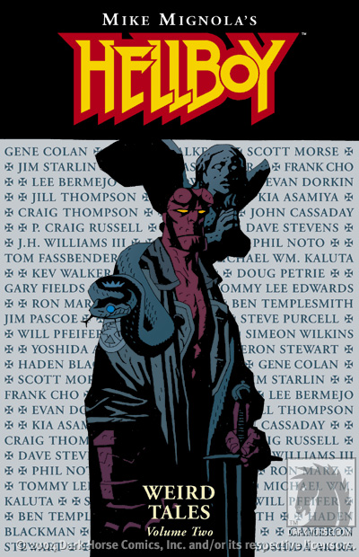MIKE MIGNOLA
<em>Hellboy Weird Tales</em> #5–8

</tbody>

### Omnibus Collection

In addition to collecting *Hellboy: Weird Tales* \#1–8, the *Hellboy: Weird Tales* omnibus also features two canonical stories *[How Koshchei Became Deathless](/entry/How_Koshchei_Became_Deathless)* and *[Baba Yaga's Feast](/entry/Baba_Yaga%27s_Feast)*. The eight-episode story *[Doc Hollow's Grand Vibro-Destructo Machine](/entry/Doc_Hollow%27s_Grand_Vibro-Destructo_Machine)* was retitled "*Lobster Johnson: Action Detective Adventure*" for this collection.

For the paperback version, the story *[Toy Soldier](/entry/Toy_Soldier)* was removed, possibly because it was written by [C. B. Cebulski](/entry/C.B._Cebulski) under his controversial pseudonym "Akira Yoshida". The introduction by [Scott Allie](/entry/Scott_Allie) was also removed.

Title
Date Published
Cover
Material Collected
Additional Material

<tbody>

<em>Hellboy: Weird Tales</em> 
(Hardcover)
November 26, 2014
 MIKE MIGNOLA
<ul>
<li><em>Hellboy Weird Tales</em> #1–8</li>
<li><em>[How Koshchei Became Deathless](/entry/How_Koshchei_Became_Deathless)</em></li>
<li><em>[Baba Yaga's Feast](/entry/Baba_Yaga%26)</em></li>
</ul>
Introduction by [Scott Allie](/entry/Scott_Allie)

<em>Hellboy: Weird Tales</em> 
(Paperback)
November 9, 2022
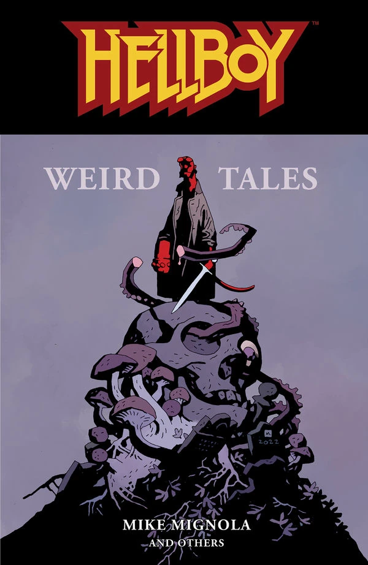MIKE MIGNOLA
<ul>
<li><em>Hellboy Weird Tales</em> #1–8 
(except "<em>Toy Soldier</em>")</li>
<li><em>[How Koshchei Became Deathless](/entry/How_Koshchei_Became_Deathless)</em></li>
<li><em>[Baba Yaga's Feast](/entry/Baba_Yaga%26)</em></li>
</ul>

</tbody>

### Digest Sized Collection

*The Theatre of the Dead & Other Stories* was bundled with the [Hellboy Animated: Blood & Iron](/entry/Hellboy_Animated%3A_Blood_%26_Iron) DVD when purchased through a Trans World Entertainment Corporation store (Sam Goody, Suncoast, FYE, etc.). It contains select stories from across the *Weird Tales* run.

Title
Date Published
Material Collected |- id=""
<em>The Theatre of the Dead &amp; Other Stories</em>
May, 2007
<ul>
<li><em>[Big-Top-Hell-Boy](/entry/Big-Top-Hell-Boy)</em></li>
<li><em>[Curse of the Haunted Doily](/entry/Curse_of_the_Haunted_Doily)</em></li>
<li><em>[Midnight Cowboy](/entry/Midnight_Cowboy)</em></li>
<li><em>[Haunted](/entry/Haunted)</em></li>
<li><em>[Shattered](/entry/Shattered)</em></li>
<li><em>[Friday](/entry/Friday)</em></li>
<li><em>[Theater of the Dead](/entry/Theater_of_the_Dead)</em></li>
<li><em>[Fifteen Minutes...](/entry/Fifteen_Minutes...)</em></li>
</ul>

<tbody>
</tbody>

## External Links

- [*Hellboy: Weird Tales \#1* product page on DarkHorse.com](https://www.darkhorse.com/Comics/11-329/Hellboy-Weird-Tales-1)
- [*Hellboy: Weird Tales \#2* product page on DarkHorse.com](https://www.darkhorse.com/Comics/11-333/Hellboy-Weird-Tales-2)
- [*Hellboy: Weird Tales \#3* product page on DarkHorse.com](https://www.darkhorse.com/Comics/11-336/Hellboy-Weird-Tales-3)
- [*Hellboy: Weird Tales \#4* product page on DarkHorse.com](https://www.darkhorse.com/Comics/12-313/Hellboy-Weird-Tales-4)
- [*Hellboy: Weird Tales \#5* product page on DarkHorse.com](https://www.darkhorse.com/Comics/12-471/Hellboy-Weird-Tales-5)
- [*Hellboy: Weird Tales \#6* product page on DarkHorse.com](https://www.darkhorse.com/Comics/12-472/Hellboy-Weird-Tales-6)
- [*Hellboy: Weird Tales \#7* product page on DarkHorse.com](https://www.darkhorse.com/Comics/12-473/Hellboy-Weird-Tales-7)
- [*Hellboy: Weird Tales \#8* product page on DarkHorse.com](https://www.darkhorse.com/Comics/12-474/Hellboy-Weird-Tales-8)
- [*Hellboy: Weird Tales Volume 1* product page on DarkHorse.com](https://www.darkhorse.com/Books/11-341/Hellboy-Weird-Tales-Volume-1-TPB)
- [*Hellboy: Weird Tales Volume 2* product page on DarkHorse.com](https://www.darkhorse.com/Books/12-480/Hellboy-Weird-Tales-Volume-2-TPB)
- [*Hellboy: Weird Tales* Hardcover Omnibus product page on DarkHorse.com](https://www.darkhorse.com/Books/24-712/Hellboy-Weird-Tales-HC)
- [*Hellboy: Weird Tales* PaperbackOmnibus product page on DarkHorse.com](https://www.darkhorse.com/Books/3011-095/Hellboy-Weird-Tales-TPB)
