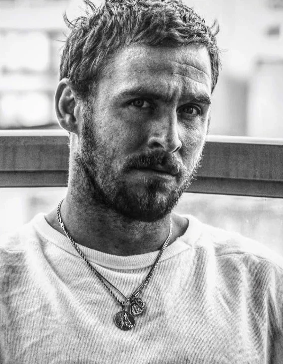

*For the original 2008 comic, see [The Crooked Man (comic story)](/entry/The_Crooked_Man_(comic_story)).*

Dark things call to dark things.

***Hellboy: The Crooked Man*** is a 2024 folk horror superhero film based on the [Dark Horse Comics](/entry/Dark_Horse_Comics) series *[Hellboy](/entry/Hellboy_(series))*, created by [Mike Mignola](/entry/Mike_Mignola); the film specifically derives from [the limited series *The Crooked Man*](/entry/The_Crooked_Man_(comic_story)) written by Mignola and illustrated by [Richard Corben](/entry/Richard_Corben).

*The Crooked Man* is directed by [Brian Taylor](/entry/Brian_Taylor), from a screenplay by Mignola and [Christopher Golden](/entry/Christopher_Golden). [Jack Kesy](/entry/Jack_Kesy) stars as [Hellboy](/entry/Hellboy_(character)) opposite [Martin Bassindale](/entry/Martin_Bassindale) as the titular [Crooked Man](/entry/Jeremiah_Witkins), with [Jefferson White](/entry/Jefferson_White) and [Adeline Rudolph](/entry/Adeline_Rudolph) in supporting roles. The movie was filmed in Bulgaria from March through May 2023.

This film is not connected to any of the three prior live-action film adaptations of *Hellboy*, serving as a reboot for the series.

*Hellboy: The Crooked Man* was produced for a much lower budget than previous live-action outings, and received limited promotion and distribution – even foregoing a theatrical release in the United States. The film received mixed reviews from critics – many detracting its technical aspects or execution of ideas (or comparing it unfavorably to [the 2004 film](/entry/Hellboy_(2004_film))), though others praised its horror atmosphere or found its lower-stakes story compelling (with many noting its accuracy to the comic).

## Plot

In the 1950s, [B.P.R.D.](/entry/Bureau_for_Paranormal_Research_and_Defense) agents [Hellboy](/entry/Hellboy) and [Bobbie Jo Song](/entry/Bobbie_Jo_Song) are tasked with transporting via train a toxic supernatural spider to their headquarters. However, when they cross the Appalachian Mountains, the spider suddenly enlarges to monstrous proportions, forcing their train car to overturn and escape. Hellboy surmises that the spider grew due to something evil haunting the area, admitting that he heard it calling to him. Left stranded, Hellboy and Bobbie Jo wander until they meet [Tom Ferrell](/entry/Tom_Ferrell), a local who's recently returned to atone for past sins. The agents accompany Tom to speak with [Cora Fisher](/entry/Cora_Fisher), a witch and Tom's ex-girlfriend, only to find the house and Cora's body empty.

As they wait for the demonic familiar to return with Cora's full body, Tom regales to the agents he once met [Effie Kolb](/entry/Effie_Kolb_(character)), a [witch](/entry/Witches) that attracted him towards witchcraft and convinced him to make a deal with an entity known as "[The Crooked Man](/entry/Jeremiah_Witkins)." At Effie's suggestion, Tom used a cat carcass to summon the Crooked Man, that whatever bone he held once the entity arrived would become his [lucky bone](/entry/Lucky_cat_bone). However, the sight of the Crooked Man terrified Tom enough to have a change of heart and discard the lucky bone, but it would always return and kept him safe from harm. Tom intends to face the Crooked Man once and for all. When the familiar returns Cora's body, she reveals to the Tom that the local witches want her soul.

To Tom's shock, Effie arrives on a white horse to collect Cora's soul. After Hellboy threatens Effie, the white horse suddenly transforms into Tom's father as Effie escapes. Tom and his father reconcile briefly before he dies. The following morning, Tom, Cora, and the agents walk to a nearby church, owned by [Reverend Watts](/entry/Nathanial_Armstrong_Watts), to bury Tom's father, but Cora is attacked and killed by a demonic snake. Hellboy succeeds in killing it, but its bites show him visions of his mother [Sarah](/entry/Sarah_Hughes), a witch who made a deal with a demon.

The survivors reach the church, where they are confronted by the Crooked Man and his servants. Tom is tempted to return his lucky bone to the Crooked Man, but Hellboy stops him. As Hellboy battles the Crooked Man's forces, he attempts to entice the blind Reverend with youth and sight in exchange for giving up Tom. Watts refuses to give in to temptation and blesses a shovel with Tom's lucky bone that allows Hellboy to weaken the Crooked Man and neutralize his forces.

Hellboy and Tom chase the Crooked Man to an [abandoned mansion](/entry/The_Hurricane) but are assaulted with traumatic visions. Bobbie Jo, believing the Crooked Man draws power from the town's mines, reaches a tunnel system via an access under the church. She disrupts the Crooked Man's power source with a spell, which frees Hellboy and Tom from the visions and destroys the Crooked Man.

In the ruins of the tunnel, Bobbie Jo finds the now-shrunken spider and recaptures it in a small jar. She and Hellboy find an emergency telephone and are able to contact the B.P.R.D. for retrieval. Tom feels a weight has been lifted from his soul. The group encounters Effie again, who now appears greatly aged as a result of no longer having power from the Crooked Man. Using the cursed bridle she once applied to Tom's father, Kolb is given the form or a horse. Hellboy paints a warning onto its hide: "Beware! I am a Witch!"

## Cast

- [Jack Kesy](/entry/Jack_Kesy) as [Hellboy](/entry/Hellboy_(character))
- [Jefferson White](/entry/Jefferson_White) as [Tom Ferrell](/entry/Tom_Ferrell)
- [Adeline Rudolph](/entry/Adeline_Rudolph) as [Bobbie Jo Song](/entry/Bobbie_Jo_Song)
- [Hannah Margetson](/entry/Hannah_Margetson) as [Cora Fisher](/entry/Cora_Fisher)
- [Leah McNamara](/entry/Leah_McNamara) as [Effie Kolb](/entry/Effie_Kolb_(character))
- [Joseph Marcell](/entry/Joseph_Marcell) as [Reverend Watts](/entry/Nathanial_Armstrong_Watts)
- [Martin Bassindale](/entry/Martin_Bassindale) as [Mr. Onselm / The Crooked Man](/entry/Jeremiah_Witkins)
- Carola Colombo as [Sarah](/entry/Sarah_Hughes)
- Nathan Cooper as Farmhand

[Azzael](/entry/Azzael) also appears.

## Production

### Development

In February 2023, Millennium Media announced plans for a new live-action reboot titled Hellboy: The Crooked Man, the first in a potential series of films. The film was co-produced between Nu Boyana Film Studios and Campbell Grobman Films and is presented by Millennium Media in association with Dark Horse Entertainment.

Production began in April 2023 in Bulgaria, with [Brian Taylor](/entry/Brian_Taylor) directing from a script by comics creator [Mike Mignola](/entry/Mike_Mignola) and frequent collaborator [Christopher Golden](/entry/Christopher_Golden), based on the 2008 comic [miniseries of the same name](/entry/The_Crooked_Man_(comic_story)). Taylor expressed his intentions to "reset" the film series and depict a younger and wandering version of [Hellboy](/entry/Hellboy_(character)) with a folk horror influence similar to the comics; Taylor also confirmed that, much like [the 2019 film](/entry/Hellboy_(2019_film)), *Hellboy: The Crooked Man* would be R-rated in order to embrace the "dark and scary and violent and adult" elements of the comics, hoping to present "a much more grounded and personal story as opposed to the global-sprawling apocalyptic scope of the last three movies".

### Casting

The following month, [Jack Kesy](/entry/Jack_Kesy) was announced to portray [Hellboy](/entry/Hellboy_(character)) himself, while Jefferson White, Adeline Rudolph, and Hannah Margaretson were cast as [Tom Ferrell](/entry/Tom_Ferrell), [Bobbie Jo Song](/entry/Bobbie_Jo_Song), and [Cora Fisher](/entry/Cora_Fisher) respectively. Martin Bassindale was cast as [The Crooked Man](/entry/Jeremiah_Witkins).

### Filming

Principal photography began in March 2023, in Bulgaria, and wrapped on May 15th of the same year.

[Hellboy](/entry/Hellboy_(character)) and [the Crooked man](/entry/Jeremiah_Witkins) were made with practical effects.

### Post-production

Ketchup Entertainment was announced to be distributing the film.

## Gallery

### Promotional

Film logo

US/SDCC poster

UK Poster

International poster

International trailer thumbnail

Vietnamese advertisement

#### Jack Kesy as Hellboy

### Screenshots

Hellboy sits in a B.P.R.D. railcar.

Hellboy emerges from the wrecked boxcar.

Chain-smoking.

Stranded in Appalachia

Bobbie Jo and Hellboy investigate the victim of a [witchball](/entry/Witchball).

Ferrell, Hellboy, and Song

Hellboy investigates Cora's cabin.

Waiting for [Cora Fisher](/entry/Cora_Fisher) to return to her cabin.

Hellboy and Bobbie Jo witness Cora returning to her skin.

[Effie Kolb](/entry/Effie_Kolb) astride an old worn-out horse.

A disoriented Hellboy.

Hellboy and Bobbie Jo Song in the church.

Tom and Cora in the church.

Hellboy checks his revolver.

The Crooked Man

A revitalized corpse attacks the church.

Hellboy beset upon by the reanimated corpses from the churchyard.

Reverend Watts

Tom Ferrell wields a shovel blessed by the Reverend.

Bobbie Jo, Tom, and Hellboy

### Behind-the-scenes

Jefferson White on set.

Brian Taylor directs Martin Bassindale.

Hellboy makeup applied to Kesy.

### Videos

Hellboy- The Crooked Man - Official Teaser

Teaser Trailer

Hellboy- The Crooked Man - Official Trailer (2024) Jack Kesy, Adeline Rudolph, Leah McNamara

Official Trailer

Hellboy- The Crooked Man - Official 'Transformation' Clip - Comic Con (2024) Jack Kesy

"Transformation" clip - Cora's raccoon familiar returns to her skin

Hellboy- The Crooked Man - Snake Attack (Official Clip)

"Snake Attack" clip

## Trivia

- *Hellboy: The Crooked Man* is the first [Hellboy](/entry/Hellboy_(series)) film not to be set in the present day (as of their release); it takes place in the 1950s.
- Hellboy creator [Mike Mignola](/entry/Mike_Mignola) considered the movie to be one of the most comic-book-accurate adaptations to date: "In other *\[Hellboy\]* movies, there have been moments where I’ve gone, 'Oh, cool, that's the comic.' But this thing was so much the comic."
- A UK poster advertised the film as the fourth entry in the *Hellboy* franchise. Though this is the fourth live-action film featuring the character, they are not canonically connected in the manner the tagline implies; of the four, only *[Hellboy](/entry/Hellboy_(2004_film))* and *[Hellboy II: The Golden Army](/entry/Hellboy_II__The_Golden_Army)* are in continuity with each other.
- The film also adapts elements of *[The Chained Coffin](/entry/The_Chained_Coffin)*.

### Differences from the *[Hellboy: The Crooked Man](/entry/The_Crooked_Man_(comic_story))* comic

- An original character in the film, [Bobbie Jo Song](/entry/Bobbie_Jo_Song), did not appear in the comics.
