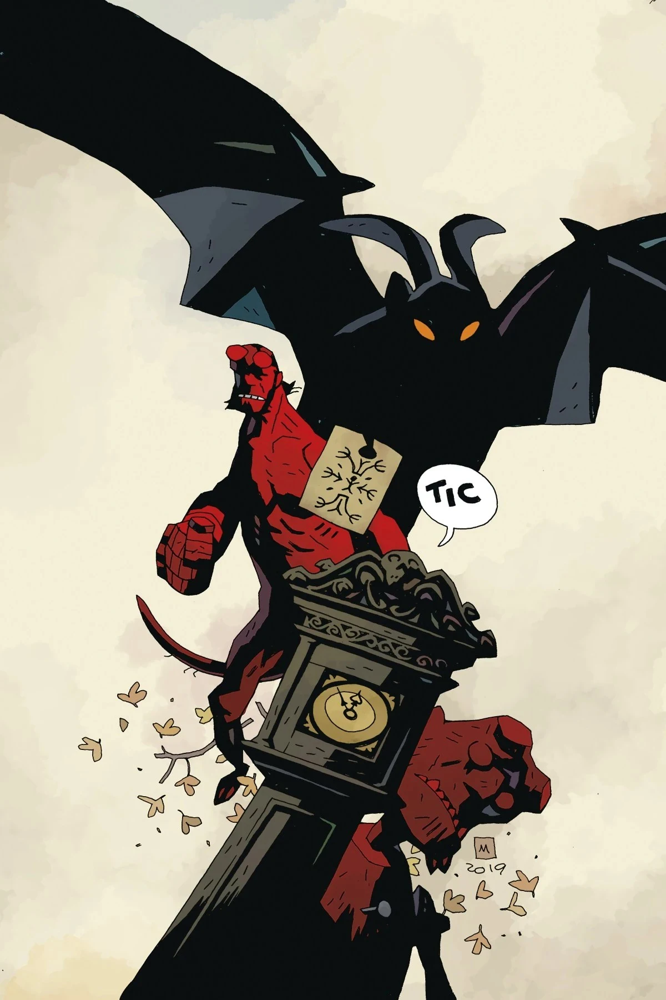

***Her Fatal Hour*** is a short story published in a one-shot together with *[The Sending](/entry/The_Sending)*, both written by [Mike Mignola](/entry/Mike_Mignola) and drawn by [Tiernen Trevallion](/entry/Tiernen_Trevallion). *Her Fatal Hour* returns to the Romani characters from *[The Beast of Vargu](/entry/The_Beast_of_Vargu)* and *[The Secret God of the Roma](/entry/The_Secret_God_of_the_Roma)*.

## Publishing history

Originally scheduled for a May release, the issue was delayed due to the COVID-19 outbreak.

## Synopsis

Years after Hellboy’s ill-fated tangle with the Beast of Vargu, the Romani women who helped him need that debt repaid. Claimed by a demon in a romance gone wrong, the younger woman reaches out to Hellboy through the power of a familiar old puppet, and a supernatural confrontation full of magic and mayhem ensues!

## Gallery

*Hellboy and the B.P.R.D.:  
Her Fatal Hour and The Sending*  
[Tiernen Trevallion](/entry/Tiernen_Trevallion) cover

*Hellboy and the B.P.R.D.:  
Her Fatal Hour and The Sending*  
[Mike Mignola](/entry/Mike_Mignola) variant cover

Hellboy and the B.P.R.D. Publication Order

&#10;
Preceded by
The Seven Wives Club
Her Fatal Hour

Followed by
The Sending

|Hellboy and the B.P.R.D.: Her Fatal Hour and The Sending Mike Mignola variant cover
