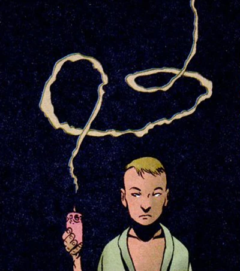

**Herbert Izzo** appeard in the non-canon [Ghost/Hellboy](/entry/Ghost/Hellboy) cross-over miniseries. He was a mystic living in Arcadia several decades to [Hellboy's](/entry/Hellboy_(character)) visit to that city. He performed a service to a mobster, damning an already dead laughing gangster to eternal torment, but was shot by said mobster.
