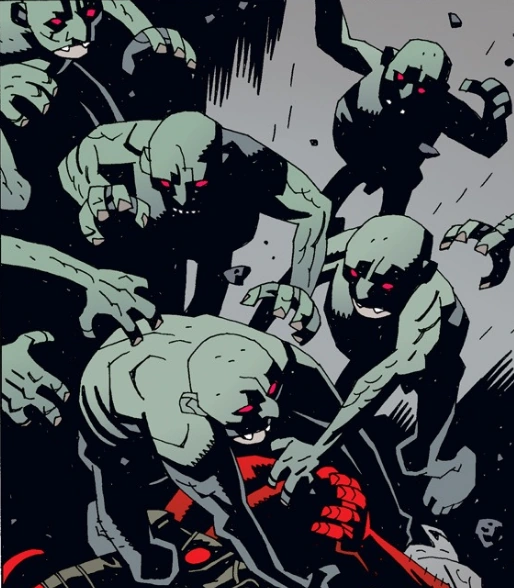

A **homunculus** is an artificial human being created from blood and herbs, and stewed in manure.

## Known Homunculi

### [Roger](/entry/Roger)

The best known homunculi in the Hellboy series, Roger first appeared in the *[Wake the Devil](/entry/Wake_the_Devil)* story line where a team of [B.P.R.D.](/entry/Bureau_for_Paranormal_Research_and_Defense) agents discovered him in Romania. One of the agents Liz Sherman, fueled her pyrokinetic energy into the creature, bringing him to life. Roger then killed [Bud Waller](/entry/Bud_Waller), and escaped. Roger then met his "brother" who informed him about his creation, and his creator. Roger's brother then planned on creating an enormous body out of human fat, for them to inhabit. However the plan was stopped by [Hellboy](/entry/Hellboy), and Kate Corrigan. Hellboy then gave Roger his name, and Roger fueled Liz Sherman's pyrokinetic energy back into her, bringing a dead Sherman back to life.

Roger then continued to be a BPRD agent for many years, until his death.

### [Evil Brother](/entry/Roger's_brother)

*see [Almost Colossus](/entry/Almost_Colossus)*

The evil brother of Roger was created 500 years ago by an alchemist who abandoned him in pursuit of further projects. The brother continued to live in secret, until he heard of his creator being imprisoned by the inquisition. The brother then broke into his creator's cell and ripped a key from his belly that opened a box containing all of his formulas and secret bases. The brother, then seek out Roger's help in creating a giant body out of human parts. But, Roger betrayed his brother and destroyed the giant body.

### The Evil Brother's henchmen

Over the years, Roger's brother created a number of crude homunculi to help with his schemes.
