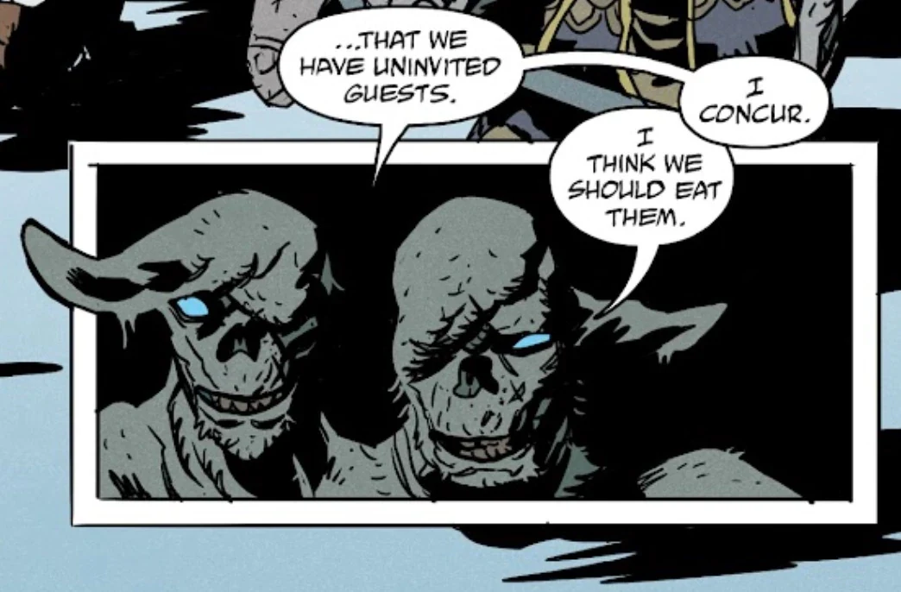

**Hraesvelg** is a monstrous, two-headed frost giant from Norse mythology.

## History

Hraesvelg was one of the manly Norse monsters and giants that remerged in a rotten form after the resurrection of Thrym, the king of the giants. He and several other giants were eating captured humans in the restorated [Utgard](/entry/Utgard), or citadel of the giants. Hraesvelg and the giants were discovered by [Hellboy](/entry/Hellboy_(character)), [Abe Sapien](/entry/Abe_Sapien), [Pernilla Aickman](/entry/Pernilla_Aickman) and several [dwarves](/entry/Dwarf), and a fight broke out between the two groups.

He and most of the giants were killed by Hellboy, armed with [Thor](/entry/Thor)'s hammer [Mjollnir](/entry/Mjollnir) and possessed by the Thunderer's spirits. Hraesvelg managed to survive the first strike, though was mortally injured and asked Hellboy/Thor if any of what they experienced war real or not. The cambion/god replied that it was, before striking down the giant.

## Mythology

TBA

## Appearance

- [The Bones of Giants](/entry/The_Bones_of_Giants_(comic_miniseries))
