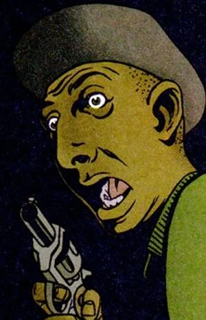
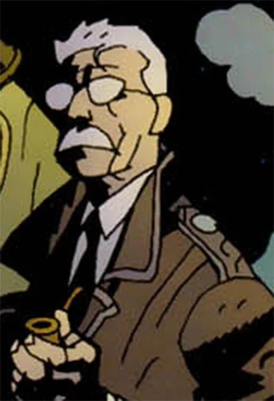
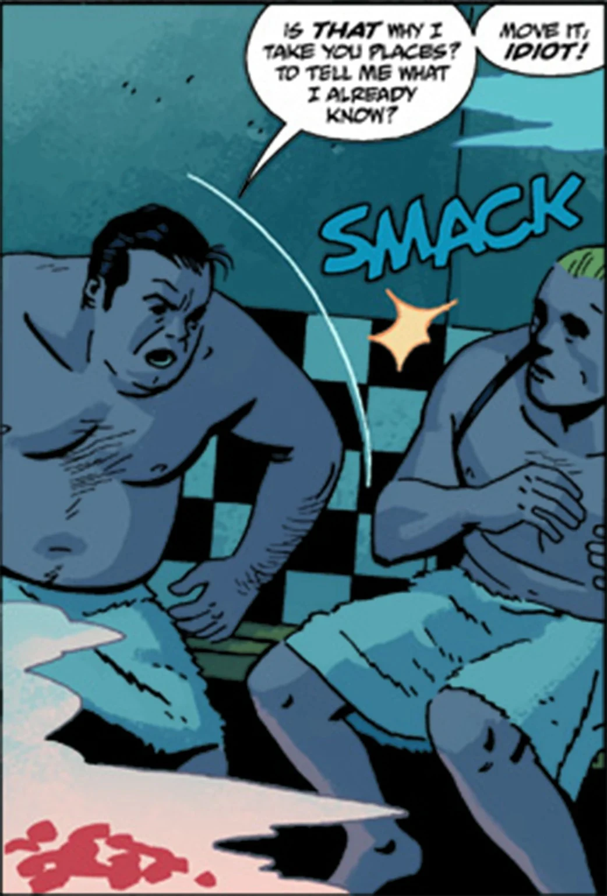

**Humans** (*Homo sapiens*) or **Mortals** are the everyday folk of the Earth in the Hellboy universe. Most go through their lives blissfully ignorant of the myriad supernatural threats that seek to make their lives as miserable as can be.

Those that do come into contact with the occult tend to either die, be mutated, go mad or join the [B.P.R.D.](/entry/B.P.R.D.) in general.

## History

Humans are the second race of man. Humanity rose to prominence long after the fall of the first race of man, the [Hyperboreans](/entry/Hyperboreans). However there was some contact between the Hyperboreans and early man. Hyperborean priests choose a few humans and taught them how to summon and utilize [Vril](/entry/Vril). These men, such as [Shonchin](/entry/Shonchin). would lead communities of early men against the monsters in the prehistoric world. Early man had to contend with threats such as the [Cold People](/entry/Vampire_(creature)) and the [Ogdru Hem](/entry/Ogdru_Hem) spirits that were starting to seep their way back into the world. [Gall Dennar](/entry/Gall_Dennar) led a tribe of early men wielding a broken Hyperborean blade fashioned into a weapon.

The [frog monsters](/entry/Frog_monster) created by the Ogdru Hem such as [Sadu-Hem](/entry/Sadu-Hem) and the [Conqueror Worm](/entry/Conqueror_Worm) are referred to as the third race of man. While they appear to have all been destroyed the frogs were active in attempting to summon the Ogdru Hem into the world. They have succeeded with summoning the Ogdru Hem called [Katha-Hem](/entry/Katha-Hem), whose arrival is supposed a great change coming to the world.

Recent events have made it harder for the general populace to ignore what their world truly is. Human members of the [B.P.R.D.](/entry/B.P.R.D.) usually end up as cannon fodder, but occasionally even powerless members of the public can prevail against some monsters.

## [Hell on Earth](/entry/Hell_on_Earth_(story_cycle))

Recently the destruction unleashed by Liz Sherman upon the Black Flame and the remaining frog monsters in the inner world underneath Agartha has caused the return of several Ogdru Hem throughout the world. More Ogdru creatures awoke and brought even further destruction after the revival of [the Black Flame](/entry/The_Black_Flame_(character)) by the [Zinco Corporation](/entry/Zinco_Corporation). The Ogdru Hem have wrought great destruction upon the world. Many cities have seen attacks by rampaging Ogdru Hem and Ogdru creatures; these cities include Seattle, New York City, Paris, Moscow, Beijing, Seoul, Vladivostok, Lisbon, Sao Paulo, Buenos Aires, Boise, Chicago, Tampa, Raleigh, and Rampayedik. A giant Ogdru Hem is roaming the Salton Sea in California and laying eggs. Volcanic activity has occurred all over the planet. A volcano burst through the earth and erupted in Houston, Texas. A series of earthquakes and tidal waves have caused massive devastation to Indonesia and regions in the Southeast Pacific. The islands of Borneo and Sulawesi are gone.

After the events of The Devil You Know, humanity is in hiding underground, replaced by a [race of creatures](/entry/Bonji) like [Abraham Sapien](/entry/Abraham_Sapien), the true third race of man.

## General Powers and Abilities

On the whole, the human race lacks many powers that the fae, witches, demons/devils and others do possess, only excelling in the power of ignorance. Some members of the species do have or develop general special powers such as psychic abilities, channeling of spirits as a medium or take up magic as a witch/wizard/etc.'s apprentice.

A rare few have or develop truly astounding powers, such as Liz Sherman's pyrokinesis, [Sidney Leach](/entry/Sidney_Leach)'s metal-detection and manipulation or Fenix's precognitions to name a few.

## Gallery

|

|

|

|
