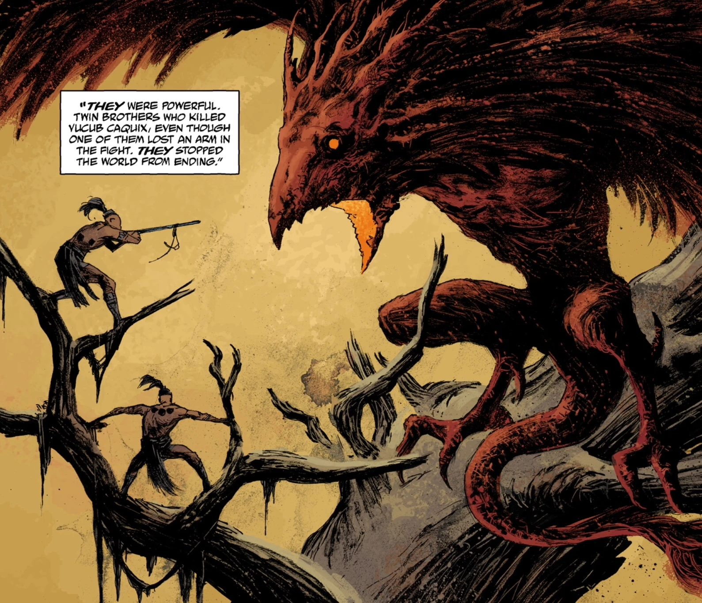

***Hunahpu and Xbalanque*** (aka the *Mayan twins*) were heroes from Mayan folklore. They're vanquished by the demonic bird [Vucub Caquix](/entry/Vucub_Caquix), who was actually an [Ogdru Hem](/entry/Ogdru_Hem).

## Appearances

- [The Shape of Things to Come](/entry/The_Shape_of_Things_to_Come)

## Gallery

Battled, and though the Ogdru Hem spirit **Vucub Caquix**

|Battled, and though the Ogdru Hem spirit Vucub Caquix
